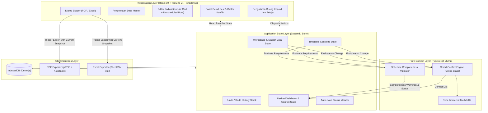
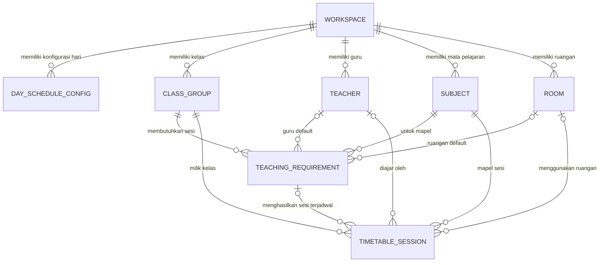
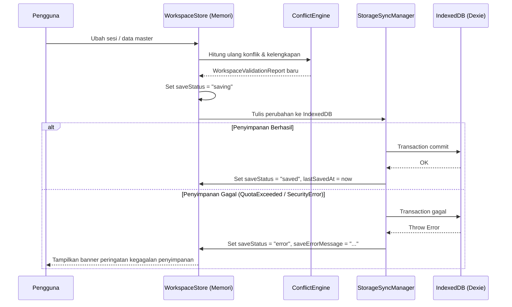

# Technical Design Document (TDD) - Schedovyn

**Versi Dokumen:** 1.0.0  
**Status:** Draft  
**Referensi Utama:** `docs/Schedovyn-PRD.md` (v1.0.0)  
**Target Arsitektur:** Client-Side Single Page Application (Local-First Web App)  
**Platform Target:** Browser Desktop Modern (Chromium, Firefox, Safari)

---

## 1. Ringkasan Teknis dan Prinsip Arsitektur

Schedovyn adalah aplikasi web penyusunan jadwal pembelajaran berbasis *Smart Timetable Planner* yang berjalan sepenuhnya di sisi klien (*browser*). Seluruh proses mulai dari pengelolaan data master, penempatan jadwal secara *drag-and-drop*, deteksi konflik lintas kelas (*smart conflict detection*), *undo/redo*, penyimpanan otomatis (*auto-save*), hingga pembuatan dokumen PDF dan Excel dilakukan di *browser* tanpa komponen *backend* maupun *database server*.

### 1.1 Keputusan Arsitektur Utama

1. **Zero-Backend & Local-First:** Seluruh *state* persisten disimpan di **IndexedDB** pada *browser* pengguna. Tidak ada pemanggilan API jaringan untuk penyimpanan maupun pemrosesan ekspor.
2. **Strict Separation of Concerns (NFR-05):**
   - **Domain Layer (`src/domain/`)** berisi tipe data murni, kalkulasi interval waktu, *conflict detection engine*, dan validator kelengkapan jadwal. Modul ini bebas dari ketergantungan React, DOM, maupun IndexedDB sehingga dapat diuji secara terisolasi melalui *unit test*.
   - **Persistence Layer (`src/db/`)** mengenkapsulasi skema dan transaksi IndexedDB menggunakan Dexie.js.
   - **Application State Layer (`src/store/`)** mengelola *state* aktif di memori, antrean *undo/redo*, pemicu perhitungan ulang konflik, dan sinkronisasi *auto-save* ke IndexedDB.
   - **Export Service Layer (`src/services/export/`)** mengubah *snapshot* data jadwal dan laporan konflik menjadi berkas `.pdf` dan `.xlsx` di memori klien.
   - **Presentation Layer (`src/components/`, `src/pages/`)** merender antarmuka pengguna berbasis React 19, Tailwind CSS v4, shadcn/ui, dan `@dnd-kit/react`.
3. **Representasi Waktu Numerik untuk Komputasi Cepat:** Format waktu tampilan dan penyimpanan menggunakan string 24 jam (`"HH:mm"`), namun selama proses validasi dan *drag-and-drop*, waktu dikonversi ke bilangan bulat menit sejak tengah malam (`0` hingga `1440`) agar perbandingan interval bebas dari kesalahan *floating-point* maupun *timezone parsing*.
4. **Non-Blocking Conflict Detection:** Sesuai FR-05.8, penempatan sesi yang menimbulkan konflik tetap diizinkan masuk ke dalam *state* jadwal agar alur penyuntingan pengguna tidak terhambat, namun sesi tersebut langsung ditandai secara visual dan masuk ke dalam daftar konflik aktif.

### 1.2 Diagram Arsitektur Sistem



---

## 2. Tech Stack dan Dependensi

Berdasarkan fondasi repositori saat ini (`package.json`) dan kebutuhan PRD Bagian 9.2, berikut adalah spesifikasi pustaka yang digunakan:

| Kategori | Pustaka / Teknologi | Status di Repo | Tujuan Penggunaan |
|---|---|---|---|
| **Package Manager & Script Runner** | `bun` (`^1.4.0`) | Terpasang | Manajemen dependensi (`bun add`) dan eksekusi script (`bun run`) |
| **UI Runtime** | `react` (`^19.3.0`), `react-dom` (`^19.3.0`) | Terpasang | Rendering komponen UI reaktif |
| **Language** | `typescript` (`~6.0.2`) | Terpasang | *Static typing* ketat tanpa penggunaan `any` |
| **Build Tool** | `vite` (`^8.0.0`) | Terpasang | Bundler dan *dev server* |
| **Routing** | `react-router` (`^8.4.0`) | Terpasang | Navigasi antar tampilan (Pengaturan, Data Master, Editor) |
| **Styling & UI** | `tailwindcss` (`^4`), `shadcn` (`radix-lyra`), `lucide-react` | Terpasang | Sistem desain utilitas, aksesibilitas komponen dialog/select/table |
| **Drag & Drop** | `@dnd-kit/react` (`^0.5.1`) | Terpasang | Interaksi tarik-lepas kartu sesi ke grid waktu |
| **Data Table** | `@tanstack/react-table` (`^9.3.1`) | Terpasang | Tabel pengelolaan data master dan rekapitulasi |
| **State Management** | `zustand` (`^5.x`) | Perlu ditambah | Pengelolaan *state* lintas komponen dan *middleware* *undo/redo* |
| **Local Database** | `dexie` (`^4.x`), `dexie-react-hooks` | Perlu ditambah | Abstraksi IndexedDB dengan dukungan transaksi dan *indexing* |
| **PDF Export** | `jspdf` (`^2.5.x` / `^3.x`), `jspdf-autotable` | Perlu ditambah | Pembuatan dokumen PDF *landscape* siap cetak di *browser* |
| **Excel Export** | `xlsx` (SheetJS CE) | Perlu ditambah | Pembuatan *workbook* `.xlsx` multi-*worksheet* di *browser* |
| **Testing** | `vitest`, `@testing-library/react`, `fake-indexeddb` | Perlu ditambah | Pengujian unit *conflict engine*, penyimpanan lokal, dan komponen |

---

## 3. Struktur Direktori Proyek

Struktur direktori di bawah `src/` dirancang untuk memisahkan logika bisnis murni dari komponen UI dan penyimpanan lokal:

```text
src/
├── domain/                         # Pure TypeScript (tanpa dependensi React/DOM)
│   ├── types/
│   │   ├── entities.ts             # Definisi tipe data utama (Workspace, Session, dll.)
│   │   ├── validation.ts           # Definisi tipe Conflict, CompletenessWarning, ValidationSummary
│   │   └── export.ts               # Kontrak parameter dan opsi ekspor
│   ├── time/
│   │   ├── time-utils.ts           # Konversi "HH:mm" <-> menit, kalkulasi durasi, snap grid
│   │   └── interval-utils.ts       # Fungsi irisan interval (startA < endB && startB < endA)
│   └── validation/
│       ├── conflict-engine.ts      # Deteksi konflik kelas, guru, ruangan, jam belajar, ketersediaan
│       ├── completeness-engine.ts  # Evaluasi pemenuhan TeachingRequirement & kelengkapan atribut
│       └── workspace-validator.ts  # Orkestrator status validasi kelas aktif & ruang kerja (FR-11)
├── db/                             # Persistence Layer (IndexedDB via Dexie)
│   ├── database.ts                 # Deklarasi skema tabel dan indeks Dexie
│   ├── workspace-repository.ts     # Operasi baca/tulis transaksional ke IndexedDB
│   └── seed-default.ts             # Inisialisasi ruang kerja awal ketika aplikasi pertama dibuka
├── store/                          # Application State Layer
│   ├── use-workspace-store.ts      # Store utama (data master, kelas aktif, sesi, hasil validasi)
│   ├── history-manager.ts          # Stack Undo/Redo untuk mutasi sesi jadwal (FR-07)
│   └── storage-sync.ts             # Pengelola auto-save, status penyimpanan, dan error handling (FR-10)
├── services/
│   └── export/
│       ├── export-data-mapper.ts   # Transformasi state menjadi struktur siap cetak/ekspor
│       ├── pdf-exporter.ts         # Generator berkas PDF client-side (FR-08)
│       └── excel-exporter.ts       # Generator berkas .xlsx client-side + formula sanitization (FR-09)
├── components/
│   ├── ui/                         # Komponen dasar shadcn/ui
│   ├── layout/                     # AppShell, TopHeader, ClassSelectorBar, SaveStatusBadge
│   ├── workspace/                  # Form konfigurasi ruang kerja, jam operasional, dan jam istirahat
│   ├── master-data/                # Tabel & dialog CRUD: Kelas, Guru, Mapel, Ruangan, Kebutuhan
│   ├── timetable/                  # TimetableGrid, DayColumn, SessionBlock, UnscheduledPanel, SessionDetailPanel
│   ├── conflicts/                  # ConflictListDrawer, ValidationSummaryBanner, ConflictBadge
│   └── export/                     # ExportDialog (pilihan cakupan, format, dan peringatan konflik)
├── pages/
│   ├── editor-page.tsx             # Halaman utama penyusunan jadwal (FR-03, FR-04, FR-05, FR-06)
│   ├── master-data-page.tsx        # Halaman pengelolaan data master (FR-02)
│   └── settings-page.tsx           # Halaman pengaturan ruang kerja & jam belajar (FR-01)
├── route/
│   └── index.tsx                   # Konfigurasi React Router
└── __tests__/                      # Unit & integration tests
    ├── domain/
    │   ├── interval-utils.spec.ts
    │   ├── conflict-engine.spec.ts
    │   └── completeness-engine.spec.ts
    ├── db/
    │   └── workspace-repository.spec.ts
    └── export/
        └── excel-exporter.spec.ts
```

---

## 4. Desain Model Data dan Skema Penyimpanan Lokal

### 4.1 Konvensi Tipe Waktu dan Identitas

- **ID Entitas:** Menggunakan UUID v4 (`crypto.randomUUID()`) bertipe `string`.
- **Representasi Waktu (`TimeString`):** Format string 24 jam `"HH:mm"` (contoh: `"07:30"`, `"14:15"`).
- **Representasi Komputasi (`MinutesFromMidnight`):** Integer `0` s.d. `1440` (contoh: `"07:30"` = `450`).
- **Hari Pembelajaran (`DayOfWeek`):** Enum string eksplisit dengan urutan Senin s.d. Minggu.

### 4.2 Kontrak Tipe Data Domain (`src/domain/types/entities.ts`)

```typescript
export type DayOfWeek =
  | "monday"
  | "tuesday"
  | "wednesday"
  | "thursday"
  | "friday"
  | "saturday"
  | "sunday";

/** Format 24 jam "HH:mm", misalnya "07:00" atau "13:45" */
export type TimeString = `${number}${number}:${number}${number}`;

export type SnapIntervalMinutes = 5 | 10 | 15 | 30 | 60;

export type RoomType = "classroom" | "laboratory" | "sports" | "hall" | "other";

export type SubjectColorKey =
  | "blue"
  | "emerald"
  | "amber"
  | "rose"
  | "violet"
  | "cyan"
  | "orange"
  | "teal"
  | "indigo"
  | "slate";

export interface TimeInterval {
  id: string;
  dayOfWeek: DayOfWeek;
  startTime: TimeString;
  endTime: TimeString;
  label?: string;
}

export interface BreakInterval {
  id: string;
  startTime: TimeString;
  endTime: TimeString;
  label: string; // contoh: "Istirahat Pertama", "Ishoma"
}

export interface DayScheduleConfig {
  id: string;
  workspaceId: string;
  dayOfWeek: DayOfWeek;
  isSchoolDay: boolean;
  startTime: TimeString; // contoh: "07:00"
  endTime: TimeString;   // contoh: "15:00"
  snapIntervalMinutes: SnapIntervalMinutes; // default: 15
  breakIntervals: BreakInterval[];
}

export interface Workspace {
  id: string;
  name: string;             // contoh: "SMP Negeri 1 Nusantara"
  academicPeriod: string;   // contoh: "Semester Ganjil 2026/2027"
  activeClassId: string | null;
  defaultSnapIntervalMinutes: SnapIntervalMinutes;
  createdAt: string;        // ISO-8601 timestamp
  updatedAt: string;        // ISO-8601 timestamp
}

export interface ClassGroup {
  id: string;
  workspaceId: string;
  name: string;             // contoh: "VII-A"
  grade: string;            // contoh: "VII"
  notes?: string;
}

export interface Teacher {
  id: string;
  workspaceId: string;
  name: string;
  notes?: string;
  unavailableIntervals: TimeInterval[];
}

export interface Subject {
  id: string;
  workspaceId: string;
  name: string;
  colorKey: SubjectColorKey;
  notes?: string;
}

export interface Room {
  id: string;
  workspaceId: string;
  name: string;
  type: RoomType;
  notes?: string;
  unavailableIntervals: TimeInterval[];
}

export interface TeachingRequirement {
  id: string;
  workspaceId: string;
  classId: string;
  subjectId: string;
  defaultTeacherId: string | null;
  defaultRoomId: string | null;
  sessionsPerWeek: number;  // bilangan bulat >= 1
  durationMinutes: number;  // kelipatan snapIntervalMinutes, misalnya 40, 45, 80, 90
  roomRequired: boolean;
  notes?: string;
}

export interface TimetableSession {
  id: string;
  workspaceId: string;
  requirementId: string | null; // merujuk ke TeachingRequirement asal jika dibuat dari kebutuhan
  classId: string;
  subjectId: string;
  teacherId: string | null;
  roomId: string | null;
  dayOfWeek: DayOfWeek;
  startTime: TimeString;
  endTime: TimeString;
  durationMinutes: number;      // selalu selaras dengan (toMinutes(endTime) - toMinutes(startTime))
  notes?: string;
}
```

### 4.3 Mekanisme Sesi Belum Terjadwal (Unscheduled Sessions Model — FR-06)

Untuk menghindari duplikasi status atau ketidaksinkronan ketika pengguna mengubah angka `sessionsPerWeek` pada `TeachingRequirement`, daftar sesi yang belum terjadwal (**Unscheduled Pool**) dihitung secara deterministik (*derived state*):

1. Setiap `TeachingRequirement` membutuhkan sebanyak `N = requirement.sessionsPerWeek` sesi pada kelas `requirement.classId`.
2. Sistem menghitung jumlah `TimetableSession` di ruang kerja yang memiliki `session.requirementId === requirement.id` (sebut saja `M`).
3. Jika `M < N`, maka terdapat `N - M` kartu sesi belum terjadwal (`UnscheduledSessionSlot`) yang dirender pada panel kiri editor untuk kelas aktif:

```typescript
export interface UnscheduledSessionItem {
  virtualId: string; // format: `${requirement.id}::slot-${index}`
  requirementId: string;
  classId: string;
  subjectId: string;
  defaultTeacherId: string | null;
  defaultRoomId: string | null;
  durationMinutes: number;
  roomRequired: boolean;
  remainingCount: number;
  totalRequiredCount: number;
}
```

4. Ketika pengguna menarik satu kartu `UnscheduledSessionItem` ke grid waktu pada hari dan jam tertentu, sistem membuat objek `TimetableSession` baru dengan `id: crypto.randomUUID()`, menyalin `defaultTeacherId` dan `defaultRoomId` dari `TeachingRequirement`, serta menghitung `endTime = addMinutes(startTime, durationMinutes)`. Secara otomatis nilai `M` bertambah `1` dan jumlah sesi tersisa pada panel berkurang `1`.
5. Ketika pengguna mengeluarkan (*unschedule* / hapus) sebuah `TimetableSession` dari grid, objek `TimetableSession` tersebut dihapus dari tabel `sessions` sehingga slot kebutuhan kembali muncul di panel sesi belum terjadwal.

### 4.4 Skema Database Lokal IndexedDB (`src/db/database.ts`)

Penyimpanan lokal menggunakan **Dexie.js** dengan nama database `schedovyn_local_db` dan versi skema `1`.



Definisi tabel dan indeks pada Dexie:

```typescript
import Dexie, { type EntityTable } from "dexie";

export class SchedovynDatabase extends Dexie {
  workspaces!: EntityTable<Workspace, "id">;
  dayConfigs!: EntityTable<DayScheduleConfig, "id">;
  classes!: EntityTable<ClassGroup, "id">;
  teachers!: EntityTable<Teacher, "id">;
  subjects!: EntityTable<Subject, "id">;
  rooms!: EntityTable<Room, "id">;
  requirements!: EntityTable<TeachingRequirement, "id">;
  sessions!: EntityTable<TimetableSession, "id">;

  constructor() {
    super("schedovyn_local_db");
    this.version(1).stores({
      workspaces: "id, updatedAt",
      dayConfigs: "id, workspaceId, [workspaceId+dayOfWeek]",
      classes: "id, workspaceId, name",
      teachers: "id, workspaceId, name",
      subjects: "id, workspaceId, name",
      rooms: "id, workspaceId, name, type",
      requirements: "id, workspaceId, classId, [workspaceId+classId], subjectId",
      sessions:
        "id, workspaceId, classId, requirementId, [workspaceId+classId], [workspaceId+dayOfWeek], [workspaceId+teacherId], [workspaceId+roomId]",
    });
  }
}
```

### 4.5 Aturan Integritas Referensial Saat Penghapusan Data Master

Karena IndexedDB tidak memiliki *foreign key cascade* bawaan, penghapusan data master dilakukan di dalam satu transaksi `db.transaction("rw", ...)` dengan aturan berikut:

- **Menghapus Kelas (`ClassGroup`):** Menghapus seluruh `TeachingRequirement` dan `TimetableSession` milik kelas tersebut. Jika `workspace.activeClassId` adalah kelas yang dihapus, `activeClassId` diarahkan ke kelas pertama yang tersisa atau `null`.
- **Menghapus Mata Pelajaran (`Subject`):** Ditolak dengan pesan konfirmasi apabila masih digunakan oleh `TeachingRequirement` atau `TimetableSession`, kecuali pengguna memilih opsi hapus beserta kebutuhan dan sesi terkait.
- **Menghapus Guru (`Teacher`):** Mengubah `defaultTeacherId` pada `TeachingRequirement` menjadi `null` dan `teacherId` pada `TimetableSession` menjadi `null` (yang kemudian akan memicu peringatan kelengkapan `MISSING_TEACHER`).
- **Menghapus Ruangan (`Room`):** Mengubah `defaultRoomId` pada `TeachingRequirement` menjadi `null` dan `roomId` pada `TimetableSession` menjadi `null` (memicu peringatan `MISSING_REQUIRED_ROOM` jika `roomRequired === true`).

---

## 5. Kontrak Modul Smart Conflict Engine dan Validasi

Sesuai NFR-05 dan FR-05, *conflict engine* dibangun sebagai fungsi murni (*pure function*) yang menerima seluruh data ruang kerja dan mengembalikan hasil evaluasi deterministik tanpa memodifikasi input.

### 5.1 Utilitas Matematika Waktu dan Interval (`src/domain/time/`)

```typescript
/** Mengonversi "HH:mm" menjadi menit sejak 00:00 (contoh: "08:30" -> 510) */
export function timeToMinutes(time: TimeString): number {
  const [hoursStr, minutesStr] = time.split(":");
  const hours = Number(hoursStr);
  const minutes = Number(minutesStr);
  return hours * 60 + minutes;
}

/** Mengonversi menit sejak 00:00 menjadi "HH:mm" (contoh: 510 -> "08:30") */
export function minutesToTime(totalMinutes: number): TimeString {
  const clamped = Math.max(0, Math.min(1440, Math.round(totalMinutes)));
  const hours = Math.floor(clamped / 60);
  const minutes = clamped % 60;
  return `${String(hours).padStart(2, "0")}:${String(minutes).padStart(2, "0")}` as TimeString;
}

/**
 * Aturan irisan interval sesuai PRD FR-05.7:
 * Dua interval [startA, endA) dan [startB, endB) bertabrakan jika dan hanya jika:
 * startA < endB && startB < endA
 */
export function doIntervalsOverlap(
  startA: TimeString,
  endA: TimeString,
  startB: TimeString,
  endB: TimeString
): boolean {
  const sA = timeToMinutes(startA);
  const eA = timeToMinutes(endA);
  const sB = timeToMinutes(startB);
  const eB = timeToMinutes(endB);
  return sA < eB && sB < eA;
}

/** Menghitung irisan waktu aktual antara dua interval yang bertabrakan */
export function getOverlapRange(
  startA: TimeString,
  endA: TimeString,
  startB: TimeString,
  endB: TimeString
): { startTime: TimeString; endTime: TimeString } | null {
  if (!doIntervalsOverlap(startA, endA, startB, endB)) {
    return null;
  }
  const overlapStart = Math.max(timeToMinutes(startA), timeToMinutes(startB));
  const overlapEnd = Math.min(timeToMinutes(endA), timeToMinutes(endB));
  return {
    startTime: minutesToTime(overlapStart),
    endTime: minutesToTime(overlapEnd),
  };
}
```

### 5.2 Kontrak Tipe Konflik dan Validasi (`src/domain/types/validation.ts`)

```typescript
export type ConflictType =
  | "CLASS_OVERLAP"            // FR-05.1: Kelas yang sama memiliki >1 sesi tumpang tindih
  | "TEACHER_OVERLAP"          // FR-05.2: Guru yang sama mengajar >1 sesi pada waktu tumpang tindih (lintas kelas)
  | "ROOM_OVERLAP"             // FR-05.3: Ruangan yang sama digunakan >1 sesi pada waktu tumpang tindih
  | "TEACHER_UNAVAILABLE"      // FR-05.4: Sesi berada pada waktu tidak tersedia guru
  | "ROOM_UNAVAILABLE"         // FR-05.4: Sesi berada pada waktu tidak tersedia ruangan
  | "OUTSIDE_OPERATING_HOURS"  // FR-05.5: Sesi berada di luar jam belajar hari tersebut atau pada hari libur
  | "BREAK_TIME_OVERLAP";      // FR-05.5: Sesi beririsan dengan waktu istirahat

export interface ScheduleConflict {
  id: string;                  // Kunci deterministik, misal: "TEACHER_OVERLAP::sessionA::sessionB"
  conflictType: ConflictType;
  severity: "error";           // Seluruh bentrokan waktu memiliki tingkat keparahan error
  dayOfWeek: DayOfWeek;
  startTime: TimeString;       // Awal rentang waktu yang berkonflik
  endTime: TimeString;         // Akhir rentang waktu yang berkonflik
  affectedSessionIds: string[];
  affectedClassIds: string[];
  teacherId?: string;
  roomId?: string;
  title: string;               // Ringkasan singkat Bahasa Indonesia
  description: string;         // Penjelasan lengkap penyebab, kelas, guru/ruangan, dan jam (FR-05.8)
}

export type CompletenessWarningType =
  | "UNFULFILLED_REQUIREMENT"  // FR-05.6: Sesi terjadwal < sessionsPerWeek
  | "OVER_SCHEDULED_SESSION"   // Sesi terjadwal > sessionsPerWeek
  | "MISSING_TEACHER"          // FR-05.6: Sesi terjadwal belum memiliki guru
  | "MISSING_REQUIRED_ROOM"    // FR-05.6: Sesi membutuhkan ruangan tetapi roomId masih null
  | "UNCONFIGURED_CLASS";      // Kelas belum memiliki kebutuhan pembelajaran sama sekali

export interface CompletenessWarning {
  id: string;
  warningType: CompletenessWarningType;
  severity: "warning";
  classId: string;
  requirementId?: string;
  sessionId?: string;
  subjectId?: string;
  missingSessionCount?: number;
  title: string;
  description: string;
}

/** Empat status validasi eksplisit sesuai PRD FR-11 */
export type ValidationStatus =
  | "CONFLICT_DETECTED"
  | "INCOMPLETE"
  | "NO_CONFLICT_CURRENT_DATA"
  | "COMPLETE_AND_VALID";

export interface ScopeValidationSummary {
  status: ValidationStatus;
  statusLabel: string;
  scheduledSessionsCount: number;
  unscheduledSessionsCount: number;
  activeConflictsCount: number;
  completenessWarningsCount: number;
  conflicts: ScheduleConflict[];
  warnings: CompletenessWarning[];
}

export interface WorkspaceValidationReport {
  evaluatedAt: number;
  workspaceSummary: ScopeValidationSummary;
  byClassId: Record<string, ScopeValidationSummary>;
  conflictsBySessionId: Record<string, ScheduleConflict[]>;
  warningsBySessionId: Record<string, CompletenessWarning[]>;
}
```

### 5.3 Algoritma Evaluasi Konflik (`src/domain/validation/conflict-engine.ts`)

Agar memenuhi target kinerja **NFR-01** (pembaruan hasil konflik dalam `< 300 ms` untuk `1.000` sesi), algoritma tidak melakukan perulangan bersarang naif $O(N^2)$ terhadap seluruh sesi sekaligus, melainkan melakukan partisi dan *sort-sweep* per hari:

1. **Pre-indexing Lookup Maps ($O(M)$):**
   Buat `Map<string, ClassGroup>`, `Map<string, Teacher>`, `Map<string, Subject>`, `Map<string, Room>`, dan `Map<DayOfWeek, DayScheduleConfig>` untuk pencarian atribut dengan kompleksitas $O(1)$.
2. **Partisi Berdasarkan Hari ($O(N)$):**
   Kelompokkan seluruh `sessions` di dalam ruang kerja ke dalam 7 ember berdasarkan `dayOfWeek`. Untuk 1.000 sesi dalam 5–6 hari kerja, setiap hari rata-rata hanya memiliki ~160–200 sesi.
3. **Pemeriksaan Konflik Per Sesi Terhadap Jam Operasional & Ketersediaan ($O(N)$):**
   Untuk setiap sesi $S$ pada hari $D$:
   - **Jam Operasional (`OUTSIDE_OPERATING_HOURS`):** Jika `!dayConfig.isSchoolDay` atau `toMinutes(S.startTime) < toMinutes(dayConfig.startTime)` atau `toMinutes(S.endTime) > toMinutes(dayConfig.endTime)`, tambahkan konflik.
   - **Waktu Istirahat (`BREAK_TIME_OVERLAP`):** Periksa setiap `breakInterval` pada `dayConfig.breakIntervals`. Jika `doIntervalsOverlap(S.startTime, S.endTime, break.startTime, break.endTime)` bernilai `true`, tambahkan konflik dengan rentang irisan.
   - **Ketersediaan Guru (`TEACHER_UNAVAILABLE`):** Jika `S.teacherId` terisi, periksa `teacher.unavailableIntervals` pada hari $D$. Jika beririsan, tambahkan konflik.
   - **Ketersediaan Ruangan (`ROOM_UNAVAILABLE`):** Jika `S.roomId` terisi, periksa `room.unavailableIntervals` pada hari $D$. Jika beririsan, tambahkan konflik.
4. **Pemeriksaan Bentrokan Antar-Sesi dengan Sort & Sweep ($O(K \log K)$ per hari):**
   Urutkan sesi pada hari $D$ berdasarkan `toMinutes(startTime)` menaik. Untuk setiap sesi $A$ pada indeks $i$, iterasikan sesi $B$ pada indeks $j = i + 1 \dots K-1$:
   - **Early Termination:** Jika `toMinutes(B.startTime) >= toMinutes(A.endTime)`, hentikan perulangan dalam (`break`) karena seluruh sesi berikutnya pasti dimulai setelah sesi $A$ selesai.
   - Karena `toMinutes(B.startTime) < toMinutes(A.endTime)` dan $B$ dimulai setelah atau bersamaan dengan $A$, keduanya pasti bertabrakan (`startA < endB && startB < endA`).
   - **Cek Kelas (`CLASS_OVERLAP`):** Jika `A.classId === B.classId`, buat `ScheduleConflict` bertipe `CLASS_OVERLAP`.
   - **Cek Guru Lintas Kelas (`TEACHER_OVERLAP`):** Jika `A.teacherId !== null && A.teacherId === B.teacherId`, buat `ScheduleConflict` bertipe `TEACHER_OVERLAP` yang menyertakan `affectedClassIds: [A.classId, B.classId]`.
   - **Cek Ruangan Lintas Kelas (`ROOM_OVERLAP`):** Jika `A.roomId !== null && A.roomId === B.roomId`, buat `ScheduleConflict` bertipe `ROOM_OVERLAP`.

Dengan teknik *Sort & Sweep* dan *early termination* ini, pemeriksaan 1.000 sesi hanya membutuhkan sekitar 3.000–5.000 operasi perbandingan sederhana yang selesai dalam waktu **< 5 ms** pada *main thread* *browser* desktop.

### 5.4 Logika Penentuan Status Validasi (FR-11 & AC-13)

Sesuai FR-11, sistem tidak boleh menyatakan jadwal "Lengkap dan Valid" apabila masih ada sesi yang belum dijadwalkan atau kelas lain dalam ruang kerja belum selesai. Berikut matriks keputusan untuk `ValidationStatus`:

| Kondisi Konflik | Kondisi Kelengkapan Scope | Kondisi Kelengkapan Workspace Global | Status yang Dihasilkan (`ValidationStatus`) | Label Antarmuka |
|---|---|---|---|---|
| `activeConflictsCount > 0` | Apa pun | Apa pun | `CONFLICT_DETECTED` | **Konflik ditemukan** |
| `0` konflik | `unscheduledSessionsCount > 0` ATAU `completenessWarningsCount > 0` ATAU `totalRequirements === 0` | Apa pun | `INCOMPLETE` | **Belum lengkap** |
| `0` konflik | Scope kelas aktif sudah lengkap (`0` unscheduled, `0` warning, `> 0` sesi) | Workspace global masih memiliki kelas lain yang belum lengkap atau berkonflik | `NO_CONFLICT_CURRENT_DATA` | **Tidak ada konflik terdeteksi pada data saat ini** |
| `0` konflik | Lengkap | Seluruh kelas di ruang kerja lengkap, memiliki jadwal, dan `0` konflik di seluruh ruang kerja | `COMPLETE_AND_VALID` | **Jadwal lengkap dan valid** |

---

## 6. Desain Interaksi Editor Jadwal (Drag-and-Drop & Grid Waktu)

### 6.1 Tata Letak 3 Panel Editor (FR-04)

Halaman Editor Jadwal (`src/pages/editor-page.tsx`) menggunakan tata letak 3 kolom tetap pada layar desktop (`min-width: 1024px`) dan *tabbed/drawer* responsif pada layar yang lebih sempit:

1. **Panel Kiri (`UnscheduledPanel` - Lebar `280px`):**
   - Menampilkan filter berdasarkan Mata Pelajaran dan pencarian cepat.
   - Menampilkan kartu `UnscheduledSessionItem` untuk kelas aktif beserta lencana jumlah sisa sesi (misal: `2 dari 3 sesi belum ditempatkan`).
   - Setiap kartu merupakan elemen `useDraggable` dari `@dnd-kit/react`.
2. **Area Tengah (`TimetableGrid` - Fleksibel `1fr`):**
   - Header kolom menampilkan hari pembelajaran aktif (`dayConfig.isSchoolDay === true`).
   - Sumbu vertikal kiri menampilkan penanda jam dari `min(dayConfig.startTime)` hingga `max(dayConfig.endTime)` dengan garis bantu setiap `snapIntervalMinutes`.
   - Area waktu istirahat (`breakIntervals`) dan area di luar jam belajar hari tertentu diarsir secara visual dengan label "Waktu Istirahat" atau "Di Luar Jam Belajar".
   - Sesi yang telah dijadwalkan pada kelas aktif dirender sebagai blok absolut (`SessionBlock`) yang juga bersifat `useDraggable` untuk pemindahan waktu/hari.
3. **Panel Kanan (`InspectorAndConflictPanel` - Lebar `340px`):**
   - Memiliki 2 tab utama: **Detail Sesi** dan **Konflik & Validasi**.
   - Ketika pengguna mengeklik sebuah sesi di grid, tab **Detail Sesi** menampilkan informasi lengkap (Mata Pelajaran, Kelas, Guru, Ruangan, Hari, Waktu Mulai–Selesai, Durasi) beserta formulir untuk mengubah Guru, Ruangan, atau memindahkan jam secara presisi, serta daftar konflik spesifik pada sesi tersebut.
   - Tab **Konflik & Validasi** menampilkan daftar seluruh konflik aktif (baik pada kelas aktif maupun lintas kelas) dan peringatan kelengkapan. Mengeklik salah satu item konflik akan mengarahkan fokus ke kelas/sesi yang bersangkutan dan menyorot blok sesi di grid.

### 6.2 Perhitungan Koordinat Vertikal dan Snap Grid

Grid menggunakan pemetaan piksel linier terhadap menit:

- Konstanta tinggi per menit: `PIXELS_PER_MINUTE = 1.6` (sehingga slot `15 menit` = `24px`, slot `45 menit` = `72px`, dan `1 jam` = `96px`).
- `gridOriginMinutes`: nilai minimum `timeToMinutes(dayConfig.startTime)` dari seluruh hari aktif di ruang kerja.
- Posisi vertikal (`top`) sebuah blok sesi:
  $$\text{topPx} = (\text{timeToMinutes}(\text{session.startTime}) - \text{gridOriginMinutes}) \times \text{PIXELS\_PER\_MINUTE}$$
- Tinggi (`height`) sebuah blok sesi:
  $$\text{heightPx} = \text{session.durationMinutes} \times \text{PIXELS\_PER\_MINUTE}$$
- Saat pengguna menarik kartu di atas kolom hari pada koordinat pointer `offsetY` relatif terhadap bagian atas kolom hari, waktu mulai hasil *snap* dihitung dengan:
  $$\text{rawMinutes} = \text{gridOriginMinutes} + \frac{\text{offsetY}}{\text{PIXELS\_PER\_MINUTE}}$$
  $$\text{snappedMinutes} = \text{ gridOriginMinutes} + \text{Math.round}\left(\frac{\text{rawMinutes} - \text{gridOriginMinutes}}{\text{snapIntervalMinutes}}\right) \times \text{snapIntervalMinutes}$$
- Selama *drag* berlangsung, sistem menampilkan *Ghost Preview Block* setinggi `durationMinutes * PIXELS_PER_MINUTE` pada posisi `snappedMinutes` beserta pratinjau cepat apakah slot tersebut akan memicu konflik.

### 6.3 Tata Letak Visual Sesi yang Tumpang Tindih di Kelas yang Sama

Karena FR-05.8 mengizinkan penempatan sesi meskipun menghasilkan konflik, dua sesi di kelas yang sama dapat berada pada jam yang beririsan (`CLASS_OVERLAP`). Agar kedua blok tidak saling menutupi secara penuh sehingga tetap dapat diklik dan dipindahkan:

- Sebelum merender kolom suatu hari, sistem mengelompokkan sesi yang saling tumpang tindih ke dalam *overlap cluster*.
- Untuk sebuah *cluster* berisi $C$ sesi yang beririsan secara bersamaan, setiap sesi ke-$k$ ($k \in \{0 \dots C-1\}$) diberi lebar `width: calc(100% / C)` dan posisi horizontal `left: calc((100% / C) * k)`.
- Setiap sesi yang memiliki konflik diberi bingkai tegas berwarna merah (`border-destructive`), ikon peringatan (`AlertTriangle`), dan teks badge ringkas jenis konflik (contoh: `Konflik Guru: Budi S. (VIII-A)`), memenuhi prinsip visual Bagian 7.2 PRD (indikator tidak bergantung pada warna saja).

### 6.4 Aksesibilitas Keyboard pada Editor (PRD Bagian 7.3)

Untuk memastikan pengguna tetap dapat menyusun dan memindahkan jadwal tanpa bergantung pada *mouse drag*:

1. Setiap kartu di panel **Sesi Belum Terjadwal** memiliki tombol aksi cepat **"Tempatkan ke Jadwal"** yang membuka pemilih Hari dan Waktu Mulai, atau langsung menempatkan sesi ke slot kosong pertama dan memindahkan fokus ke blok tersebut.
2. Ketika sebuah `SessionBlock` di grid sedang fokus (`Tab`), pengguna dapat:
   - Menekan `Enter` untuk membuka fokus ke formulir **Panel Detail Sesi** di sebelah kanan guna mengubah Hari, Jam Mulai, Guru, atau Ruangan melalui kontrol standar.
   - Menekan `Alt + ArrowUp` / `Alt + ArrowDown` untuk menggeser waktu sesi maju/mundur sebesar `snapIntervalMinutes`.
   - Menekan `Alt + ArrowLeft` / `Alt + ArrowRight` untuk memindahkan sesi ke hari belajar sebelumnya/berikutnya.
   - Menekan `Delete` atau `Backspace` untuk mengembalikan sesi ke panel belum terjadwal.

---

## 7. Manajemen State, Undo/Redo, dan Penyimpanan Otomatis

### 7.1 Arsitektur Undo dan Redo (FR-07)

Fitur *Undo* dan *Redo* mencakup seluruh perubahan jadwal (`ADD_SESSION`, `MOVE_SESSION`, `UPDATE_SESSION`, `REMOVE_SESSION`, `COPY_CLASS_SCHEDULE`).

```typescript
export interface ScheduleHistorySnapshot {
  actionLabel: string; // contoh: "Pindahkan Matematika ke Senin 08:00"
  timestamp: number;
  sessions: TimetableSession[];
}

export interface HistoryState {
  past: ScheduleHistorySnapshot[];    // dibatasi maksimal 50 entri (FIFO)
  future: ScheduleHistorySnapshot[];
}
```

Alur kerja saat terjadi mutasi jadwal:

1. Sebelum memodifikasi `sessions`, *store* menyimpan salinan imutabel `sessions` saat ini ke bagian akhir `past` dan mengosongkan `future`.
2. *Store* menerapkan perubahan pada `sessions`.
3. *Store* menjalankan `evaluateWorkspaceValidation()` secara sinkron sehingga daftar konflik langsung diperbarui.
4. *Store* memicu sinkronisasi ke tabel `sessions` di IndexedDB.
5. Saat pengguna menekan `Undo` (`Ctrl+Z` / tombol UI):
   - Snapshot terakhir dari `past` diambil, state `sessions` saat ini didorong ke `future`, dan `sessions` diganti dengan snapshot dari `past`.
   - `evaluateWorkspaceValidation()` dijalankan ulang (sesuai FR-07: *"Setelah undo atau redo, sistem harus menghitung ulang hasil validasi"*).
   - Tabel `sessions` pada IndexedDB diperbarui di dalam satu transaksi.

### 7.2 Alur Penyimpanan Otomatis Lokal dan Penanganan Kegagalan (FR-10)



Ketentuan keandalan penyimpanan (FR-10 & NFR-02):

1. Saat aplikasi dimuat pertama kali (`bootWorkspace()`), sistem memeriksa ketersediaan `window.indexedDB` dan mencoba membaca ruang kerja terakhir dari tabel `workspaces`.
2. Jika IndexedDB diblokir oleh pengaturan privasi *browser* atau gagal dibuka, `saveStatus` langsung disetel ke `"error"` dengan pesan yang jelas bahwa penyimpanan lokal tidak tersedia pada sesi *browser* ini.
3. Indikator status di bagian atas aplikasi (`SaveStatusBadge`) menampilkan tiga kondisi secara jujur:
   - `Menyimpan...` (saat transaksi IndexedDB sedang berjalan).
   - `Tersimpan di browser` (hanya ditampilkan setelah *Promise* transaksi IndexedDB benar-benar *resolved*).
   - `Gagal menyimpan lokal` (ditampilkan dengan warna peringatan merah apabila operasi tulis gagal, disertai detail alasan dan tombol "Coba Simpan Ulang").

---

## 8. Arsitektur Ekspor Dokumen Client-Side (PDF dan Excel)

Sesuai FR-08, FR-09, dan AC-11, pembuatan dokumen PDF maupun Excel dieksekusi sepenuhnya di memori *browser* dari *state* ruang kerja saat ini tanpa mengunggah data ke server.

### 8.1 Alur Pra-Ekspor dan Peringatan Konflik (AC-11)

1. Saat pengguna membuka **Dialog Ekspor**, pengguna memilih:
   - **Cakupan Ekspor (`ExportScope`):** `ACTIVE_CLASS` (Hanya Kelas Aktif) atau `ENTIRE_WORKSPACE` (Seluruh Kelas dalam Ruang Kerja).
   - **Format Berkas (`ExportFormat`):** `PDF` (`.pdf`) atau `EXCEL` (`.xlsx`).
2. Dialog segera membaca `WorkspaceValidationReport` untuk cakupan yang dipilih:
   - Jika terdapat konflik (`activeConflictsCount > 0`) atau jadwal belum lengkap (`unscheduledSessionsCount > 0`), dialog menampilkan kotak peringatan (`Alert` kuning/merah) yang merinci jumlah konflik dan jumlah sesi yang belum terjadwal.
   - Tombol unduh tetap aktif (sesuai FR-08.5: *"Ekspor tetap dapat dilakukan jika konflik masih ada, tetapi dokumen harus memberi peringatan yang jelas"*), namun label tombol berubah menjadi **"Tetap Ekspor dengan Peringatan Konflik"**.

### 8.2 Spesifikasi Generator PDF (`src/services/export/pdf-exporter.ts`)

Menggunakan `jsPDF` (orientasi `landscape`, ukuran `a4`, satuan `mm`) dan `jspdf-autotable`:

1. **Struktur Halaman Per Kelas:**
   - **Header Dokumen:**
     - Judul: Nama Sekolah / Ruang Kerja (`workspace.name`) dan Periode Akademik (`workspace.academicPeriod`).
     - Subjudul: `Jadwal Pembelajaran Kelas: <Nama Kelas>` dan tanggal pembuatan dokumen.
     - **Banner Status Validasi:** Jika kelas memiliki konflik aktif atau belum lengkap, sebuah kotak peringatan dicetak di bagian atas halaman (contoh: `PERINGATAN: Jadwal ini masih memiliki 2 konflik waktu dan 1 sesi belum terjadwal`).
   - **Tabel Jadwal Mingguan:**
     - Dikelompokkan secara kronologis berdasarkan Hari Pembelajaran dan Rentang Waktu (`startTime - endTime`), atau matriks Hari vs Slot Waktu.
     - Setiap baris/sel memuat: Hari, Jam (`HH:mm - HH:mm`), Durasi, Mata Pelajaran, Guru, Ruangan, dan Catatan Konflik (jika sesi tersebut bermasalah).
     - Baris sesi yang mengalami konflik diberi latar belakang merah muda terang dan tanda `[KONFLIK]` agar tetap terbaca jelas walaupun dicetak hitam-putih.
   - **Tabel Lampiran Konflik (Jika Ada):**
     - Dicetak di bawah tabel jadwal (atau halaman berikutnya jika ruang tidak cukup) berisi daftar rincian konflik yang melibatkan kelas tersebut.
2. **Mode Seluruh Ruang Kerja (`ENTIRE_WORKSPACE`):**
   - Setiap kelas dicetak mulai pada halaman baru (`doc.addPage("a4", "landscape")`) agar tabel tidak terpotong antar-kelas.
   - Halaman terakhir memuat **Ringkasan Validasi dan Konflik Seluruh Ruang Kerja**.
3. **Nama Berkas Unduhan:**
   - Satu kelas: `Jadwal_${sanitizeFilename(workspace.name)}_Kelas_${sanitizeFilename(classGroup.name)}.pdf`
   - Seluruh kelas: `Jadwal_${sanitizeFilename(workspace.name)}_Semua_Kelas.pdf`

### 8.3 Spesifikasi Generator Excel (`src/services/export/excel-exporter.ts`)

Menggunakan `xlsx` (SheetJS) untuk membangun `WorkBook` di memori dan mengunduhnya via `XLSX.writeFile`:

#### A. Sanitasi Formula Spreadsheet (FR-09 Ketentuan Teknis 3)

Untuk mencegah nilai input pengguna (seperti nama kelas, keterangan, atau nama guru yang diawali karakter `=`, `+`, `-`, `@`, `\t`, `\r`) berubah menjadi formula di Microsoft Excel / LibreOffice Calc, seluruh nilai teks melewati fungsi sanitasi sebelum dimasukkan ke *worksheet*:

```typescript
export function sanitizeSpreadsheetText(raw: string | null | undefined): string {
  if (!raw) return "";
  const trimmed = String(raw);
  if (/^[=+\-@\t\r]/.test(trimmed)) {
    return `'${trimmed}`;
  }
  return trimmed;
}
```

Selain itu, sel dibuat dengan tipe eksplisit `t: "s"` (*string cell*) pada objek worksheet SheetJS.

#### B. Struktur Worksheet (FR-09)

1. **Worksheet `Jadwal` (Tersedia pada ekspor satu kelas maupun seluruh ruang kerja):**
   Kolom terstruktur yang siap difilter (*AutoFilter* diaktifkan pada baris header):
   - `Hari` (Senin, Selasa, dst.)
   - `Waktu Mulai` (`HH:mm` format 24 jam)
   - `Waktu Selesai` (`HH:mm` format 24 jam)
   - `Durasi (Menit)` (Angka)
   - `Kelas` (Nama Kelas)
   - `Tingkat` (Tingkat Kelas)
   - `Mata Pelajaran`
   - `Guru` (Nama Guru atau `"Belum Ditentukan"`)
   - `Ruangan` (Nama Ruangan atau `"-"`)
   - `Status Validasi` (`"Valid"` atau `"Konflik: <Ringkasan Konflik>"` / `"Peringatan: Guru belum ditentukan"`)
2. **Worksheet `Rekap Guru` (Mode Seluruh Ruang Kerja):**
   - `Nama Guru`
   - `Jumlah Sesi Terjadwal`
   - `Total Menit Mengajar / Minggu`
   - `Total Jam Mengajar (Jam:Menit)`
   - `Daftar Kelas yang Diajar`
   - `Jumlah Konflik Terkait`
3. **Worksheet `Rekap Ruangan` (Mode Seluruh Ruang Kerja):**
   - `Nama Ruangan`
   - `Jenis Ruangan`
   - `Jumlah Sesi Penggunaan`
   - `Total Menit Penggunaan / Minggu`
   - `Jumlah Konflik Ruangan`
4. **Worksheet `Konflik` (Tersedia jika ada konflik/peringatan atau pada mode seluruh ruang kerja):**
   - `Kategori` (`"Konflik Waktu"` atau `"Peringatan Kelengkapan"`)
   - `Jenis` (Contoh: `"Konflik Guru Lintas Kelas"`, `"Kebutuhan Sesi Belum Terpenuhi"`)
   - `Hari`
   - `Rentang Waktu`
   - `Kelas Terlibat`
   - `Rincian Masalah`

---

## 9. Struktur Halaman, Navigasi, dan Wireframe Antarmuka

### 9.1 Peta Navigasi dan Rute (`src/route/index.tsx`)

Aplikasi menggunakan satu `AppShell` dengan navigasi utama di bagian atas agar ruang horizontal layar desktop maksimal untuk grid jadwal:

| Path URL | Komponen Halaman | Fungsi Utama |
|---|---|---|
| `/` | `EditorPage` | Antarmuka utama: pemilih kelas aktif, panel sesi belum terjadwal, grid jadwal drag-and-drop, panel detail & konflik |
| `/master-data` | `MasterDataPage` | Pengelolaan tab Kelas, Guru, Mata Pelajaran, Ruangan, dan Kebutuhan Pembelajaran |
| `/settings` | `SettingsPage` | Pengaturan identitas ruang kerja, hari sekolah, jam operasional per hari, snap interval, dan jam istirahat |

### 9.2 Wireframe Tata Letak Editor Jadwal

```text
+----------------------------------------------------------------------------------------------------------+
| [Schedovyn] SMPN 1 Nusantara (Ganjil 26/27)  |  [Jadwal] [Data Master] [Pengaturan]  | [Tersimpan] [Tema] |
+----------------------------------------------------------------------------------------------------------+
| Kelas Aktif: [ VII-A v ]  | Status: [!] 1 Konflik, 2 Sesi Belum Terjadwal | [Undo] [Redo] [Salin] [Ekspor]|
+---------------------------+-----------------------------------------------+------------------------------+
| SESI BELUM TERJADWAL (2)  | GRID JADWAL KELAS VII-A (Interval Snap: 15m)  | DETAIL SESI / KONFLIK (1)    |
| Filter: [Semua Mapel v]   | Jam   | Senin      | Selasa     | Rabu        | [Tab: Detail] [Tab: Konflik] |
|                           |-------+------------+------------+-------------|                              |
| +-----------------------+ | 07:00 | Matematika | B. Ind     | IPA         | [!] KONFLIK GURU LINTAS KELAS|
| | Matematika      [1/2] | |       | Budi S.    | Siti A.    | Hendra K.   | Senin, 08:00 - 08:45         |
| | Guru: Budi S.         | | 07:45 | R. VII-A   | R. VII-A   | Lab IPA     | Guru Budi S. mengajar di:    |
| | Durasi: 90 mnt        | |-------+------------+------------+-------------| - Kelas VII-A (Matematika)   |
| | [Tempatkan]           | | 08:00 | [!] Fisika | B. Ind     | IPA         | - Kelas VIII-A (Matematika)  |
| +-----------------------+ |       | Budi S.    | Siti A.    | Hendra K.   |   (08:00 - 09:30)            |
|                           | 08:45 | Konflik!   |            |             | [Sorot Sesi] [Buka VIII-A]   |
| +-----------------------+ |-------+------------+------------+-------------|------------------------------|
| | Bahasa Inggris  [1/1] | | 09:30 |//////// ISTIRAHAT (09:30-10:00) //////| EDIT SESI TERPILIH:          |
| | Guru: Rina W.         | |-------+------------+------------+-------------| Mapel  : Fisika              |
| | Durasi: 90 mnt        | | 10:00 | Sejarah    | (Kosong)   | Olahraga    | Hari   : [Senin v]           |
| | [Tempatkan]           | |       | Ahmad T.   |            | Lapangan    | Mulai  : [08:00] (Durasi 45m)|
| +-----------------------+ | 11:30 |            |            |             | Guru   : [Budi S. v]         |
|                           |       |            |            |             | Ruang  : [R. VII-A v]        |
|                           |       |            |            |             | [Keluarkan dari Grid]        |
+---------------------------+-----------------------------------------------+------------------------------+
```

---

## 10. Strategi Pengujian dan Pemetaan Acceptance Criteria

Seluruh persyaratan pada Bagian 10 (NFR) dan Bagian 12 (Acceptance Criteria AC-01 s.d. AC-13) di PRD dipetakan langsung ke dalam *automated test suite* menggunakan **Vitest**:

| Kode AC / NFR | Skenario Pengujian | Jenis Test & Lokasi Berkas | Asersi Utama |
|---|---|---|---|
| **AC-01** | Pemilihan kelas aktif hanya menampilkan sesi kelas tersebut dan menjaga sesi kelas lain tetap utuh | Integration Test (`store/use-workspace-store.spec.ts`) | Mengubah `activeClassId` memfilter selector sesi kelas aktif tanpa memutasi sesi kelas lain di *store* |
| **AC-02** | Menarik sesi belum terjadwal ke grid membuat `TimetableSession` dan memicu *conflict engine* | Integration Test (`store/use-workspace-store.spec.ts`) | `placeUnscheduledSession()` mengurangi jumlah `unscheduledSessionsCount` sebesar 1 dan memperbarui `validationReport` |
| **AC-03** | Konflik guru lintas kelas (VIII-A `08:00-09:00` vs VII-A `08:30-09:30`) | Unit Test (`domain/conflict-engine.spec.ts`) | Menghasilkan `TEACHER_OVERLAP` dengan `startTime: "08:30"`, `endTime: "09:00"`, dan `affectedSessionIds` berisi kedua ID sesi |
| **AC-04** | Konflik antar dua sesi dengan durasi berbeda (misal 40 menit vs 90 menit) yang beririsan | Unit Test (`domain/conflict-engine.spec.ts`) | `detectConflicts()` mendeteksi irisan waktu dengan akurat berapapun durasi masing-masing sesi |
| **AC-05** | Sesi berurutan yang berbatasan tepat (`08:00-09:00` dan `09:00-10:00`) tidak dianggap konflik | Unit Test (`domain/interval-utils.spec.ts` & `conflict-engine.spec.ts`) | `doIntervalsOverlap("08:00", "09:00", "09:00", "10:00") === false` dan `conflicts.length === 0` |
| **AC-06** | Konflik ruangan yang sama pada waktu tumpang tindih lintas kelas | Unit Test (`domain/conflict-engine.spec.ts`) | Menghasilkan `ROOM_OVERLAP` ketika `roomId` bukan `null` dan waktu beririsan |
| **AC-07** | Memindahkan sesi yang berkonflik ke jam kosong menghapus konflik dari laporan | Integration Test (`store/use-workspace-store.spec.ts`) | Setelah `moveSession()` ke slot bebas, `activeConflictsCount` menjadi `0` |
| **AC-08** | Kebutuhan 5 sesi/minggu yang baru ditempatkan 3 sesi menampilkan sisa 2 sesi belum terjadwal | Unit Test (`domain/completeness-engine.spec.ts`) | Menghasilkan `UNFULFILLED_REQUIREMENT` dengan `missingSessionCount === 2` dan `unscheduledSessionsCount === 2` |
| **AC-09** | Ekspor PDF menghasilkan berkas secara lokal tanpa pemanggilan jaringan | Unit Test (`services/export/pdf-exporter.spec.ts`) | Fungsi generator menghasilkan objek dokumen/Blob PDF valid berisi metadata kelas dan tabel sesi |
| **AC-10** | Ekspor Excel menghasilkan `.xlsx` dengan worksheet `Jadwal`, `Rekap Guru`, `Rekap Ruangan`, `Konflik` | Unit Test (`services/export/excel-exporter.spec.ts`) | `Workbook.SheetNames` memiliki keempat sheet dan kolom sesuai spesifikasi FR-09 |
| **AC-11** | Ekspor saat jadwal masih memiliki konflik menyertakan peringatan dan data konflik | Unit Test (`services/export/excel-exporter.spec.ts` & `pdf-exporter.spec.ts`) | Sheet `Konflik` dan teks peringatan PDF terisi sesuai daftar konflik aktif |
| **AC-12** | Perubahan jadwal tersimpan di IndexedDB dan dipulihkan saat *store* diinisialisasi ulang | Integration Test (`db/workspace-repository.spec.ts` dengan `fake-indexeddb`) | `hydrateWorkspace()` mengembalikan seluruh data master dan sesi yang identik dengan kondisi sebelum *reload* |
| **AC-13** | Jadwal bebas konflik tetapi belum semua kebutuhan sesi terpenuhi tidak berstatus "Lengkap dan Valid" | Unit Test (`domain/workspace-validator.spec.ts`) | `status` bernilai `"INCOMPLETE"` atau `"NO_CONFLICT_CURRENT_DATA"`, bukan `"COMPLETE_AND_VALID"` |
| **NFR-01** | Benchmark evaluasi konflik untuk 1.000 sesi selesai dalam `< 300 ms` | Performance Test (`domain/conflict-engine.spec.ts`) | `performance.now()` delta untuk `evaluateWorkspaceValidation(1000Sessions)` berada di bawah `300 ms` |

---

## 11. Tahapan Implementasi Teknis (Roadmap Eksekusi)

Selaras dengan Bagian 14 PRD, implementasi kode akan dieksekusi dalam 5 fase berurutan berbasis TDD:

1. **Fase 1: Domain Engine & Unit Tests (Red-Green-Refactor)**
   - Implementasi tipe domain (`src/domain/types/`), utilitas waktu (`src/domain/time/`), *conflict engine* (`src/domain/validation/conflict-engine.ts`), dan validator kelengkapan (`src/domain/validation/completeness-engine.ts`).
   - Penulisan *unit test* lengkap untuk AC-03, AC-04, AC-05, AC-06, AC-08, AC-13, dan benchmark NFR-01.
2. **Fase 2: Local Persistence (IndexedDB) & Application Store**
   - Pemasangan `dexie` dan `zustand`.
   - Implementasi skema IndexedDB (`src/db/database.ts`), repositori transaksional, *history manager* (*undo/redo*), dan *auto-save sync* beserta pengujian AC-01, AC-02, AC-07, dan AC-12.
3. **Fase 3: Pengaturan Ruang Kerja & Pengelolaan Data Master UI**
   - Pembangunan `AppShell`, `SettingsPage` (FR-01), dan `MasterDataPage` (FR-02: Kelas, Guru + *unavailable intervals*, Mata Pelajaran + warna, Ruangan + *unavailable intervals*, Kebutuhan Pembelajaran).
4. **Fase 4: Editor Jadwal Visual Drag-and-Drop & Panel Konflik**
   - Pembangunan `EditorPage` dengan pemilih kelas aktif (FR-03), panel sesi belum terjadwal (FR-06), grid waktu *drag-and-drop* berbasis `@dnd-kit/react` (FR-04), *keyboard navigation*, serta panel detail sesi dan daftar konflik interaktif (FR-05 & FR-11) dan fitur salin jadwal kelas (FR-12).
5. **Fase 5: Modul Ekspor PDF & Excel serta Finalisasi End-to-End**
   - Pemasangan `jspdf`, `jspdf-autotable`, dan `xlsx` menggunakan `bun add`.
   - Implementasi `pdf-exporter.ts` (FR-08), `excel-exporter.ts` (FR-09), dan `ExportDialog` dengan peringatan konflik (AC-09, AC-10, AC-11).
   - Verifikasi menyeluruh (`bun run typecheck`, `bun run test`, `bun run build`).
