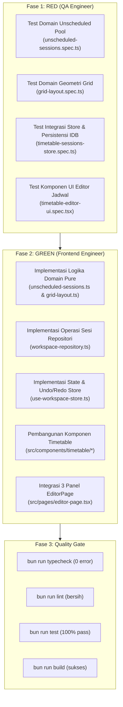

# Spesifikasi Task & Kontrak Teknis: FR-04 — Editor Jadwal Drag-and-Drop

**Kode Fitur:** `FR-04` (Didukung oleh `AC-02`, `AC-08`, `FR-06`, `FR-07`, `FR-10`, `AC-12`, `NFR-01`, `NFR-02`, `NFR-05`)  
**Status:** Siap Dieksekusi (Fase RED -> Fase GREEN)  
**Dokumen Referensi:**
- Product Requirements Document: [`docs/Schedovyn-PRD.md`](../Schedovyn-PRD.md) (Bagian 5, 7, 8, 10, 12)
- Technical Design Document: [`docs/Schedovyn-TDD.md`](../Schedovyn-TDD.md) (Bagian 4.3, 4.4, 6, 7)
- Design System & UI Guidelines: [`DESIGN.md`](../../DESIGN.md) (Bagian 4, 5.2)
- Agent Guidelines: [`AGENTS.md`](../../AGENTS.md)
- Task Sebelumnya (Selesai):
  - [`docs/tasks/FR-01-workspace-and-schedule-config.md`](./FR-01-workspace-and-schedule-config.md)
  - [`docs/tasks/FR-02-master-data-management.md`](./FR-02-master-data-management.md)
  - [`docs/tasks/FR-03-active-class-selection.md`](./FR-03-active-class-selection.md)

---

## 1. Konteks & Tujuan Fitur

### 1.1 Hasil Telusur `graphify`
Berdasarkan penelusuran arsitektur dan keterhubungan modul:
- **Editor Jadwal Mingguan sebagai Inti Aplikasi:**
  `Editor Jadwal Drag-and-Drop` merupakan antarmuka interaksi utama Schedovyn di mana staf kurikulum / penyusun jadwal menyusun sesi pembelajaran mingguan secara visual.
- **Fondasi yang Sudah Tersedia:**
  - `TimetableSession` dan `TeachingRequirement` telah terdefinisi di [`src/domain/types/entities.ts`](../../src/domain/types/entities.ts#L265-L291).
  - Skema tabel `sessions` pada IndexedDB (`schedovyn_local_db`) telah siap di [`src/db/database.ts`](../../src/db/database.ts#L367-L370).
  - Seleksi kelas aktif telah selesai pada `FR-03` melalui `useWorkspaceStore((state) => state.workspace.activeClassId)` dan `resolveActiveClass` di [`src/domain/timetable/active-class-context.ts`](../../src/domain/timetable/active-class-context.ts).
- **Kekosongan yang Perlu Diimplementasikan pada FR-04:**
  - Belum ada modul kalkulasi murni untuk *Unscheduled Sessions Pool* (`src/domain/timetable/unscheduled-sessions.ts`).
  - Belum ada modul kalkulasi geometri grid waktu, konversi koordinat piksel, *snap-to-interval*, dan *clustering* sesi bertumpuk (`src/domain/timetable/grid-layout.ts`).
  - Belum ada method persistensi CRUD sesi pada repositori [`src/db/workspace-repository.ts`](../../src/db/workspace-repository.ts).
  - Belum ada *state* `selectedSessionId`, mutasi sesi (`placeUnscheduledSession`, `moveSession`, `updateSessionDetails`, `removeSession`), dan histori *undo/redo* pada [`src/store/use-workspace-store.ts`](../../src/store/use-workspace-store.ts).
  - Belum ada komponen antarmuka 3 panel (`UnscheduledPanel`, `TimetableGrid`, `SessionBlock`, `SessionDetailPanel`, `EditorToolbar`) di `src/components/timetable/`.
  - Halaman [`src/pages/editor-page.tsx`](../../src/pages/editor-page.tsx) saat ini masih menampilkan tabel data statis untuk kelas aktif dan perlu diintegrasikan menjadi kanvas editor 3 panel interaktif berbasis `@dnd-kit/react`.

### 1.2 Referensi Persyaratan
- **FR-04 (Editor Jadwal Drag-and-Drop — PRD Bagian 5):**
  - **A. Panel Sesi Belum Terjadwal:** Menampilkan kartu pelajaran belum terjadwal dari kebutuhan pembelajaran kelas aktif dengan informasi mata pelajaran, kelas, guru, durasi, dan ruangan.
  - **B. Grid Jadwal:** Menampilkan hari belajar aktif dan rentang waktu aktual.
    1. Pengguna dapat menarik kartu sesi dari panel ke grid (`FR-04.1`).
    2. Pengguna dapat memindahkan sesi dari satu waktu ke waktu lain (`FR-04.2`).
    3. Pengguna dapat mengubah hari atau waktu sesi tanpa membuat ulang data sesi (`FR-04.3`).
    4. Blok sesi harus menggambarkan durasi aktualnya secara proporsional (`FR-04.4`).
    5. Sistem memberikan pratinjau posisi (*ghost preview*) sebelum sesi ditempatkan (`FR-04.5`).
    6. Pengguna dapat memilih sesi untuk melihat atau mengubah detailnya (`FR-04.6`).
    7. Sesi ditampilkan secara visual berdasarkan mata pelajaran (`SubjectColorKey`) (`FR-04.7`).
    8. Pengguna dapat membatalkan perubahan terakhir (*undo/redo*) (`FR-04.8`).
    9. Sistem tidak boleh menganggap setiap sesi memiliki durasi yang sama (`FR-04.9`).
    10. Penempatan sesi di luar jam belajar atau pada waktu istirahat harus menghasilkan indikator peringatan visual yang jelas (`FR-04.10`).
  - **C. Panel Detail dan Validasi:** Menampilkan mata pelajaran, kelas, guru, ruangan, hari, waktu mulai, waktu selesai, durasi, dan kontrol pengeditan presisi.
- **AC-02 (Menambahkan Sesi — PRD Bagian 12):**
  - **Given** terdapat sesi yang belum ditempatkan,
  - **When** pengguna menarik sesi ke grid,
  - **Then** sesi ditempatkan pada waktu yang dipilih dan conflict engine diperbarui.
- **AC-08 (Jadwal Belum Lengkap — PRD Bagian 12):**
  - **Given** suatu kebutuhan mata pelajaran membutuhkan $N$ sesi per minggu,
  - **When** baru $M$ sesi ditempatkan,
  - **Then** sistem menunjukkan bahwa $N - M$ sesi masih belum terjadwal.
- **FR-07 (Undo dan Redo — PRD Bagian 5 & TDD Bagian 7.1):**
  - Penyusunan jadwal mendukung pembatalan aksi terakhir (*undo*) dan pengulangan aksi (*redo*) untuk penambahan, pemindahan, pengubahan, atau penghapusan sesi.
- **PRD Bagian 7.3 & DESIGN.md Bagian 5.2 (Aksesibilitas Interaksi & Estetika Visual):**
  - Mekanisme alternatif keyboard: tombol cepat "Tempatkan ke Jadwal", pintasan `Alt + ArrowUp/Down` (geser waktu), `Alt + ArrowLeft/Right` (pindah hari), `Enter` (buka detail), dan `Delete`/`Backspace` (kembalikan ke panel belum terjadwal).
  - Gaya desain `radix-lyra` (`rounded-none`, garis tepi `border-border`, tipografi `font-mono` / `tabular-nums` untuk jam dan durasi, tanpa karakter *em dash* pada copywriting).

### 1.3 Masalah Pengguna & Batasan Ruang Lingkup
- **Masalah Pengguna:** Penyusunan jadwal manual di atas kertas atau spreadsheet sangat rentan salah hitung durasi, melelahkan saat memindahkan jam, dan sulit melacak berapa sesi suatu mata pelajaran yang belum selesai ditempatkan. Pengguna membutuhkan kanvas visual yang langsung menampilkan durasi sebenarnya (misalnya 40 menit vs 80 menit berbeda tinggi secara proporsional), mudah digeser, dan menyediakan kontrol cepat tanpa harus bergantung pada mouse saja.
- **Cakupan Dalam Task Ini (In-Scope):**
  1. Kontrak domain kalkulasi *Unscheduled Sessions Pool* (`src/domain/timetable/unscheduled-sessions.ts`).
  2. Kontrak domain kalkulasi geometri vertikal, *snap to grid*, deteksi kolom hari, *overlap clustering*, dan pergeseran keyboard (`src/domain/timetable/grid-layout.ts`).
  3. Penambahan operasi penyimpanan IndexedDB untuk sesi di [`src/db/workspace-repository.ts`](../../src/db/workspace-repository.ts).
  4. Penambahan state `selectedSessionId`, mutasi sesi, dan riwayat *undo/redo* di [`src/store/use-workspace-store.ts`](../../src/store/use-workspace-store.ts).
  5. Pembangunan komponen UI:
     - `UnscheduledPanel`: panel kiri sesi belum terjadwal dengan filter pencarian dan tombol cepat keyboard "Tempatkan ke Jadwal".
     - `TimetableGrid`: kanvas mingguan dengan penanda waktu linier, zona istirahat terarsir, zona di luar jam operasional, dan *droppable day columns*.
     - `SessionBlock`: kartu sesi terjadwal absolut di grid dengan pewarnaan mapel, label jam & durasi, *drag handle*, dan interaksi keyboard.
     - `SessionDetailPanel`: panel samping inspeksi detail dan formulir pengubahan presisi guru, ruangan, waktu, durasi, serta tombol lepas sesi.
     - `EditorToolbar`: bilah atas berisi tombol Undo/Redo dan info status ringkas.
  6. Integrasi `@dnd-kit/react` v0.5.1 pada [`src/pages/editor-page.tsx`](../../src/pages/editor-page.tsx).
- **Di Luar Cakupan Task Ini (Out-of-Scope):**
  - Mesin kalkulasi konflik menyeluruh lintas kelas (`FR-05`, disiapkan stub/slot pemicu agar siap dihubungkan saat FR-05 dikerjakan).
  - Layanan ekspor PDF dan Excel (`FR-08`, `FR-09`).

---

## 2. Kontrak Data & Arsitektur Teknis

### 2.1 Kontrak Domain Pool Sesi Belum Terjadwal (`src/domain/timetable/unscheduled-sessions.ts`)

Modul ini bersifat *pure TypeScript* (tanpa impor React, Dexie, atau DOM) dan menghitung sisa kebutuhan sesi secara deterministik (*derived state* sesuai TDD Bagian 4.3):

```typescript
import type {
  TeachingRequirement,
  TimetableSession,
} from "@/domain/types/entities"

export interface UnscheduledSessionItem {
  /** Format unik virtual id: `${requirement.id}::slot-${slotIndex}` */
  virtualId: string
  requirementId: string
  classId: string
  subjectId: string
  defaultTeacherId: string | null
  defaultRoomId: string | null
  durationMinutes: number
  roomRequired: boolean
  notes?: string
  slotIndex: number // Indeks slot (0 .. remainingCount - 1)
  remainingCount: number // Jumlah sesi kebutuhan ini yang belum terjadwal
  totalRequiredCount: number // Nilai sessionsPerWeek asal
}

export interface ClassUnscheduledSummary {
  classId: string
  items: UnscheduledSessionItem[]
  totalRequiredSessions: number
  totalScheduledSessions: number
  totalRemainingSessions: number
}

/**
 * Menghitung daftar sesi belum terjadwal untuk kelas tertentu berdasarkan
 * daftar TeachingRequirement dan TimetableSession saat ini.
 */
export function calculateUnscheduledSessions(
  requirements: readonly TeachingRequirement[],
  sessions: readonly TimetableSession[],
  classId: string
): ClassUnscheduledSummary
```

**Aturan Logika:**
1. Filter `requirements` hanya untuk `requirement.classId === classId`.
2. Hitung jumlah sesi di `sessions` yang memiliki `session.requirementId === req.id` (sebut $M$).
3. Kebutuhan yang belum terjadwal adalah $R = \max(0, \text{req.sessionsPerWeek} - M)$.
4. Jika $R > 0$, buat sebanyak $R$ item `UnscheduledSessionItem` dengan `virtualId: "${req.id}::slot-${k}"` ($k \in [0 \dots R-1]$), `remainingCount: R`, dan `totalRequiredCount: req.sessionsPerWeek`.
5. Jika $R === 0$, kebutuhan tersebut tidak memunculkan kartu di panel belum terjadwal.

---

### 2.2 Kontrak Domain Tata Letak Grid & Geometri Vertikal (`src/domain/timetable/grid-layout.ts`)

Modul ini menghitung koordinat piksel linier dan *snap interval* matematika sesuai TDD Bagian 6.2 & 6.3:

```typescript
import type {
  DayOfWeek,
  DayScheduleConfig,
  SnapIntervalMinutes,
  TimeString,
  TimetableSession,
} from "@/domain/types/entities"

/** Skala vertikal: 1.6 piksel per menit (15 menit = 24px, 45 menit = 72px, 60 menit = 96px) */
export const PIXELS_PER_MINUTE = 1.6

export interface GridBoundaries {
  originMinutes: number // Menit awal grid (paling pagi di antara hari sekolah aktif)
  maxMinutes: number // Menit akhir grid (paling sore di antara hari sekolah aktif)
  totalMinutes: number
  totalHeightPx: number
}

export interface SessionClusterLayout {
  colIndex: number // Indeks kolom horizontal dalam grup bertumpuk (0 .. colCount - 1)
  colCount: number // Total kolom yang saling beririsan
  widthPercent: number // 100 / colCount
  leftPercent: number // (100 / colCount) * colIndex
}

/**
 * Menghitung batas waktu global (paling awal dan paling akhir) dari hari-hari sekolah yang aktif.
 * Jika tidak ada hari sekolah aktif, gunakan batas default 07:00 (420 menit) hingga 16:00 (960 menit).
 */
export function calculateGridBoundaries(
  dayConfigs: readonly DayScheduleConfig[]
): GridBoundaries

/**
 * Mengonversi TimeString ("HH:mm") ke posisi vertikal piksel (top) relatif terhadap originMinutes.
 */
export function timeToGridTopPx(
  time: TimeString,
  originMinutes: number,
  pixelsPerMinute: number = PIXELS_PER_MINUTE
): number

/**
 * Mengonversi durasi menit ke tinggi piksel (height).
 */
export function durationToGridHeightPx(
  durationMinutes: number,
  pixelsPerMinute: number = PIXELS_PER_MINUTE
): number

/**
 * Mengonversi offset Y piksel pada kolom hari menjadi menit yang telah di-snap ke interval terdekat.
 */
export function offsetYToSnappedMinutes(
  offsetY: number,
  originMinutes: number,
  snapIntervalMinutes: SnapIntervalMinutes,
  pixelsPerMinute: number = PIXELS_PER_MINUTE
): number

/**
 * Memastikan nilai menit tidak melampaui batas jam belajar hari tertentu.
 */
export function clampMinutes(
  minutes: number,
  minMinutes: number,
  maxMinutes: number
): number

/**
 * Mengelompokkan sesi-sesi pada hari yang sama yang saling tumpang tindih interval waktunya
 * untuk menghasilkan layout pembagian lebar kolom (overlap clustering).
 */
export function computeDaySessionClusters(
  sessionsOnDay: readonly TimetableSession[]
): Map<string, SessionClusterLayout>

/**
 * Menghitung pergeseran waktu sesi untuk pintasan keyboard (Alt + ArrowUp / ArrowDown).
 */
export function calculateKeyboardTimeShift(
  currentStartTime: TimeString,
  durationMinutes: number,
  deltaMinutes: number,
  dayConfig: DayScheduleConfig
): { nextStartTime: TimeString; nextEndTime: TimeString }

/**
 * Mencari hari sekolah aktif berikutnya atau sebelumnya untuk pintasan keyboard (Alt + ArrowLeft / ArrowRight).
 */
export function getAdjacentSchoolDay(
  currentDay: DayOfWeek,
  dayConfigs: readonly DayScheduleConfig[],
  direction: "next" | "prev"
): DayOfWeek
```

---

### 2.3 Kontrak Persistensi Sesi IndexedDB (`src/db/workspace-repository.ts`)

Tambahkan operasi manipulasi `TimetableSession` ke dalam `src/db/workspace-repository.ts`:

```typescript
/**
 * Menyimpan atau memperbarui sebuah sesi jadwal ke dalam database IndexedDB.
 * Mengembalikan objek Workspace dengan updatedAt yang diperbarui.
 */
export async function saveTimetableSession(
  workspace: Workspace,
  session: TimetableSession,
  database?: SchedovynDatabase
): Promise<Workspace>

/**
 * Memperbarui sekumpulan sesi secara transaksional (digunakan saat bulk update atau Undo/Redo).
 */
export async function batchSaveTimetableSessions(
  workspace: Workspace,
  sessions: TimetableSession[],
  database?: SchedovynDatabase
): Promise<Workspace>

/**
 * Menghapus sebuah sesi jadwal dari database IndexedDB.
 */
export async function deleteTimetableSession(
  workspace: Workspace,
  sessionId: string,
  database?: SchedovynDatabase
): Promise<Workspace>
```

---

### 2.4 Kontrak State & Action Zustand Store (`src/store/use-workspace-store.ts`)

Perluas `WorkspaceStoreState` untuk mendukung interaksi editor, pemilihan sesi, dan histori *Undo/Redo*:

```typescript
export interface ScheduleHistorySnapshot {
  actionLabel: string // Contoh: "Tempatkan Matematika ke Senin 07:30"
  timestamp: number
  sessions: TimetableSession[]
}

export interface WorkspaceStoreState {
  // ... state sebelumnya ...
  selectedSessionId: string | null
  historyPast: ScheduleHistorySnapshot[]
  historyFuture: ScheduleHistorySnapshot[]

  // Action FR-04: Seleksi & Inspeksi
  selectSession: (sessionId: string | null) => void

  // Action FR-04: Penempatan dari Panel ke Grid
  placeUnscheduledSession: (params: {
    requirementId: string
    dayOfWeek: DayOfWeek
    startTime: TimeString
  }) => Promise<boolean>

  // Action FR-04: Pemindahan Waktu / Hari Sesi
  moveSession: (params: {
    sessionId: string
    dayOfWeek: DayOfWeek
    startTime: TimeString
  }) => Promise<boolean>

  // Action FR-04: Pengubahan Detail Sesi via Panel Detail
  updateSessionDetails: (params: {
    sessionId: string
    patch: Partial<
      Pick<
        TimetableSession,
        "teacherId" | "roomId" | "dayOfWeek" | "startTime" | "durationMinutes" | "notes"
      >
    >
  }) => Promise<boolean>

  // Action FR-04: Pengembalian Sesi ke Pool (Unschedule) / Penghapusan
  removeSession: (sessionId: string) => Promise<boolean>

  // Action FR-04 / FR-07: Undo & Redo
  undo: () => Promise<boolean>
  redo: () => Promise<boolean>
  canUndo: () => boolean
  canRedo: () => boolean
}
```

**Mekanisme Undo/Redo & Sinkronisasi DB:**
1. Setiap mutasi jadwal (`place`, `move`, `update`, `remove`) menyimpan salinan array imutabel `sessions` sebelum perubahan ke dalam `historyPast` (maksimal 50 riwayat), dan mengosongkan `historyFuture`.
2. State `sessions` baru diperbarui dan disimpan secara transaksional ke IndexedDB via `workspace-repository`.
3. Saat `undo()` dipanggil: snapshot terakhir diambil dari `historyPast`, kondisi saat ini dipindahkan ke `historyFuture`, array `sessions` diganti, dan seluruh tabel `sessions` disinkronkan ke IndexedDB.
4. Saat `redo()` dipanggil: snapshot diambil dari `historyFuture`, kondisi saat ini dipindahkan ke `historyPast`, array `sessions` diganti, dan disinkronkan ke IndexedDB.

---

### 2.5 Arsitektur Komponen Antarmuka (`src/components/timetable/`)

Struktur modular komponen di `src/components/timetable/`:
```text
src/components/timetable/
├── editor-toolbar.tsx         # Toolbar kontrol: Undo, Redo, Ringkasan status, Toggle tampilan
├── unscheduled-panel.tsx      # Panel kiri: Sesi belum terjadwal (useDraggable), filter mapel, tombol cepat
├── unscheduled-session-card.tsx # Kartu sesi belum terjadwal dengan drag-handle dan aksesibilitas keyboard
├── timetable-grid.tsx         # Kanvas grid: Garis waktu linier, kolom hari (useDroppable), zona istirahat
├── timetable-day-column.tsx   # Komponen kolom per hari: droppable zone, render SessionBlock & Ghost preview
├── session-block.tsx          # Blok sesi terjadwal: useDraggable, visual warna mapel, label jam, pintasan keyboard
├── session-detail-panel.tsx   # Panel kanan: Inspektur detail sesi terpilih, formulir edit presisi, tombol unschedule
└── ghost-session-preview.tsx  # Komponen pratinjau semi-transparan saat drag aktif di atas grid
```

**Integrasi `@dnd-kit/react` v0.5.1:**
- Gunakan `<DragDropProvider onDragEnd={handleDragEnd} onDragOver={handleDragOver}>` yang membungkus kanvas editor di `EditorPage`.
- Tipe data transfer drag dibedakan secara tegas:
  - Kartu belum terjadwal: `{ type: "unscheduled-item", item: UnscheduledSessionItem }`
  - Sesi terjadwal di grid: `{ type: "scheduled-session", session: TimetableSession }`
- Drop target pada kolom hari:
  - `{ type: "day-column", dayOfWeek: DayOfWeek }`
- Perhitungan posisi drop: periksa koordinat pointer/offset terhadap kolom untuk mengonversi ke `snappedStartTime` menggunakan `offsetYToSnappedMinutes()`.

---

## 3. Acceptance Criteria (Given-When-Then)

### AC-FR04-01: Penempatan Sesi dari Panel ke Grid (AC-02 & FR-04.1)
- **Given** kelas aktif "VII-A" memiliki kebutuhan mata pelajaran Matematika (2 sesi @ 45 menit) dan saat ini belum ada sesi yang ditempatkan (tersisa 2 sesi di panel),
- **When** pengguna menarik satu kartu Matematika ke kolom hari "Senin" pada koordinat jam 07:30,
- **Then** sistem membuat satu objek `TimetableSession` baru dengan `dayOfWeek: "monday"`, `startTime: "07:30"`, `endTime: "08:15"`, dan `durationMinutes: 45`,
- **And** sesi langsung dirender pada grid hari Senin dari posisi 07:30 hingga 08:15,
- **And** jumlah sesi tersisa untuk Matematika pada panel kiri berkurang menjadi 1 sesi,
- **And** status penyimpanan lokal diperbarui menjadi `"Tersimpan"`.

### AC-FR04-02: Pemindahan Sesi Antar-Waktu dan Antar-Hari (FR-04.2 & FR-04.3)
- **Given** terdapat sesi Bahasa Indonesia di kelas "VII-A" pada hari "Senin" pukul 08:15–09:45,
- **When** pengguna menarik blok sesi tersebut dan melepaskannya di kolom hari "Selasa" pada posisi pukul 09:00,
- **Then** sesi berpindah ke hari "Selasa" dengan `startTime: "09:00"` dan `endTime: "10:30"`,
- **And** durasi sesi tetap 90 menit tanpa membuat ulang ID sesi,
- **And** kolom hari Senin bersih dari sesi tersebut.

### AC-FR04-03: Perhitungan Pool Sesi Belum Terjadwal (AC-08 & FR-04.A)
- **Given** kebutuhan mata pelajaran IPA membutuhkan 4 sesi per minggu,
- **When** pengguna telah menempatkan 3 sesi IPA ke dalam grid,
- **Then** panel sesi belum terjadwal menampilkan kartu IPA dengan lencana `"1 sesi tersisa"`,
- **When** pengguna menghapus (*unschedule*) salah satu sesi IPA dari grid,
- **Then** lencana sesi IPA di panel belum terjadwal secara otomatis bertambah menjadi `"2 sesi tersisa"`.

### AC-FR04-04: Visualisasi Durasi Nyata & Penanganan Sesi Tumpang Tindih (FR-04.4, FR-04.9, & TDD 6.3)
- **Given** sesi A berdurasi 45 menit dan sesi B berdurasi 90 menit,
- **Then** tinggi blok sesi B pada grid tepat dua kali lipat tinggi blok sesi A (`144px` vs `72px`),
- **When** pengguna menempatkan dua sesi berbeda pada kelas yang sama di interval waktu yang saling beririsan (misalnya sesi A 08:00–09:30 dan sesi B 08:30–09:30),
- **Then** sistem membagi lebar kolom secara horizontal (masing-masing 50% lebar kolom) sehingga kedua sesi tetap terlihat, dapat diklik, dan dapat dipindahkan,
- **And** kedua blok sesi menampilkan indikator peringatan visual yang jelas.

### AC-FR04-05: Aksesibilitas Keyboard & Panel Detail Sesi (PRD 7.3 & TDD 6.4)
- **Given** pengguna menavigasi editor menggunakan keyboard tanpa mouse,
- **When** pengguna menekan tombol "Tempatkan ke Jadwal" pada kartu di panel sesi belum terjadwal,
- **Then** sistem menampilkan dialog cepat untuk memilih Hari dan Waktu Mulai, lalu menempatkan sesi ke grid,
- **When** sebuah blok sesi di grid menerima fokus keyboard:
  - Menekan `Enter` membuka fokus ke Panel Detail Sesi di sebelah kanan,
  - Menekan `Alt + ArrowDown` menggeser waktu sesi maju sebesar `snapIntervalMinutes` (misal 15 menit),
  - Menekan `Alt + ArrowUp` menggeser waktu sesi mundur sebesar `snapIntervalMinutes`,
  - Menekan `Alt + ArrowRight` memindahkan sesi ke hari sekolah aktif berikutnya,
  - Menekan `Alt + ArrowLeft` memindahkan sesi ke hari sekolah aktif sebelumnya,
  - Menekan `Delete` atau `Backspace` mengembalikan sesi ke panel belum terjadwal (*unschedule*).

### AC-FR04-06: Pembatalan Aksi (Undo / Redo) & Ketahanan Persistensi (FR-04.8, FR-07, & AC-12)
- **Given** pengguna baru saja memindahkan sesi dari Senin 07:30 ke Selasa 09:00,
- **When** pengguna menekan tombol Undo atau pintasan `Ctrl + Z`,
- **Then** sesi kembali ke hari Senin pukul 07:30,
- **When** pengguna menekan tombol Redo atau pintasan `Ctrl + Y` (`Ctrl + Shift + Z`),
- **Then** sesi kembali ke hari Selasa pukul 09:00,
- **And** setiap langkah perubahan tersimpan secara andal ke IndexedDB lokal.

---

## 4. Breakdown Task Eksekusi (TDD Roadmap)

Pengembangan wajib mengikuti siklus **Test-Driven Development (TDD)** secara ketat:



---

### 4.1 Task QA Engineer (Fase RED)

QA Engineer bertugas menulis seluruh skenario pengujian unit, integrasi, dan komponen di dalam folder pengujian hingga seluruh *assertion* siap dan berstatus **FAIL (RED)** karena implementasi belum dibuat.

#### Task QA-01: Unit Test Domain *Unscheduled Sessions Pool*
- **File:** `src/__tests__/unit/domain/unscheduled-sessions.spec.ts`
- **Cakupan Pengujian:**
  1. Menghitung pool sesi kosong jika tidak ada kebutuhan pembelajaran.
  2. Menghasilkan jumlah `UnscheduledSessionItem` sesuai `sessionsPerWeek` ketika belum ada sesi yang dijadwalkan.
  3. Mengurangi jumlah sesi sisa ketika sebagian sesi telah dijadwalkan (`AC-08`).
  4. Menghasilkan array kosong jika seluruh kebutuhan sesi telah terpenuhi (`scheduledCount >= sessionsPerWeek`).
  5. Memastikan isolasi kelas: kebutuhan kelas lain tidak muncul pada kelas aktif yang sedang diperiksa.
  6. Menjamin nilai atribut default (`defaultTeacherId`, `defaultRoomId`, `durationMinutes`, `roomRequired`) tersalin dengan benar ke setiap item virtual.

#### Task QA-02: Unit Test Domain Geometri & Tata Letak Grid
- **File:** `src/__tests__/unit/domain/grid-layout.spec.ts`
- **Cakupan Pengujian:**
  1. Perhitungan batas awal (`originMinutes`) dan akhir (`maxMinutes`) grid dari konfigurasi hari aktif.
  2. Perhitungan posisi vertikal `timeToGridTopPx` dan `durationToGridHeightPx` berdasarkan `PIXELS_PER_MINUTE = 1.6`.
  3. Konversi `offsetYToSnappedMinutes` terhadap interval snap 15, 30, dan 5 menit.
  4. Pengelompokan sesi bertumpuk (`computeDaySessionClusters`):
     - Dua sesi yang berurutan tepat (08:00–09:00 dan 09:00–10:00) tidak dianggap overlap dan masing-masing mendapat lebar 100%.
     - Dua sesi yang tumpang tindih (08:00–09:30 dan 08:30–09:30) dikelompokkan ke cluster yang sama dengan `width: 50%` dan `left: 0%` & `50%`.
     - Tiga sesi tumpang tindih simultan mendapatkan lebar 33.33%.
  5. Pengujian pergeseran keyboard:
     - `calculateKeyboardTimeShift`: geser maju/mundur 15 menit dengan batas jam belajar hari terkait.
     - `getAdjacentSchoolDay`: mencari hari aktif sebelum/sesudah dengan melompati hari libur (`isSchoolDay: false`).

#### Task QA-03: Integration Test Store Jadwal & Persistensi IndexedDB
- **File:** `src/__tests__/integration/timetable-sessions-store.spec.ts`
- **Lingkungan:** Vitest + `fake-indexeddb`
- **Cakupan Pengujian:**
  1. **Menambahkan Sesi:** Menjalankan `placeUnscheduledSession()` memicu pembuatan `TimetableSession`, menyinkronkan ke Dexie, dan mengurangi sisa sesi belum terjadwal (`AC-FR04-01`).
  2. **Memindahkan Sesi:** Menjalankan `moveSession()` mengubah hari dan waktu mulai sesi tanpa mengubah id, serta memperbarui Dexie (`AC-FR04-02`).
  3. **Mengubah Detail Sesi:** Menjalankan `updateSessionDetails()` memperbarui guru, ruangan, atau catatan sesi.
  4. **Menghapus Sesi (Unschedule):** Menjalankan `removeSession()` menghapus sesi dari store dan Dexie, serta mengembalikan slot ke pool sesi belum terjadwal (`AC-FR04-03`).
  5. **Undo dan Redo:**
     - Memindahkan sesi, lalu memanggil `undo()` -> sesi kembali ke waktu semula.
     - Memanggil `redo()` -> sesi kembali ke waktu baru (`AC-FR04-06`).
     - Memverifikasi batasan stack history maksimal 50 langkah.
  6. **Isolasi Kelas:** Memastikan modifikasi sesi pada kelas aktif tidak mengubah sesi kelas lain.

#### Task QA-04: Component Test Antarmuka Editor Jadwal
- **File:** `src/__tests__/components/timetable-editor-ui.spec.tsx`
- **Lingkungan:** Vitest + `@testing-library/react` + `@testing-library/user-event`
- **Cakupan Pengujian:**
  1. Render 3 panel editor: Panel A (Sesi belum terjadwal), Panel B (Grid mingguan), dan Panel C (Detail sesi / ringkasan).
  2. Filter pencarian mata pelajaran pada panel kiri menyaring kartu yang ditampilkan secara tepat.
  3. Klik tombol "Tempatkan ke Jadwal" pada kartu belum terjadwal membuka dialog penempatan cepat.
  4. Klik pada blok sesi di grid memilih sesi tersebut dan menampilkan informasi detail di Panel Detail Sesi.
  5. Pengujian interaksi keyboard pada blok sesi yang berfokus (`Enter`, `Alt+ArrowUp/Down`, `Alt+ArrowLeft/Right`, `Delete`).
  6. Tombol Undo dan Redo pada toolbar aktif/nonaktif sesuai kondisi riwayat.

---

### 4.2 Task Frontend Engineer (Fase GREEN)

Frontend Engineer bertugas mengimplementasikan modul kode produksi secara bertahap hingga seluruh test QA lulus (**GREEN**), memenuhi standar desain `radix-lyra`, dan lolos verifikasi akhir:

#### Task FE-01: Implementasi Modul Domain Murni
1. Buat berkas `src/domain/timetable/unscheduled-sessions.ts` sesuai kontrak Bagian 2.1.
2. Buat berkas `src/domain/timetable/grid-layout.ts` sesuai kontrak Bagian 2.2.
3. Jalankan `bun test src/__tests__/unit/domain/` untuk memastikan Task QA-01 dan QA-02 lulus (**GREEN**).

#### Task FE-02: Implementasi Repositori Persistensi Sesi
1. Tambahkan fungsi `saveTimetableSession`, `batchSaveTimetableSessions`, dan `deleteTimetableSession` pada `src/db/workspace-repository.ts` sesuai kontrak Bagian 2.3.
2. Pastikan transaksi IndexedDB memutasi tabel `sessions` dan memperbarui `updatedAt` pada `workspaces` secara atomik.

#### Task FE-03: Implementasi State & History Store
1. Perbarui `src/store/use-workspace-store.ts`:
   - Tambahkan state `selectedSessionId`, `historyPast`, dan `historyFuture`.
   - Implementasikan action `selectSession`, `placeUnscheduledSession`, `moveSession`, `updateSessionDetails`, `removeSession`, `undo`, `redo`, `canUndo`, dan `canRedo`.
   - Hubungkan setiap mutasi dengan perekaman snapshot history dan pemanggilan repositori IndexedDB.
2. Jalankan `bun test src/__tests__/integration/timetable-sessions-store.spec.ts` untuk memastikan Task QA-03 lulus (**GREEN**).

#### Task FE-04: Pembangunan Komponen Timetable & Drag-and-Drop
1. Bangun komponen pendukung di folder `src/components/timetable/`:
   - `editor-toolbar.tsx`: Toolbar atas dengan tombol Undo, Redo, pemilih kelas, dan indikator status.
   - `unscheduled-panel.tsx` & `unscheduled-session-card.tsx`: Panel sesi belum terjadwal dengan filter pencarian, drag source `useDraggable`, dan tombol cepat keyboard.
   - `session-block.tsx`: Blok sesi terjadwal absolut di grid dengan warna mata pelajaran, durasi waktu, teks jam, drag source, dan handler tombol keyboard.
   - `timetable-day-column.tsx`: Kolom hari droppable `useDroppable`, area istirahat terarsir, area di luar jam kerja, dan penempatan blok sesi dengan overlap clustering.
   - `timetable-grid.tsx`: Grid waktu lengkap dengan sumbu jam vertikal dan header hari aktif.
   - `session-detail-panel.tsx`: Panel kanan untuk mengubah guru, ruangan, jam mulai/selesai, catatan, atau melepas sesi dari grid.
2. Integrasikan seluruh komponen ke dalam `src/pages/editor-page.tsx` menggunakan `<DragDropProvider>` dari `@dnd-kit/react` v0.5.1.
3. Jalankan `bun test src/__tests__/components/timetable-editor-ui.spec.tsx` untuk memastikan Task QA-04 lulus (**GREEN**).

#### Task FE-05: Verifikasi Menyeluruh & Quality Gate
Jalankan perintah verifikasi wajib sebelum menandai task selesai:
```bash
bun run typecheck
bun run lint
bun test
bun run build
```
Semua perintah di atas harus lulus dengan **0 error**, tanpa kompromi tipe `any`, dan tanpa peringatan lint yang diabaikan.

---

## 5. Ringkasan File Terdampak

| File Path | Tipe Perubahan | Penanggung Jawab |
|---|---|---|
| `src/__tests__/unit/domain/unscheduled-sessions.spec.ts` | Berkas Baru (Unit Test) | QA Engineer |
| `src/__tests__/unit/domain/grid-layout.spec.ts` | Berkas Baru (Unit Test) | QA Engineer |
| `src/__tests__/integration/timetable-sessions-store.spec.ts` | Berkas Baru (Integration Test) | QA Engineer |
| `src/__tests__/components/timetable-editor-ui.spec.tsx` | Berkas Baru (Component Test) | QA Engineer |
| `src/domain/timetable/unscheduled-sessions.ts` | Berkas Baru (Domain Logic) | Frontend Engineer |
| `src/domain/timetable/grid-layout.ts` | Berkas Baru (Domain Logic) | Frontend Engineer |
| `src/db/workspace-repository.ts` | Modifikasi (Session CRUD Methods) | Frontend Engineer |
| `src/store/use-workspace-store.ts` | Modifikasi (Session Actions & Undo/Redo) | Frontend Engineer |
| `src/components/timetable/*` | Direktori & Komponen Baru | Frontend Engineer |
| `src/pages/editor-page.tsx` | Modifikasi (Integrasi 3 Panel Editor) | Frontend Engineer |
| `docs/tasks/FR-04-timetable-drag-and-drop-editor.md` | Berkas Baru (Spesifikasi & Panduan) | Product Manager / Architect |
