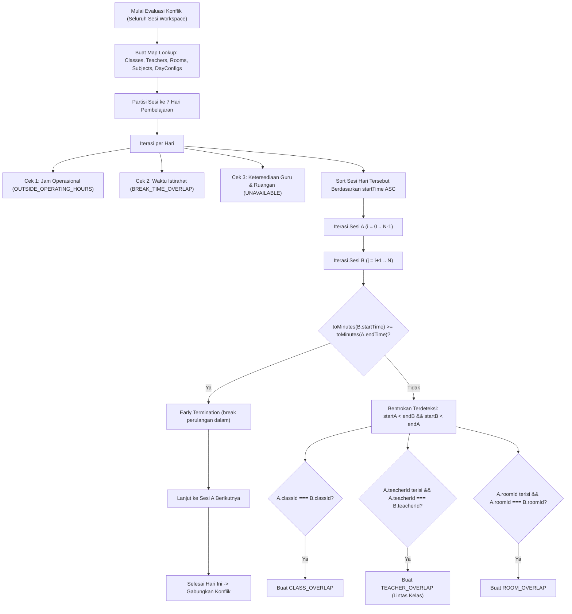
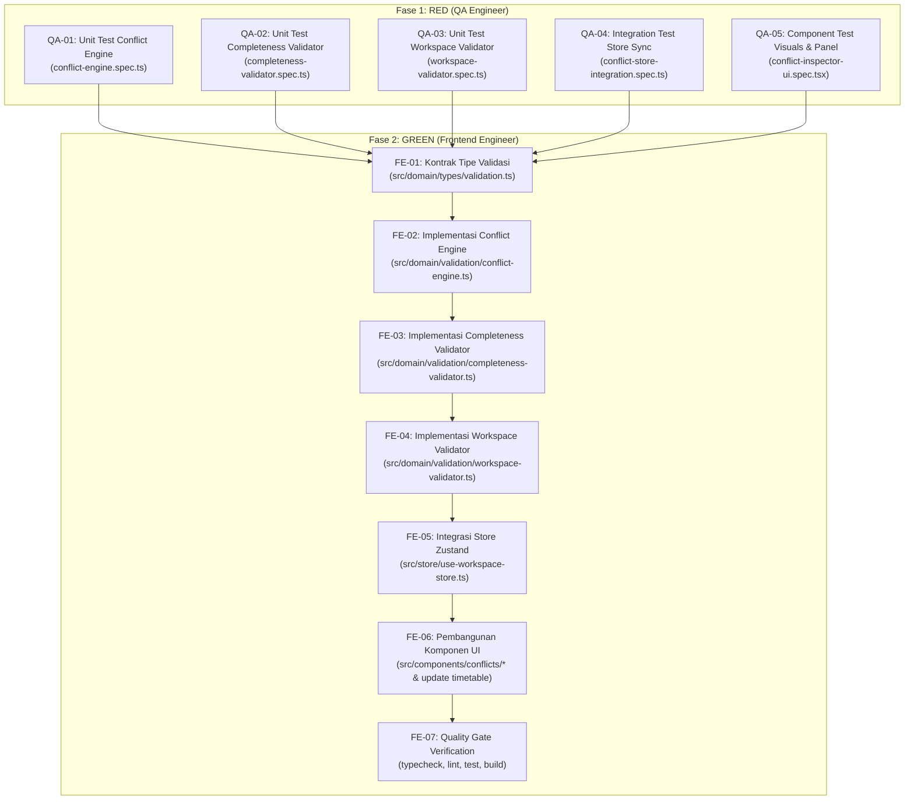

# Spesifikasi Task & Kontrak Teknis: FR-05 — Smart Conflict Detection

**Kode Fitur:** `FR-05` (Didukung oleh `AC-03`, `AC-04`, `AC-05`, `AC-06`, `AC-07`, `AC-08`, `AC-13`, `FR-11`, `NFR-01`, `NFR-02`, `NFR-05`)  
**Status:** Siap Dieksekusi (Fase RED -> Fase GREEN)  
**Dokumen Referensi:**
- Product Requirements Document: [`docs/Schedovyn-PRD.md`](../Schedovyn-PRD.md) (Bagian 5, 7, 8, 10, 11, 12)
- Technical Design Document: [`docs/Schedovyn-TDD.md`](../Schedovyn-TDD.md) (Bagian 5.1, 5.2, 5.3, 5.4, 6.3)
- Design System & UI Guidelines: [`DESIGN.md`](../../DESIGN.md) (Bagian 4, 5.2)
- Agent Guidelines: [`AGENTS.md`](../../AGENTS.md)
- Task Sebelumnya (Selesai):
  - [`docs/tasks/FR-01-workspace-and-schedule-config.md`](./FR-01-workspace-and-schedule-config.md)
  - [`docs/tasks/FR-02-master-data-management.md`](./FR-02-master-data-management.md)
  - [`docs/tasks/FR-03-active-class-selection.md`](./FR-03-active-class-selection.md)
  - [`docs/tasks/FR-04-timetable-drag-and-drop-editor.md`](./FR-04-timetable-drag-and-drop-editor.md)

---

## 1. Konteks & Tujuan Fitur

### 1.1 Hasil Telusur `graphify`
Berdasarkan penelusuran arsitektur dan keterhubungan modul:
- **Nilai Utama Schedovyn (*Conflict-First Principle*):**
  Deteksi dan penjelasan konflik lintas kelas secara transparan merupakan *core value proposition* aplikasi Schedovyn ([`docs/Schedovyn-PRD.md#L267-L320`](file:///home/ardi/projects/schedovyn/frontend/docs/Schedovyn-PRD.md#L267-L320)).
- **Fondasi yang Sudah Tersedia:**
  - Utilitas matematika waktu linier `doIntervalsOverlap`, `getOverlapRange`, dan `isIntervalWithinBounds` telah siap dan lulus uji pada [`src/domain/time/interval-utils.ts`](../../src/domain/time/interval-utils.ts).
  - Entitas `TimetableSession`, `ClassGroup`, `Teacher`, `Subject`, `Room`, `TeachingRequirement`, dan `DayScheduleConfig` telah terdefinisi di [`src/domain/types/entities.ts`](../../src/domain/types/entities.ts).
  - Seluruh sesi dalam ruang kerja tersimpan di IndexedDB dan Zustand Store [`src/store/use-workspace-store.ts`](../../src/store/use-workspace-store.ts).
- **Kekosongan yang Perlu Diimplementasikan pada FR-05:**
  - Belum ada kontrak tipe validasi terpadu di `src/domain/types/validation.ts`.
  - Belum ada modul algoritma evaluasi konflik waktu berbasis *Sort-and-Sweep* di `src/domain/validation/conflict-engine.ts`.
  - Belum ada modul evaluasi peringatan kelengkapan jadwal di `src/domain/validation/completeness-validator.ts`.
  - Belum ada modul kompilasi laporan validasi ruang kerja dan derivasi 4 status validasi di `src/domain/validation/workspace-validator.ts`.
  - Store Zustand belum menyimpan `validationReport` dan belum memicu evaluasi otomatis secara sinkron pada mutasi jadwal.
  - Komponen antarmuka `src/components/conflicts/` belum dibuat, dan `SessionBlock` serta `SessionDetailPanel` belum menampilkan indikator visual multi-cue untuk konflik.

### 1.2 Referensi Persyaratan
- **FR-05 (Smart Conflict Detection — PRD Bagian 5):**
  - Sistem memeriksa konflik secara otomatis saat pengguna menambahkan, memindahkan, atau mengubah sesi (`FR-05`).
  - Pemeriksaan menggunakan seluruh data sesi dalam ruang kerja, bukan hanya jadwal kelas aktif (`FR-05`).
  - **FR-05.1 (Konflik Kelas):** Kelas yang sama memiliki lebih dari satu sesi yang waktunya tumpang tindih.
  - **FR-05.2 (Konflik Guru):** Guru yang sama ditugaskan mengajar lebih dari satu sesi pada waktu yang tumpang tindih, termasuk sesi di kelas berbeda (*lintas kelas*).
  - **FR-05.3 (Konflik Ruangan):** Ruangan yang sama digunakan lebih dari satu sesi pada waktu yang tumpang tindih.
  - **FR-05.4 (Konflik Ketersediaan):** Sesi berada pada rentang waktu tidak tersedia untuk guru (`teacher.unavailableIntervals`) atau ruangan (`room.unavailableIntervals`).
  - **FR-05.5 (Konflik Jam Operasional & Istirahat):** Sesi berada di luar jam belajar (`!isSchoolDay` atau di luar rentang `startTime..endTime` hari terkait) atau beririsan dengan waktu istirahat (`breakIntervals`).
  - **FR-05.6 (Peringatan Kelengkapan Jadwal):** Sesi belum memenuhi alokasi mingguan, kelebihan sesi, sesi belum memiliki guru, ruangan wajib belum terisi, atau kelas belum dikonfigurasi. Peringatan kelengkapan wajib dibedakan dari bentrokan waktu.
  - **FR-05.7 (Aturan Perhitungan Interval):** Sesi A dan B berkonflik jika `startA < endB && startB < endA`. Sesi berurutan tepat waktu (`08:00–09:00` dan `09:00–10:00`) **tidak boleh** dianggap berkonflik (`AC-05`).
  - **FR-05.8 (Perilaku Ketika Konflik Ditemukan):** Menandai sesi dengan indikator visual multi-cue, menampilkan di daftar konflik dengan keterangan penyebab lengkap, dan dapat disorot/diperbaiki langsung.
- **FR-11 (Status Validasi Transparan & AC-13):**
  Empat status validasi eksplisit:
  1. `CONFLICT_DETECTED` (Konflik ditemukan)
  2. `INCOMPLETE` (Belum lengkap)
  3. `NO_CONFLICT_CURRENT_DATA` (Tidak ada konflik terdeteksi pada data saat ini)
  4. `COMPLETE_AND_VALID` (Jadwal lengkap dan valid)
- **Acceptance Criteria (PRD Bagian 12):**
  - `AC-03`: Konflik Guru Lintas Kelas (Guru sama di Kelas VIII-A dan VII-A bertabrakan).
  - `AC-04`: Durasi Berbeda (Sesi 40 menit vs 80 menit tumpang tindih tetap terdeteksi).
  - `AC-05`: Sesi Berurutan (Batas jam bertemu tidak berkonflik).
  - `AC-06`: Konflik Ruangan (Ruangan sama digunakan pada waktu tumpang tindih).
  - `AC-07`: Konflik yang Diperbaiki (Otomatis hilang saat sesi dipindahkan ke jam bebas konflik).
  - `AC-08`: Jadwal Belum Lengkap (Peringatan alokasi sesi belum selesai).
  - `AC-13`: Validasi Tidak Lengkap (Sistem tidak menyatakan jadwal valid jika alokasi belum lengkap).
- **NFR-01 (Kinerja):** Pembaruan hasil validasi untuk 1.000 sesi dalam waktu `< 300 ms` pada desktop.

### 1.3 Masalah Pengguna & Batasan Ruang Lingkup
- **Masalah Pengguna:** Penyusunan jadwal manual di sekolah sering mengalami bentrokan guru yang tidak disadari karena guru yang sama mengajar di banyak kelas paralel. Admin kurikulum membutuhkan sistem yang mendeteksi tabrakan waktu seketika secara otomatis tanpa perlu menekan tombol validasi manual, sekaligus membedakan antara "jadwal yang bentrok" dengan "jadwal yang baru disusun sebagian".
- **Cakupan Dalam Task Ini (In-Scope):**
  1. Kontrak tipe data validasi murni di `src/domain/types/validation.ts`.
  2. Implementasi algoritma evaluasi konflik waktu berbasis *Sort-and-Sweep* di `src/domain/validation/conflict-engine.ts`.
  3. Implementasi evaluasi kelengkapan jadwal di `src/domain/validation/completeness-validator.ts`.
  4. Kompilasi laporan validasi ruang kerja dan derivasi 4 status validasi di `src/domain/validation/workspace-validator.ts`.
  5. Pengikatan laporan validasi ke store Zustand [`src/store/use-workspace-store.ts`](../../src/store/use-workspace-store.ts) secara sinkron pada setiap mutasi jadwal.
  6. Penyempurnaan komponen visual:
     - `ConflictStatusBadge`: Lencana status validasi di toolbar dan header.
     - `ConflictListPanel`: Panel daftar konflik interaktif dengan filter (semua, kelas ini, lintas kelas, peringatan).
     - Pembaruan `SessionBlock`: Bingkai merah, ikon `AlertCircle`, dan teks badge jenis konflik.
     - Pembaruan `SessionDetailPanel`: Seksi informasi konflik spesifik pada sesi yang dipilih beserta navigasi cepat.
- **Di Luar Cakupan Task Ini (Out-of-Scope):**
  - Layanan ekspor PDF dan Excel (`FR-08`, `FR-09`).
  - Dialog konfirmasi pra-ekspor konflik (`AC-11`, masuk ke task ekspor).

---

## 2. Kontrak Data & Arsitektur Teknis

### 2.1 Kontrak Tipe Validasi Domain Murni (`src/domain/types/validation.ts`)

Seluruh tipe wajib bebas dari `any` dan tidak boleh mengimpor React, DOM, atau pustaka eksternal:

```typescript
import type { DayOfWeek, TimeString } from "@/domain/types/entities"

/** Jenis bentrokan waktu nyata (Tingkat Keparahan: ERROR) */
export type ConflictType =
  | "CLASS_OVERLAP"            // FR-05.1: Kelas sama memiliki >1 sesi pada interval tumpang tindih
  | "TEACHER_OVERLAP"          // FR-05.2: Guru sama mengajar >1 sesi pada interval tumpang tindih (lintas kelas)
  | "ROOM_OVERLAP"             // FR-05.3: Ruangan sama digunakan >1 sesi pada interval tumpang tindih
  | "TEACHER_UNAVAILABLE"      // FR-05.4: Sesi berada pada jadwal tidak tersedia guru
  | "ROOM_UNAVAILABLE"         // FR-05.4: Sesi berada pada jadwal tidak tersedia ruangan
  | "OUTSIDE_OPERATING_HOURS"  // FR-05.5: Sesi berada di luar jam belajar hari tersebut atau pada hari libur
  | "BREAK_TIME_OVERLAP"       // FR-05.5: Sesi beririsan dengan waktu istirahat

export interface ScheduleConflict {
  /** Format unik deterministik: `${conflictType}::${sortedAffectedSessionIds.join("::")}` */
  id: string
  conflictType: ConflictType
  severity: "error"
  dayOfWeek: DayOfWeek
  startTime: TimeString
  endTime: TimeString
  affectedSessionIds: string[]
  affectedClassIds: string[]
  teacherId?: string
  roomId?: string
  title: string       // Judul ringkas Bahasa Indonesia, misal: "Bentrokan Jadwal Guru"
  description: string // Penjelasan lengkap Bahasa Indonesia (FR-05.8)
}

/** Jenis peringatan kelengkapan jadwal (Tingkat Keparahan: WARNING) */
export type CompletenessWarningType =
  | "UNFULFILLED_REQUIREMENT"  // FR-05.6: Sesi terjadwal < sessionsPerWeek
  | "OVER_SCHEDULED_SESSION"   // Sesi terjadwal > sessionsPerWeek
  | "MISSING_TEACHER"          // FR-05.6: Sesi terjadwal belum memiliki guru
  | "MISSING_REQUIRED_ROOM"    // FR-05.6: Sesi mewajibkan ruangan namun roomId kosong
  | "UNCONFIGURED_CLASS"       // Kelas belum memiliki kebutuhan pembelajaran sama sekali

export interface CompletenessWarning {
  /** Format unik deterministik: `${warningType}::${classId}::${requirementId ?? sessionId ?? ""}` */
  id: string
  warningType: CompletenessWarningType
  severity: "warning"
  classId: string
  requirementId?: string
  sessionId?: string
  subjectId?: string
  missingSessionCount?: number
  title: string
  description: string
}

/** Empat status validasi eksplisit sesuai PRD FR-11 & TDD Bagian 5.4 */
export type ValidationStatus =
  | "CONFLICT_DETECTED"         // Terdapat minimal 1 bentrokan waktu aktif
  | "INCOMPLETE"                 // 0 konflik, namun kebutuhan sesi/data belum lengkap
  | "NO_CONFLICT_CURRENT_DATA"   // 0 konflik, kelas aktif lengkap, namun kelas lain belum lengkap/berkonflik
  | "COMPLETE_AND_VALID"         // 0 konflik di seluruh ruang kerja, seluruh kelas lengkap terisi

export interface ScopeValidationSummary {
  status: ValidationStatus
  statusLabel: string
  scheduledSessionsCount: number
  unscheduledSessionsCount: number
  activeConflictsCount: number
  completenessWarningsCount: number
  conflicts: ScheduleConflict[]
  warnings: CompletenessWarning[]
}

export interface WorkspaceValidationReport {
  evaluatedAt: number
  workspaceSummary: ScopeValidationSummary
  byClassId: Record<string, ScopeValidationSummary>
  conflictsBySessionId: Record<string, ScheduleConflict[]>
  warningsBySessionId: Record<string, CompletenessWarning[]>
}
```

---

### 2.2 Arsitektur Conflict Engine Berbasis Sort-and-Sweep (`src/domain/validation/conflict-engine.ts`)

Untuk memenuhi **NFR-01** (evaluasi 1.000 sesi dalam waktu `< 300 ms`), algoritma menggunakan strategi partisi harian dan *Sort-and-Sweep* berdasar waktu mulai:



**Kontrak Fungsi:**
```typescript
export interface ConflictEvaluationParams {
  dayConfigs: readonly DayScheduleConfig[]
  classes: readonly ClassGroup[]
  teachers: readonly Teacher[]
  rooms: readonly Room[]
  subjects: readonly Subject[]
  sessions: readonly TimetableSession[]
}

export function detectScheduleConflicts(
  params: ConflictEvaluationParams
): ScheduleConflict[]
```

**Aturan Penamaan & Deskripsi Konflik (Bahasa Indonesia):**
- **Bentrokan Guru Lintas Kelas:**  
  `title: "Bentrokan Jadwal Guru"`  
  `description: "Guru {NamaGuru} dijadwalkan mengajar kelas {KelasA} dan kelas {KelasB} secara bersamaan pada {Hari}, {Mulai} - {Selesai}."`
- **Bentrokan Ruangan:**  
  `title: "Bentrokan Pemakaian Ruangan"`  
  `description: "Ruangan {NamaRuangan} digunakan oleh kelas {KelasA} dan kelas {KelasB} pada {Hari}, {Mulai} - {Selesai}."`
- **Bentrokan Kelas:**  
  `title: "Jadwal Kelas Tumpang Tindih"`  
  `description: "Kelas {NamaKelas} memiliki dua sesi pembelajaran bersamaan pada {Hari}, {Mulai} - {Selesai}."`
- **Di Luar Jam Belajar:**  
  `title: "Sesi di Luar Jam Belajar"`  
  `description: "Sesi {NamaMapel} berada di luar jam operasional pembelajaran hari {Hari} ({MulaiOperasional} - {SelesaiOperasional})."`
- **Bekerja di Waktu Istirahat:**  
  `title: "Sesi Beririsan dengan Waktu Istirahat"`  
  `description: "Sesi {NamaMapel} beririsan dengan {LabelIstirahat} ({MulaiIstirahat} - {SelesaiIstirahat})."`

---

### 2.3 Kontrak Completeness Validator (`src/domain/validation/completeness-validator.ts`)

Modul ini mengevaluasi apakah alokasi sesi telah lengkap dan apakah sesi terjadwal telah memiliki guru dan ruangan yang diperlukan:

```typescript
export interface CompletenessEvaluationParams {
  classes: readonly ClassGroup[]
  subjects: readonly Subject[]
  requirements: readonly TeachingRequirement[]
  sessions: readonly TimetableSession[]
}

export function evaluateCompletenessWarnings(
  params: CompletenessEvaluationParams
): CompletenessWarning[]
```

**Aturan Peringatan:**
1. **`UNFULFILLED_REQUIREMENT`:** Jika untuk suatu kebutuhan pembelajaran, $\text{scheduledCount} < \text{requirement.sessionsPerWeek}$.  
   `missingSessionCount = requirement.sessionsPerWeek - scheduledCount`.  
   `description: "Mata pelajaran {Mapel} di kelas {Kelas} membutuhkan {N} sesi, namun baru {M} sesi yang ditempatkan (kurang {K} sesi)."`
2. **`OVER_SCHEDULED_SESSION`:** Jika $\text{scheduledCount} > \text{requirement.sessionsPerWeek}$.
3. **`MISSING_TEACHER`:** Setiap `TimetableSession` yang memiliki `teacherId === null`.
4. **`MISSING_REQUIRED_ROOM`:** Sesi yang berasal dari kebutuhan pembelajaran dengan `roomRequired === true` namun `session.roomId === null`.
5. **`UNCONFIGURED_CLASS`:** Kelas yang tidak memiliki satu pun `TeachingRequirement` terdaftar.

---

### 2.4 Kontrak Workspace Validator & Derivasi Status (`src/domain/validation/workspace-validator.ts`)

Modul ini menggabungkan hasil evaluasi `conflict-engine` dan `completeness-validator` untuk menghasilkan `WorkspaceValidationReport`:

```typescript
export interface WorkspaceValidationData {
  dayConfigs: readonly DayScheduleConfig[]
  classes: readonly ClassGroup[]
  teachers: readonly Teacher[]
  rooms: readonly Room[]
  subjects: readonly Subject[]
  requirements: readonly TeachingRequirement[]
  sessions: readonly TimetableSession[]
  activeClassId: string | null
}

export function evaluateWorkspaceValidation(
  data: WorkspaceValidationData
): WorkspaceValidationReport
```

**Matriks Logika Status Validasi (FR-11 & AC-13):**

| Kondisi Konflik | Kondisi Scope Evaluasi | Kondisi Global Workspace | Status (`ValidationStatus`) | Label Status |
|---|---|---|---|---|
| `conflictsCount > 0` | Apa pun | Apa pun | `CONFLICT_DETECTED` | **Konflik ditemukan** |
| `0` konflik | `unscheduledCount > 0` ATAU `warningsCount > 0` ATAU `totalRequirements === 0` | Apa pun | `INCOMPLETE` | **Belum lengkap** |
| `0` konflik | Scope kelas aktif lengkap (`0` unscheduled, `0` warning, `> 0` sesi) | Kelas lain di workspace masih belum lengkap atau berkonflik | `NO_CONFLICT_CURRENT_DATA` | **Tidak ada konflik pada data saat ini** |
| `0` konflik | Seluruh kelas di workspace lengkap, memiliki sesi, dan `0` konflik | Seluruh kelas lengkap | `COMPLETE_AND_VALID` | **Jadwal lengkap dan valid** |

---

### 2.5 Integrasi Zustand Store (`src/store/use-workspace-store.ts`)

1. Tambahkan properti ke `WorkspaceStoreState`:
   ```typescript
   export interface WorkspaceStoreState {
     // ... state sebelumnya ...
     validationReport: WorkspaceValidationReport | null

     // Action pemicu evaluasi eksplisit
     revalidateWorkspace: () => void

     // Selector pembantu
     getActiveClassValidationSummary: () => ScopeValidationSummary | null
     getSessionConflicts: (sessionId: string) => ScheduleConflict[]
     getSessionWarnings: (sessionId: string) => CompletenessWarning[]
   }
   ```
2. Hubungkan fungsi `evaluateWorkspaceValidation()` ke dalam alur mutasi:
   - Setiap kali terjadi penambahan, pemindahan, pengubahan, penghapusan sesi (`placeUnscheduledSession`, `moveSession`, `updateSessionDetails`, `removeSession`, `undo`, `redo`), panggil evaluasi validasi secara sinkron dan perbarui `validationReport`.
   - Setiap kali konfigurasi hari/jam sekolah diubah atau data master guru/ruangan/kebutuhan diubah, perbarui `validationReport`.

---

### 2.6 Arsitektur Komponen Antarmuka (`src/components/conflicts/`)

```text
src/components/conflicts/
├── conflict-status-badge.tsx    # Lencana 4-status validasi (warna, ikon, label deskriptif)
├── conflict-list-panel.tsx      # Drawer/sheet panel daftar konflik dan peringatan interaktif
├── conflict-item-card.tsx       # Kartu item konflik dengan tombol aksi "Lihat di Jadwal"
└── conflict-inspector-card.tsx  # Widget ringkasan konflik di sidebar kanan / bawah editor
```

**Prinsip Desain Visual Multi-Cue (PRD Bagian 7.2 & DESIGN.md):**
- **Pada `SessionBlock` (`src/components/timetable/session-block.tsx`):**
  - Jika sesi memiliki bentrokan waktu: tambahkan border tebal merah (`border-destructive border-2`), latar belakang aksen halus, ikon `AlertCircle`, dan teks badge jenis konflik (misal: `"Bentrokan Guru"`).
  - Jika sesi hanya memiliki peringatan kelengkapan (misal belum ada guru): tambahkan ikon `AlertTriangle` warna amber dan badge `"Guru Belum Ada"`.
- **Pada `SessionDetailPanel` (`src/components/timetable/session-detail-panel.tsx`):**
  - Tampilkan bagian khusus "Konflik dan Peringatan Sesi Ini" yang merinci jenis masalah, waktu bentrokan, serta kelas lain yang terlibat.
- **Pada `EditorToolbar` (`src/components/timetable/editor-toolbar.tsx`):**
  - Sematkan `ConflictStatusBadge` yang menampilkan jumlah konflik aktif dan dapat diklik untuk membuka `ConflictListPanel`.

---

## 3. Acceptance Criteria (Given-When-Then)

### AC-FR05-01: Konflik Kelas pada Sesi Bertabrakan (`CLASS_OVERLAP`)
- **Given** kelas VII-A memiliki sesi Matematika pada Senin 07:30–08:30,
- **When** pengguna menempatkan sesi Bahasa Indonesia pada kelas VII-A di hari Senin 08:00–09:00,
- **Then** sistem mendeteksi konflik `CLASS_OVERLAP` untuk rentang waktu 08:00–08:30,
- **And** status validasi berubah menjadi `CONFLICT_DETECTED`,
- **And** kedua blok sesi di grid menampilkan penanda konflik (border merah dan ikon peringatan).

### AC-FR05-02: Konflik Guru Lintas Kelas (`TEACHER_OVERLAP` - `AC-03`)
- **Given** guru Budi Santoso ditugaskan mengajar kelas VIII-A pada Senin 08:00–09:00,
- **When** pengguna berada di kelas VII-A dan menempatkan sesi dengan guru Budi Santoso pada Senin 08:30–09:30,
- **Then** sistem mendeteksi konflik `TEACHER_OVERLAP` yang melibatkan Kelas VII-A dan Kelas VIII-A pada rentang 08:30–09:00,
- **And** deskripsi konflik secara jelas menyebutkan kedua kelas dan guru yang bersangkutan,
- **And** kedua sesi pada kedua kelas ditandai sebagai berkonflik.

### AC-FR05-03: Konflik Ruangan Lintas Kelas (`ROOM_OVERLAP` - `AC-06`)
- **Given** Laboratorium IPA digunakan oleh kelas IX-A pada Selasa 10:00–11:30,
- **When** sesi kelas VII-B dijadwalkan menggunakan Laboratorium IPA pada Selasa 10:45–12:15,
- **Then** sistem menghasilkan konflik `ROOM_OVERLAP` pada interval 10:45–11:30,
- **And** kedua sesi yang memperebutkan ruangan tersebut ditandai berkonflik.

### AC-FR05-04: Penanganan Sesi Berbeda Durasi & Sesi Berurutan Tepat (`AC-04` & `AC-05`)
- **Given** sesi A berdurasi 40 menit (08:00–08:40) dan sesi B berdurasi 80 menit (08:30–09:50) pada kelas yang sama,
- **Then** sistem mendeteksi konflik untuk irisan waktu 08:30–08:40 (`AC-04`),
- **Given** sesi C berakhir tepat pukul 09:00 (08:00–09:00) dan sesi D dimulai tepat pukul 09:00 (09:00–10:00) dengan guru yang sama,
- **Then** sistem **tidak** menganggap sesi C dan D berkonflik (`AC-05`).

### AC-FR05-05: Konflik Ketersediaan, Jam Belajar, dan Istirahat (`FR-05.4` & `FR-05.5`)
- **Given** guru Siti tidak bersedia mengajar pada Rabu 07:00–09:00 (`teacher.unavailableIntervals`),
- **When** sesi kelas VII-A dengan guru Siti ditempatkan pada Rabu 08:00–09:30,
- **Then** sistem mendeteksi `TEACHER_UNAVAILABLE` pada rentang 08:00–09:00,
- **Given** hari Jumat jam sekolah berakhir pukul 11:30 dan terdapat waktu istirahat pukul 09:30–10:00,
- **When** sesi ditempatkan pukul 09:15–10:15, sistem mendeteksi `BREAK_TIME_OVERLAP`,
- **When** sesi ditempatkan pukul 11:00–12:00, sistem mendeteksi `OUTSIDE_OPERATING_HOURS`.

### AC-FR05-06: Peringatan Kelengkapan Jadwal (`AC-08` & `FR-05.6`)
- **Given** kebutuhan mata pelajaran Bahasa Inggris membutuhkan 4 sesi per minggu,
- **When** baru 2 sesi yang ditempatkan ke dalam grid dan tidak ada bentrokan waktu,
- **Then** sistem menghasilkan `CompletenessWarning` bertipe `UNFULFILLED_REQUIREMENT` dengan `missingSessionCount: 2`,
- **And** status validasi adalah `INCOMPLETE`, bukan `CONFLICT_DETECTED`.

### AC-FR05-07: Resolusi Konflik Otomatis saat Sesi Dipindahkan (`AC-07`)
- **Given** terdapat bentrokan guru antara dua sesi pada pukul 08:30–09:00,
- **When** pengguna memindahkan salah satu sesi ke jam kosong pada pukul 10:00–11:00,
- **Then** conflict engine menghitung ulang validasi seketika,
- **And** konflik guru tersebut otomatis terhapus dari daftar konflik aktif dan penanda visual merah pada blok sesi dihilangkan.

### AC-FR05-08: Derivasi Empat Status Validasi Ruang Kerja (`AC-13` & `FR-11`)
- **Given** tidak ada konflik waktu di ruang kerja,
- **When** kelas aktif VII-A telah lengkap terisi seluruh sesinya tanpa konflik, namun kelas VIII-A masih memiliki alokasi sesi yang belum terjadwal,
- **Then** status validasi untuk scope ruang kerja global adalah `NO_CONFLICT_CURRENT_DATA`,
- **And** sistem **tidak** menyatakan seluruh jadwal lengkap dan valid (`AC-13`),
- **When** seluruh kelas di ruang kerja telah terisi penuh alokasinya dan tidak ada konflik apa pun di seluruh ruang kerja,
- **Then** status validasi menjadi `COMPLETE_AND_VALID`.

### AC-FR05-09: Visualisasi Multi-Cue dan Navigasi Interaktif (`FR-05.8` & `PRD 7.2`)
- **Given** terdapat bentrokan waktu pada sebuah sesi di grid,
- **Then** blok sesi menampilkan indikator multi-cue: garis tepi tebal merah, ikon `AlertCircle`, dan teks jenis konflik,
- **When** pengguna mengeklik sesi tersebut, formulir Detail Sesi menampilkan daftar konflik yang dialami dan tombol aksi cepat,
- **When** pengguna mengeklik tombol "Lihat di Jadwal" pada item konflik lintas kelas di `ConflictListPanel`, sistem secara otomatis beralih ke kelas yang bersangkutan dan menyorot sesi yang terlibat.

---

## 4. Breakdown Task Eksekusi (TDD Roadmap)



---

### 4.1 Task QA Engineer (Fase RED)

QA Engineer bertugas menulis seluruh skenario pengujian unit, integrasi, dan pengujian komponen sebelum kode produksi dibuat, memastikan seluruh assertion berstatus **FAIL (RED)** karena fungsi belum diimplementasikan.

#### Task QA-01: Unit Test *Conflict Engine* & Kinerja Sort-and-Sweep
- **File:** `src/__tests__/unit/domain/conflict-engine.spec.ts`
- **Cakupan Pengujian:**
  1. `CLASS_OVERLAP`: Dua sesi di kelas yang sama pada hari dan waktu bertabrakan (`startA < endB && startB < endA`).
  2. `TEACHER_OVERLAP` lintas kelas (`AC-03`): Guru sama ditugaskan di dua kelas berbeda pada waktu tumpang tindih. Verifikasi bahwa `affectedClassIds` memuat kedua kelas.
  3. `ROOM_OVERLAP` (`AC-06`): Ruangan sama digunakan pada waktu tumpang tindih. Verifikasi tidak berkonflik jika `roomId` bernilai `null`.
  4. Durasi berbeda (`AC-04`): Sesi 40 menit vs 80 menit tumpang tindih tetap terdeteksi.
  5. Sesi berurutan tepat (`AC-05`): Sesi selesai 09:00 dan sesi mulai 09:00 **tidak** berkonflik.
  6. `TEACHER_UNAVAILABLE` & `ROOM_UNAVAILABLE`: Sesi pada rentang waktu tidak bersedia guru/ruangan.
  7. `OUTSIDE_OPERATING_HOURS`: Sesi di hari libur atau melampaui jam belajar harian.
  8. `BREAK_TIME_OVERLAP`: Sesi beririsan dengan waktu istirahat.
  9. **Benchmark Kinerja (NFR-01):** Bangun data simulasi ruang kerja dengan **1.000 sesi** di berbagai kelas dan guru. Verifikasi bahwa `detectScheduleConflicts()` selesai dalam waktu **< 50 ms** (jauh di bawah batas 300 ms).

#### Task QA-02: Unit Test *Completeness Validator*
- **File:** `src/__tests__/unit/domain/completeness-validator.spec.ts`
- **Cakupan Pengujian:**
  1. `UNFULFILLED_REQUIREMENT` (`AC-08`): Kebutuhan 5 sesi, baru ditempatkan 3 sesi -> menghasilkan warning dengan `missingSessionCount: 2`.
  2. `OVER_SCHEDULED_SESSION`: Sesi terjadwal melebihi kuota mingguan kebutuhan.
  3. `MISSING_TEACHER`: Sesi terjadwal memiliki `teacherId === null`.
  4. `MISSING_REQUIRED_ROOM`: Kebutuhan mewajibkan ruangan (`roomRequired: true`), namun sesi memiliki `roomId === null`.
  5. `UNCONFIGURED_CLASS`: Kelas terdaftar tanpa kebutuhan pembelajaran.

#### Task QA-03: Unit Test *Workspace Validator* & Derivasi 4 Status
- **File:** `src/__tests__/unit/domain/workspace-validator.spec.ts`
- **Cakupan Pengujian:**
  1. `CONFLICT_DETECTED`: Menghasilkan status konflik jika ada minimal 1 `ScheduleConflict`, terlepas dari kelengkapan sesi.
  2. `INCOMPLETE`: 0 konflik, namun masih ada alokasi sesi yang belum terjadwal (`unscheduledSessionsCount > 0`).
  3. `NO_CONFLICT_CURRENT_DATA` (`AC-13`): 0 konflik, kelas aktif telah lengkap, namun kelas lain di workspace masih belum lengkap atau memiliki konflik.
  4. `COMPLETE_AND_VALID`: 0 konflik di seluruh ruang kerja dan seluruh kelas telah lengkap terisi jadwalnya.
  5. Pemetaan indeks `conflictsBySessionId` dan `warningsBySessionId` untuk pencarian $O(1)$ di komponen UI.

#### Task QA-04: Integration Test Store Sync & Resolusi Konflik
- **File:** `src/__tests__/integration/conflict-store-integration.spec.ts`
- **Lingkungan:** Vitest + `fake-indexeddb`
- **Cakupan Pengujian:**
  1. Menempatkan sesi baru yang menimbulkan bentrokan guru langsung memperbarui `validationReport` menjadi `CONFLICT_DETECTED` secara sinkron.
  2. Memindahkan sesi yang berkonflik ke waktu kosong langsung menghapus konflik dari `validationReport` (`AC-07`).
  3. Menjalankan `undo()` dan `redo()` memperbarui hasil evaluasi validasi selaras dengan state jadwal yang dipulihkan (FR-07).
  4. Menghapus guru atau ruangan pada master data yang sedang digunakan sesi memicu evaluasi kelengkapan yang sesuai.

#### Task QA-05: Component Test Tampilan Multi-Cue & Navigasi Konflik
- **File:** `src/__tests__/components/conflict-inspector-ui.spec.tsx`
- **Lingkungan:** Vitest + `@testing-library/react` + `@testing-library/user-event`
- **Cakupan Pengujian:**
  1. Render `SessionBlock`: Memverifikasi kehadiran atribut visual multi-cue (border merah, ikon `AlertCircle`, label teks) saat sesi berstatus konflik.
  2. Render `ConflictStatusBadge`: Menampilkan label dan warna yang sesuai dengan 4 status validasi.
  3. Buka `ConflictListPanel`: Menampilkan daftar konflik dan filter (Semua, Bentrokan Waktu, Peringatan Kelengkapan).
  4. Interaksi tombol "Lihat di Jadwal": Mengeklik item konflik memicu perpindahan ke kelas terkait dan menyorot sesi yang bermasalah.

---

### 4.2 Task Frontend Engineer (Fase GREEN)

Frontend Engineer bertugas mengimplementasikan logika domain murni, store, dan antarmuka visual hingga seluruh test QA lulus (**GREEN**):

#### Task FE-01: Kontrak Tipe Validasi
- Buat berkas `src/domain/types/validation.ts` sesuai kontrak Bagian 2.1. Pastikan zero `any` dan diekspor dengan benar.

#### Task FE-02: Implementasi Modul *Conflict Engine*
- Buat berkas `src/domain/validation/conflict-engine.ts` sesuai kontrak Bagian 2.2.
- Terapkan strategi partisi per hari, sort `startTime` menaik, dan sweep dengan *early termination*.
- Pastikan formula `startA < endB && startB < endA` dan deskripsi konflik Bahasa Indonesia tersusun rapi.
- Jalankan `bun test src/__tests__/unit/domain/conflict-engine.spec.ts` hingga lulus (**GREEN**).

#### Task FE-03: Implementasi Modul *Completeness Validator*
- Buat berkas `src/domain/validation/completeness-validator.ts` sesuai kontrak Bagian 2.3.
- Evaluasi alokasi sesi per kebutuhan, guru kosong, ruangan wajib kosong, dan kelas tanpa konfigurasi.
- Jalankan `bun test src/__tests__/unit/domain/completeness-validator.spec.ts` hingga lulus (**GREEN**).

#### Task FE-04: Implementasi Modul *Workspace Validator*
- Buat berkas `src/domain/validation/workspace-validator.ts` sesuai kontrak Bagian 2.4.
- Gabungkan hasil `detectScheduleConflicts` dan `evaluateCompletenessWarnings`, bangun lookup map per sesi, dan tentukan `ValidationStatus` sesuai matriks 4 status.
- Jalankan `bun test src/__tests__/unit/domain/workspace-validator.spec.ts` hingga lulus (**GREEN**).

#### Task FE-05: Integrasi Store Zustand
- Perbarui `src/store/use-workspace-store.ts`:
  - Tambahkan state `validationReport: WorkspaceValidationReport | null`.
  - Pasang pemanggilan `evaluateWorkspaceValidation()` pada `bootWorkspace`, mutasi sesi (`place`, `move`, `update`, `remove`, `undo`, `redo`), serta mutasi master data dan konfigurasi waktu.
  - Implementasikan selector pembantu `getActiveClassValidationSummary`, `getSessionConflicts`, dan `getSessionWarnings`.
- Jalankan `bun test src/__tests__/integration/conflict-store-integration.spec.ts` hingga lulus (**GREEN**).

#### Task FE-06: Pembangunan Komponen UI & Multi-Cue Visual
1. Bangun komponen di `src/components/conflicts/`:
   - `conflict-status-badge.tsx`: Lencana status validasi 4 kondisi.
   - `conflict-list-panel.tsx`: Panel drawer/sheet interaktif daftar konflik dengan filter tab.
2. Perbarui `src/components/timetable/session-block.tsx`:
   - Ambil konflik sesi dari `validationReport`.
   - Tambahkan styling multi-cue (border merah tegas, ikon peringatan, teks ringkas badge jenis bentrokan).
3. Perbarui `src/components/timetable/session-detail-panel.tsx`:
   - Tampilkan seksi "Konflik dan Peringatan Sesi Ini" dengan keterangan lengkap penyebab bentrokan dan tombol perbaikan.
4. Perbarui `src/components/timetable/editor-toolbar.tsx`:
   - Tampilkan `ConflictStatusBadge` dan tombol pemicu `ConflictListPanel`.
5. Jalankan `bun test src/__tests__/components/conflict-inspector-ui.spec.tsx` hingga lulus (**GREEN**).

#### Task FE-07: Verifikasi Quality Gate
Jalankan verifikasi lengkap:
```bash
bun run typecheck
bun run lint
bun test
bun run build
```
Pastikan seluruh pemeriksaan menghasilkan **0 error**, tanpa kompromi tipe `any`, dan tampilan antarmuka selaras dengan gaya `radix-lyra`.

---

## 5. Ringkasan File Terdampak

| File Path | Tipe Perubahan | Penanggung Jawab |
|---|---|---|
| `src/__tests__/unit/domain/conflict-engine.spec.ts` | Berkas Baru (Unit Test) | QA Engineer |
| `src/__tests__/unit/domain/completeness-validator.spec.ts` | Berkas Baru (Unit Test) | QA Engineer |
| `src/__tests__/unit/domain/workspace-validator.spec.ts` | Berkas Baru (Unit Test) | QA Engineer |
| `src/__tests__/integration/conflict-store-integration.spec.ts` | Berkas Baru (Integration Test) | QA Engineer |
| `src/__tests__/components/conflict-inspector-ui.spec.tsx` | Berkas Baru (Component Test) | QA Engineer |
| `src/domain/types/validation.ts` | Berkas Baru (Domain Types) | Frontend Engineer |
| `src/domain/validation/conflict-engine.ts` | Berkas Baru (Domain Logic) | Frontend Engineer |
| `src/domain/validation/completeness-validator.ts` | Berkas Baru (Domain Logic) | Frontend Engineer |
| `src/domain/validation/workspace-validator.ts` | Berkas Baru (Domain Logic) | Frontend Engineer |
| `src/store/use-workspace-store.ts` | Modifikasi (State & Evaluasi Sinkron) | Frontend Engineer |
| `src/components/conflicts/*` | Direktori & Komponen Baru | Frontend Engineer |
| `src/components/timetable/session-block.tsx` | Modifikasi (Visual Multi-Cue) | Frontend Engineer |
| `src/components/timetable/session-detail-panel.tsx` | Modifikasi (Seksi Konflik Sesi) | Frontend Engineer |
| `src/components/timetable/editor-toolbar.tsx` | Modifikasi (Badge Status & Panel Trigger) | Frontend Engineer |
| `docs/tasks/FR-05-smart-conflict-detection.md` | Berkas Baru (Spesifikasi & Panduan) | Product Manager / Architect |
