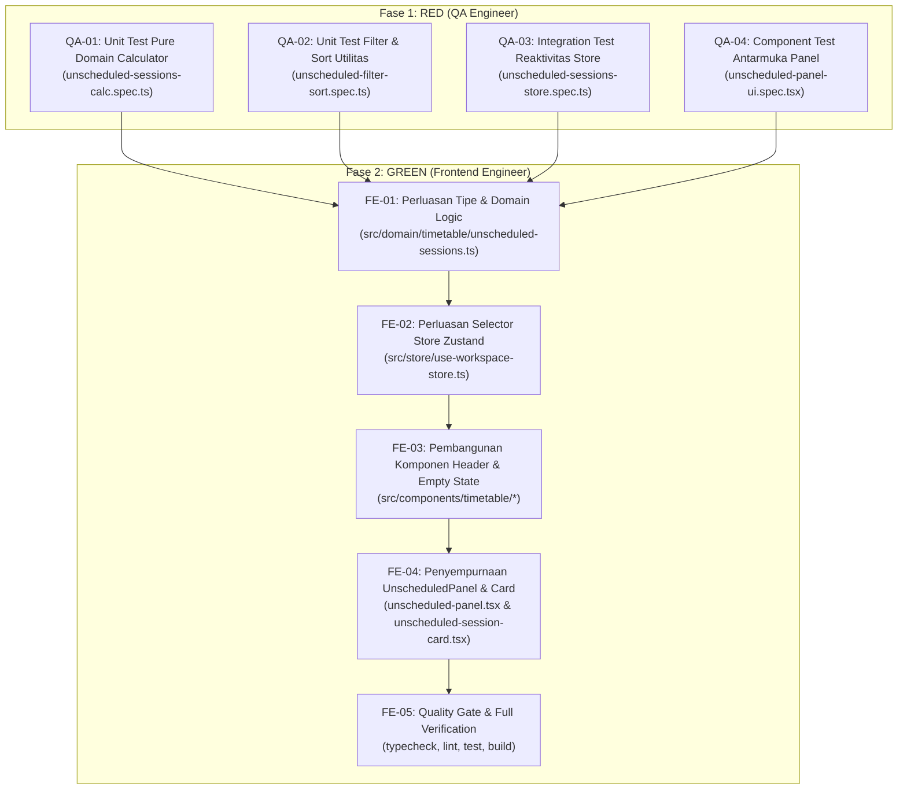

# Spesifikasi Task & Kontrak Teknis: FR-06 — Manajemen Sesi yang Belum Terjadwal

**Kode Fitur:** `FR-06` (Didukung oleh `AC-08`, `FR-04`, `FR-05`, `FR-07`, `FR-10`, `AC-12`, `NFR-01`, `NFR-02`, `NFR-05`)  
**Status:** Siap Dieksekusi (Fase RED -> Fase GREEN)  
**Dokumen Referensi:**
- Product Requirements Document: [`docs/Schedovyn-PRD.md`](../Schedovyn-PRD.md) (Bagian 5, 7, 8, 10, 12)
- Technical Design Document: [`docs/Schedovyn-TDD.md`](../Schedovyn-TDD.md) (Bagian 4.3, 6.1, 7.1)
- Design System & UI Guidelines: [`DESIGN.md`](../../DESIGN.md) (Bagian 4, 5.2)
- Agent Guidelines: [`AGENTS.md`](../../AGENTS.md)
- Task Terkait:
  - [`docs/tasks/FR-01-workspace-and-schedule-config.md`](./FR-01-workspace-and-schedule-config.md)
  - [`docs/tasks/FR-02-master-data-management.md`](./FR-02-master-data-management.md)
  - [`docs/tasks/FR-03-active-class-selection.md`](./FR-03-active-class-selection.md)
  - [`docs/tasks/FR-04-timetable-drag-and-drop-editor.md`](./FR-04-timetable-drag-and-drop-editor.md)
  - [`docs/tasks/FR-05-smart-conflict-detection.md`](./FR-05-smart-conflict-detection.md)

---

## 1. Konteks & Tujuan Fitur

### 1.1 Hasil Telusur `graphify`
Berdasarkan penelusuran arsitektur dan keterhubungan modul:
- **Peran Sesi Belum Terjadwal dalam Alur Kerja Penyusunan:**
  Dalam konsep *Smart Timetable Planner*, pengguna tidak mengetikkan sesi secara manual pada grid dari nol, melainkan menempatkan sesi dari daftar kebutuhan pembelajaran (*Teaching Requirements*) yang telah dikonfigurasi pada menu Data Master ([`docs/Schedovyn-PRD.md#L326-L337`](file:///home/ardi/projects/schedovyn/frontend/docs/Schedovyn-PRD.md#L326-L337)).
- **Fondasi yang Sudah Tersedia:**
  - `TeachingRequirement` dan `TimetableSession` telah terdefinisi di [`src/domain/types/entities.ts`](../../src/domain/types/entities.ts).
  - Skema tabel `requirements` dan `sessions` pada IndexedDB telah aktif di [`src/db/database.ts`](../../src/db/database.ts).
  - Utilitas awal kalkulasi sesi belum terjadwal telah tersedia pada [`src/domain/timetable/unscheduled-sessions.ts`](../../src/domain/timetable/unscheduled-sessions.ts).
  - Komponen awal `UnscheduledPanel` dan `UnscheduledSessionCard` telah dirintis di `src/components/timetable/`.
- **Kekosongan yang Perlu Diimplementasikan pada FR-06:**
  - Belum ada agregasi statistik pemenuhan alokasi per mata pelajaran (`SubjectUnscheduledSummary`) dan persentase kelengkapan kelas aktif (`ClassUnscheduledSummary.overallCompletionPercentage`).
  - Belum ada pembedaan status pemenuhan alokasi kebutuhan (`unfulfilled`, `fulfilled`, `over_scheduled`).
  - Panel belum terjadwal (`UnscheduledPanel`) belum memiliki progress bar visual, filter status pemenuhan alokasi (Semua, Belum Selesai, Selesai), dan opsi pengurutan kartu (Berdasarkan Nama vs Sisa Sesi Terbanyak).
  - Belum ada selector efisien di store Zustand [`src/store/use-workspace-store.ts`](../../src/store/use-workspace-store.ts) untuk rekapitulasi sesi belum terjadwal ruang kerja.
  - Penanganan *empty state* dan *success state* saat seluruh alokasi kebutuhan telah terpenuhi belum optimal.

### 1.2 Referensi Persyaratan
- **FR-06 (Sesi yang Belum Terjadwal — PRD Bagian 5):**
  - **FR-06.1:** Sistem membandingkan jumlah sesi yang dibutuhkan dengan sesi yang telah dijadwalkan secara deterministik.
  - **FR-06.2:** Pengguna dapat mengetahui kebutuhan sesi yang belum terpenuhi untuk kelas aktif secara rinci.
  - **FR-06.3:** Daftar sesi belum terjadwal dapat difilter berdasarkan mata pelajaran dan dicari dengan cepat.
  - **FR-06.4:** Pengguna dapat menarik kartu sesi yang belum terjadwal ke grid (atau menggunakan tombol aksi alternatif keyboard).
  - **FR-06.5:** Setelah sesi ditempatkan ke grid, jumlah sesi tersisa diperbarui secara otomatis dan reaktif.
- **AC-08 (Jadwal Belum Lengkap — PRD Bagian 12):**
  - **Given** suatu kebutuhan mata pelajaran membutuhkan 5 sesi per minggu,
  - **When** baru 3 sesi telah ditempatkan ke grid,
  - **Then** sistem menunjukkan bahwa 2 sesi masih belum terjadwal.
- **TDD Bagian 4.3 (Unscheduled Sessions Model — Derived State):**
  - Tidak menyimpan entitas sesi belum terjadwal ke tabel database statis.
  - Dihitung secara deterministik dari selisih `requirement.sessionsPerWeek` dikurangi jumlah `TimetableSession` yang memiliki `requirementId` terkait.
  - Ketika alokasi `sessionsPerWeek` diubah pada Data Master, jumlah sesi sisa otomatis selaras tanpa risiko duplikasi atau data yatim (*orphaned state*).
- **PRD Bagian 7.3 & DESIGN.md Bagian 5.2 (Aksesibilitas Interaksi & Visual Multi-Cue):**
  - Aksesibilitas keyboard melalui tombol cepat "Tempatkan ke Jadwal".
  - Pewarnaan berbasis `SubjectColorKey` dari mata pelajaran terkait.
  - Angka dan durasi diformat menggunakan gaya `font-mono` / `tabular-nums`.

### 1.3 Masalah Pengguna & Batasan Ruang Lingkup
- **Masalah Pengguna:** Penyusun jadwal sering kesulitan melacak mata pelajaran apa saja yang masih kurang jam mengajarnya dan berapa jam yang sudah masuk ke jadwal kelas. Menampilkan puluhan kartu tanpa indikator progres atau tanpa fitur pencarian/filter membuat proses penempatan sesi membingungkan dan rawan terlewat.
- **Cakupan Dalam Task Ini (In-Scope):**
  1. Penyempurnaan modul domain murni `src/domain/timetable/unscheduled-sessions.ts` untuk mendukung agregasi per mata pelajaran, kalkulasi persentase kelengkapan, dan status pemenuhan kuota.
  2. Penambahan selector Zustand di [`src/store/use-workspace-store.ts`](../../src/store/use-workspace-store.ts) untuk rekapitulasi sesi belum terjadwal kelas aktif dan ruang kerja.
  3. Penyempurnaan antarmuka `src/components/timetable/unscheduled-panel.tsx`:
     - Progress bar visual keterisian jadwal kelas aktif.
     - Kontrol pencarian nama mata pelajaran secara instan.
     - Kontrol filter status alokasi ("Belum Selesai" / "Selesai" / "Semua").
     - Pengurutan kartu (Berdasarkan Nama Mapel A-Z vs Sisa Sesi Terbanyak).
     - State informatif saat alokasi 100% selesai atau saat kelas belum memiliki kebutuhan pembelajaran.
  4. Penyempurnaan kartu `src/components/timetable/unscheduled-session-card.tsx` dengan informasi alokasi yang jelas (`Sesi ke-X dari Y`, sisa sesi, durasi, guru, dan ruangan).
  5. Pengujian unit, integrasi reaktivitas store, dan pengujian komponen UI.
- **Di Luar Cakupan Task Ini (Out-of-Scope):**
  - Perhitungan koordinat piksel grid waktu (`FR-04`, sudah selesai).
  - Algoritma pendeteksi bentrokan waktu lintas kelas (`FR-05`, sudah selesai).
  - Ekspor dokumen cetak PDF dan Excel (`FR-08`, `FR-09`).

---

## 2. Kontrak Data & Arsitektur Teknis

### 2.1 Kontrak Domain Murni (`src/domain/timetable/unscheduled-sessions.ts`)

Seluruh fungsi di dalam modul ini adalah fungsi murni (*pure TypeScript*) tanpa ketergantungan DOM, React, atau IndexedDB:

```typescript
import type {
  TeachingRequirement,
  TimetableSession,
} from "@/domain/types/entities"

export interface UnscheduledSessionItem {
  /** Format unik virtual id: `${requirement.id}::slot-${slotIndex}` */
  virtualId: string
  requirementId: string
  classId: string
  subjectId: string
  defaultTeacherId: string | null
  defaultRoomId: string | null
  durationMinutes: number
  roomRequired: boolean
  notes?: string
  slotIndex: number // Indeks slot (0 .. remainingCount - 1)
  remainingCount: number // Jumlah sesi kebutuhan ini yang belum terjadwal
  totalRequiredCount: number // Nilai sessionsPerWeek asal
}

export type RequirementAllocationStatus =
  | "unfulfilled"   // Sesi terjadwal < sessionsPerWeek
  | "fulfilled"     // Sesi terjadwal === sessionsPerWeek
  | "over_scheduled" // Sesi terjadwal > sessionsPerWeek

export interface SubjectUnscheduledSummary {
  subjectId: string
  requirementId: string
  classId: string
  requiredSessions: number
  scheduledSessions: number
  remainingSessions: number
  durationMinutes: number
  defaultTeacherId: string | null
  defaultRoomId: string | null
  roomRequired: boolean
  notes?: string
  completionPercentage: number // 0 .. 100 (dibulatkan ke bilangan bulat)
  status: RequirementAllocationStatus
}

export interface ClassUnscheduledSummary {
  classId: string
  items: UnscheduledSessionItem[]
  bySubject: SubjectUnscheduledSummary[]
  totalRequiredSessions: number
  totalScheduledSessions: number
  totalRemainingSessions: number
  overallCompletionPercentage: number // 0 .. 100
  isFullyScheduled: boolean
}

/**
 * Menghitung daftar sesi belum terjadwal dan rekapitulasi progres alokasi
 * untuk kelas tertentu berdasarkan kebutuhan pembelajaran dan sesi terjadwal saat ini.
 */
export function calculateUnscheduledSessions(
  requirements: readonly TeachingRequirement[],
  sessions: readonly TimetableSession[],
  classId: string
): ClassUnscheduledSummary

/**
 * Menyaring daftar kartu sesi belum terjadwal berdasarkan kriteria pencarian,
 * mata pelajaran terpilih, dan pengurutan.
 */
export interface UnscheduledFilterOptions {
  searchQuery?: string
  subjectId?: string | null
  statusFilter?: "all" | "unfulfilled_only" | "fulfilled_only"
  sortBy?: "subject_name_asc" | "remaining_desc" | "duration_desc"
}

export function filterAndSortUnscheduledItems(
  items: readonly UnscheduledSessionItem[],
  subjectNameMap: ReadonlyMap<string, string>,
  options: UnscheduledFilterOptions
): UnscheduledSessionItem[]
```

**Aturan Kalkulasi:**
1. Filter `requirements` hanya untuk `req.classId === classId`.
2. Hitung jumlah sesi di `sessions` yang memiliki `ses.requirementId === req.id` (sebut $M$).
3. Alokasi dibutuhkan $N = \text{req.sessionsPerWeek}$.
4. Sisa sesi kebutuhan: $R = \max(0, N - M)$.
5. Persentase penyelesaian mata pelajaran:
   $$\text{completionPercentage} = N > 0 ? \min(100, \text{Math.round}((M / N) \times 100)) : 100$$
6. Status alokasi:
   - Jika $M < N$: `"unfulfilled"`
   - Jika $M === N$: `"fulfilled"`
   - Jika $M > N$: `"over_scheduled"`
7. Persentase penyelesaian keseluruhan kelas:
   $$\text{overallCompletionPercentage} = \text{totalRequired} > 0 ? \min(100, \text{Math.round}((\text{totalScheduled} / \text{totalRequired}) \times 100)) : 100$$
8. `isFullyScheduled`: bernilai `true` jika `totalRequiredSessions > 0` dan `totalRemainingSessions === 0`.

---

### 2.2 Integrasi Selector Zustand Store (`src/store/use-workspace-store.ts`)

Tambahkan fungsi selector dan helper pada `use-workspace-store.ts`:

```typescript
export interface WorkspaceStoreState {
  // ... state sebelumnya ...

  // Selectors FR-06: Sesi Belum Terjadwal
  getActiveClassUnscheduledSummary: () => ClassUnscheduledSummary
  getWorkspaceUnscheduledSummary: () => {
    totalRequiredSessions: number
    totalScheduledSessions: number
    totalRemainingSessions: number
    overallCompletionPercentage: number
    byClassId: Record<string, ClassUnscheduledSummary>
  }
}
```

**Reaktivitas Otomatis:**
- Karena `calculateUnscheduledSessions` berupa fungsi deterministik murni, pemanggilannya di dalam komponen React memanfaatkan *memoization* berbasis dependensi `[requirements, sessions, activeClassId]`.
- Setiap mutasi sesi (`placeUnscheduledSession`, `moveSession`, `removeSession`, `undo`, `redo`) atau perubahan master data (`createTeachingRequirement`, `updateTeachingRequirement`, `deleteTeachingRequirement`) secara otomatis memicu pembaruan nilai sisa sesi tanpa perlu penanganan manual terpisah.

---

### 2.3 Penyempurnaan Komponen Antarmuka (`src/components/timetable/`)

Struktur komponen panel sesi belum terjadwal:
```text
src/components/timetable/
├── unscheduled-panel.tsx            # Kontainer panel kiri: header progres, filter bar, list kartu, quick-place dialog
├── unscheduled-session-card.tsx     # Kartu sesi individual yang draggable (useDraggable)
├── unscheduled-progress-header.tsx  # Header ringkasan: progress bar keterisian, lencana total sisa sesi
└── unscheduled-empty-state.tsx      # Tampilan empty state: semua terjadwal / belum ada kebutuhan
```

**Fitur Antarmuka Utama:**
1. **Header Progres & Status Keterisian (`unscheduled-progress-header.tsx`):**
   - Menampilkan judul "Sesi Belum Terjadwal".
   - Progress bar horizontal yang menunjukkan rasio sesi terjadwal terhadap total kebutuhan (`X dari Y sesi terjadwal - Z%`).
   - Lencana jumlah sisa sesi: `X sesi tersisa`.
2. **Bilah Pencarian & Filter:**
   - Input teks pencarian nama mata pelajaran dengan ikon kaca pembesar dan tombol reset cepat.
   - Filter pill / dropdown status:
     - **"Belum Selesai"** (Default): hanya menampilkan kartu mata pelajaran yang masih memiliki sisa sesi belum terjadwal.
     - **"Semua"**: menampilkan kartu mata pelajaran beserta ringkasan statusnya.
   - Opsi pengurutan (Sort): Nama Mapel (A-Z) atau Sisa Sesi Terbanyak.
3. **Kartu Sesi Belum Terjadwal (`unscheduled-session-card.tsx`):**
   - Garis warna swatch berbasis `SubjectColorKey`.
   - Nama mata pelajaran tebal dengan pemotongan teks rapi (`truncate`).
   - Lencana durasi (`XX menit`) dan indikator kuota (`Sesi X dari Y`).
   - Informasi guru default dan ruangan wajib (jika ditentukan).
   - Drag handle grip vertikal dengan kursor `cursor-grab`.
   - Tombol alternatif keyboard **"Tempatkan ke Jadwal"** untuk membuka dialog penempatan cepat.
4. **State Khusus (Empty & Completed States):**
   - **Kondisi Selesai (100%):** Menampilkan ilustrasi checklist hijau dan teks informatif bahwa seluruh sesi kelas aktif telah berhasil dijadwalkan.
   - **Kondisi Tanpa Kebutuhan:** Menampilkan pesan edukatif bahwa kelas belum memiliki data kebutuhan pembelajaran, disertai tombol tautan langsung menuju menu Data Master Kebutuhan Pembelajaran.
   - **Kondisi Pencarian Kosong:** Menampilkan pesan bahwa tidak ada mata pelajaran yang cocok dengan kata kunci pencarian.

---

## 3. Acceptance Criteria (Given-When-Then)

### AC-FR06-01: Perhitungan Komparasi Kebutuhan dan Sesi Tersisa (FR-06.1 & AC-08)
- **Given** kelas aktif VII-A memiliki kebutuhan mata pelajaran Matematika sebanyak 4 sesi per minggu,
- **When** belum ada sesi Matematika yang ditempatkan ke grid,
- **Then** sistem menghitung bahwa 4 sesi Matematika belum terjadwal,
- **And** panel menampilkan kartu Matematika dengan lencana `"4 sesi tersisa"`,
- **When** pengguna menempatkan 1 sesi Matematika ke grid,
- **Then** sistem secara otomatis memperbarui sisa alokasi Matematika menjadi `"3 sesi tersisa"`,
- **And** total sesi tersisa untuk kelas aktif berkurang 1.

### AC-FR06-02: Visibilitas Progres Kelengkapan Kelas Aktif (FR-06.2)
- **Given** kelas aktif VII-A memiliki total kebutuhan 20 sesi per minggu dari seluruh mata pelajaran,
- **When** 15 sesi telah berhasil ditempatkan ke grid,
- **Then** header panel menampilkan progres `"15 dari 20 sesi terjadwal (75%)"`,
- **And** lencana sisa sesi menampilkan `"5 sesi tersisa"`.

### AC-FR06-03: Penyaringan Berdasarkan Mata Pelajaran (FR-06.3)
- **Given** panel sesi belum terjadwal memuat mata pelajaran "Matematika", "Bahasa Indonesia", dan "Bahasa Inggris",
- **When** pengguna mengetikkan kata kunci `"bahasa"` pada kotak pencarian,
- **Then** daftar kartu langsung tersaring dan hanya menampilkan kartu "Bahasa Indonesia" dan "Bahasa Inggris",
- **When** pengguna mengosongkan kotak pencarian,
- **Then** seluruh kartu sesi belum terjadwal kembali ditampilkan.

### AC-FR06-04: Penarikan Kartu Sesi dan Penempatan Cepat Keyboard (FR-06.4 & PRD 7.3)
- **Given** terdapat kartu sesi belum terjadwal di panel kiri,
- **When** pengguna menarik kartu tersebut menggunakan mouse ke kolom hari dan jam tertentu pada grid,
- **Then** sesi ditempatkan pada waktu tersebut di grid,
- **When** pengguna tidak menggunakan mouse dan menekan tombol "Tempatkan ke Jadwal" pada kartu,
- **Then** sistem membuka dialog penempatan cepat untuk memilih hari dan jam mulai,
- **And** menekan tombol konfirmasi menempatkan sesi ke grid secara akurat.

### AC-FR06-05: Reaktivitas Otomatis saat Mutasi Jadwal (FR-06.5)
- **Given** terdapat 2 sesi IPA yang belum terjadwal,
- **When** pengguna menempatkan 1 sesi IPA ke grid, sisa berkurang menjadi 1 sesi,
- **When** pengguna menekan tombol Undo (`Ctrl + Z`),
- **Then** sesi IPA di grid terhapus dan sisa sesi IPA di panel kiri otomatis kembali menjadi 2 sesi,
- **When** pengguna menekan tombol Redo (`Ctrl + Y`),
- **Then** sesi IPA kembali ke grid dan sisa sesi di panel kiri kembali menjadi 1 sesi.

### AC-FR06-06: Penanganan Perubahan Master Data Alokasi Sesi
- **Given** suatu mata pelajaran memiliki alokasi 3 sesi per minggu dan ketiganya telah dijadwalkan di grid (sisa 0 sesi),
- **When** pengguna mengubah nilai alokasi mata pelajaran tersebut pada menu Data Master menjadi 5 sesi per minggu,
- **Then** saat pengguna kembali ke editor kelas tersebut, panel belum terjadwal otomatis memunculkan 2 sesi baru yang belum terjadwal,
- **And** tidak terjadi duplikasi ID atau ketidakkonsistenan data.

### AC-FR06-07: Penanganan Kondisi Alokasi Terpenuhi (Empty State)
- **Given** seluruh sesi pembelajaran pada kelas aktif telah berhasil ditempatkan ke grid (sisa 0 sesi),
- **When** pengguna melihat panel kiri,
- **Then** panel menampilkan tampilan pesan sukses bahwa seluruh alokasi sesi kelas aktif telah terjadwal dengan rapi,
- **And** tidak ada kartu kosong atau error rendering.

---

## 4. Breakdown Task Eksekusi (TDD Roadmap)



---

### 4.1 Task QA Engineer (Fase RED)

QA Engineer bertugas menulis seluruh skenario pengujian unit, integrasi, dan komponen di dalam folder pengujian hingga seluruh *assertion* siap dan berstatus **FAIL (RED)** sebelum kode produksi disempurnakan:

#### Task QA-01: Unit Test Pure Domain Calculator
- **File:** `src/__tests__/unit/domain/unscheduled-sessions-calc.spec.ts`
- **Cakupan Pengujian:**
  1. Menghitung pool sesi kosong jika tidak ada kebutuhan pembelajaran untuk kelas aktif.
  2. Menghitung alokasi awal saat belum ada sesi di grid: $R = N$, persentase progres 0%, status `"unfulfilled"`.
  3. Menghitung alokasi parsial saat sebagian sesi telah ditempatkan: $R = N - M$ (`AC-08`).
  4. Menghitung alokasi saat seluruh sesi telah terjadwal: $R = 0$, persentase progres 100%, status `"fulfilled"`, dan `isFullyScheduled === true`.
  5. Menangani alokasi berlebih jika sesi di grid melebihi alokasi: $R = 0$, status `"over_scheduled"`.
  6. Menghitung ringkasan per mata pelajaran (`SubjectUnscheduledSummary`) dengan atribut `defaultTeacherId`, `defaultRoomId`, dan `roomRequired` tersalin presisi.
  7. Memastikan isolasi kelas: kebutuhan dan sesi kelas lain tidak memengaruhi pool kelas aktif.

#### Task QA-02: Unit Test Filter & Sort Utilitas
- **File:** `src/__tests__/unit/domain/unscheduled-filter-sort.spec.ts`
- **Cakupan Pengujian:**
  1. Pencarian teks nama mata pelajaran bersifat *case-insensitive* dan mengabaikan spasi berlebih.
  2. Filter berdasarkan `subjectId` tertentu hanya mengembalikan kartu mata pelajaran tersebut.
  3. Filter status pemenuhan:
     - `unfulfilled_only`: hanya mengembalikan kartu yang memiliki sisa sesi belum terjadwal.
     - `fulfilled_only`: hanya mengembalikan kartu dari mata pelajaran yang telah terpenuhi.
     - `all`: mengembalikan seluruh kartu.
  4. Pengurutan kartu:
     - `subject_name_asc`: alfabetis nama mata pelajaran A ke Z.
     - `remaining_desc`: mata pelajaran dengan jumlah sesi sisa terbanyak berada di posisi teratas.
     - `duration_desc`: sesi dengan durasi terpanjang berada di posisi teratas.

#### Task QA-03: Integration Test Reaktivitas Store & Sinkronisasi Mutasi
- **File:** `src/__tests__/integration/unscheduled-sessions-store.spec.ts`
- **Lingkungan:** Vitest + `fake-indexeddb`
- **Cakupan Pengujian:**
  1. Memverifikasi bahwa pemanggilan `placeUnscheduledSession()` langsung mengurangi total sisa sesi pada store (`FR-06.5`).
  2. Memverifikasi bahwa pemanggilan `removeSession()` (unschedule) langsung mengembalikan slot sesi ke pool.
  3. Memverifikasi bahwa aksi `undo()` dan `redo()` memulihkan jumlah sesi tersisa secara tepat dan konsisten (`AC-FR06-05`).
  4. Memverifikasi bahwa pengubahan `sessionsPerWeek` pada data master kebutuhan langsung merefleksikan perubahan jumlah sesi sisa di pool (`AC-FR06-06`).

#### Task QA-04: Component Test Antarmuka UnscheduledPanel
- **File:** `src/__tests__/components/unscheduled-panel-ui.spec.tsx`
- **Lingkungan:** Vitest + `@testing-library/react` + `@testing-library/user-event`
- **Cakupan Pengujian:**
  1. Render progress bar alokasi sesi kelas aktif dengan persentase dan teks yang benar (`AC-FR06-02`).
  2. Input teks pencarian menyaring daftar kartu secara instan (`AC-FR06-03`).
  3. Klik tombol filter status alokasi ("Belum Selesai" vs "Selesai") memperbarui daftar kartu yang tampil.
  4. Tombol cepat keyboard "Tempatkan ke Jadwal" pada kartu membuka dialog penempatan dan berhasil mengirimkan mutasi saat dikonfirmasi (`AC-FR06-04`).
  5. Menampilkan tampilan pesan sukses saat seluruh sesi kelas telah terjadwal (`AC-FR06-07`).
  6. Menampilkan tampilan edukatif saat kelas belum memiliki data kebutuhan pembelajaran.

---

### 4.2 Task Frontend Engineer (Fase GREEN)

Frontend Engineer bertugas mengimplementasikan modul domain murni, store selector, dan penyempurnaan komponen UI hingga seluruh test QA lulus (**GREEN**):

#### Task FE-01: Penyempurnaan Tipe & Domain Logic
- Buka dan perbarui `src/domain/timetable/unscheduled-sessions.ts`:
  - Tambahkan tipe `SubjectUnscheduledSummary`, `RequirementAllocationStatus`, dan perbarui `ClassUnscheduledSummary`.
  - Implementasikan penghitungan `bySubject`, persentase kelengkapan per mapel, status alokasi, persentase kelengkapan total kelas, dan flag `isFullyScheduled`.
  - Implementasikan fungsi murni `filterAndSortUnscheduledItems`.
- Jalankan `bun test src/__tests__/unit/domain/unscheduled-sessions-calc.spec.ts` dan `src/__tests__/unit/domain/unscheduled-filter-sort.spec.ts` hingga lulus (**GREEN**).

#### Task FE-02: Selector Zustand Store
- Buka `src/store/use-workspace-store.ts`:
  - Tambahkan fungsi selector `getActiveClassUnscheduledSummary` dan `getWorkspaceUnscheduledSummary`.
- Jalankan `bun test src/__tests__/integration/unscheduled-sessions-store.spec.ts` hingga lulus (**GREEN**).

#### Task FE-03: Komponen Header Progres & Empty State
- Buat komponen pendukung di `src/components/timetable/`:
  - `unscheduled-progress-header.tsx`: Menampilkan bar progres visual rasio keterisian alokasi jam belajar kelas aktif.
  - `unscheduled-empty-state.tsx`: Menangani tampilan kondisi seluruh sesi terpenuhi dan kondisi kelas belum memiliki konfigurasi kebutuhan.

#### Task FE-04: Penyempurnaan UnscheduledPanel & Kartu Sesi
- Perbarui `src/components/timetable/unscheduled-panel.tsx`:
  - Integrasikan progress bar header.
  - Tambahkan bilah filter status alokasi ("Belum Selesai" / "Selesai" / "Semua") dan kontrol pengurutan kartu.
  - Hubungkan fungsi pencarian dan filter dengan `filterAndSortUnscheduledItems`.
- Perbarui `src/components/timetable/unscheduled-session-card.tsx`:
  - Pertegas lencana kuota (`Sesi X dari Y`) dan teks informasi alokasi sisa.
  - Pastikan drag-handle dan tombol penempatan cepat keyboard berfungsi harmonis.
- Jalankan `bun test src/__tests__/components/unscheduled-panel-ui.spec.tsx` hingga lulus (**GREEN**).

#### Task FE-05: Verifikasi Quality Gate
Jalankan verifikasi lengkap:
```bash
bun run typecheck
bun run lint
bun test
bun run build
```
Pastikan seluruh pemeriksaan menghasilkan **0 error**, tanpa kompromi tipe `any`, dan tampilan antarmuka selaras dengan panduan `DESIGN.md`.

---

## 5. Ringkasan File Terdampak

| File Path | Tipe Perubahan | Penanggung Jawab |
|---|---|---|
| `src/__tests__/unit/domain/unscheduled-sessions-calc.spec.ts` | Berkas Baru (Unit Test) | QA Engineer |
| `src/__tests__/unit/domain/unscheduled-filter-sort.spec.ts` | Berkas Baru (Unit Test) | QA Engineer |
| `src/__tests__/integration/unscheduled-sessions-store.spec.ts` | Berkas Baru (Integration Test) | QA Engineer |
| `src/__tests__/components/unscheduled-panel-ui.spec.tsx` | Berkas Baru (Component Test) | QA Engineer |
| `src/domain/timetable/unscheduled-sessions.ts` | Modifikasi (Penyempurnaan Domain) | Frontend Engineer |
| `src/store/use-workspace-store.ts` | Modifikasi (Selector Rekapitulasi) | Frontend Engineer |
| `src/components/timetable/unscheduled-progress-header.tsx` | Berkas Baru (Komponen UI) | Frontend Engineer |
| `src/components/timetable/unscheduled-empty-state.tsx` | Berkas Baru (Komponen UI) | Frontend Engineer |
| `src/components/timetable/unscheduled-panel.tsx` | Modifikasi (Penyempurnaan Panel) | Frontend Engineer |
| `src/components/timetable/unscheduled-session-card.tsx` | Modifikasi (Penyempurnaan Kartu) | Frontend Engineer |
| `docs/tasks/FR-06-unscheduled-sessions-management.md` | Berkas Baru (Spesifikasi Task) | Product Manager / Architect |
