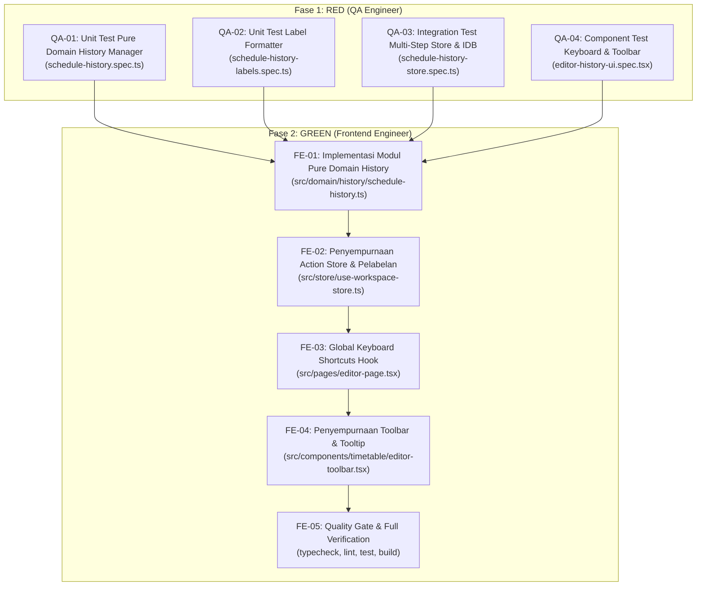

# Spesifikasi Task & Kontrak Teknis: FR-07 — Manajemen Riwayat Jadwal (Undo dan Redo)

**Kode Fitur:** `FR-07` (Didukung oleh `FR-04`, `FR-05`, `FR-06`, `FR-10`, `AC-07`, `AC-12`, `NFR-01`, `NFR-02`, `NFR-05`)  
**Status:** Siap Dieksekusi (Fase RED -> Fase GREEN)  
**Dokumen Referensi:**
- Product Requirements Document: [`docs/Schedovyn-PRD.md`](../Schedovyn-PRD.md) (Bagian 5, 7, 8, 10, 12)
- Technical Design Document: [`docs/Schedovyn-TDD.md`](../Schedovyn-TDD.md) (Bagian 7.1, 7.2)
- Design System & UI Guidelines: [`DESIGN.md`](../../DESIGN.md) (Bagian 4, 5.2)
- Agent Guidelines: [`AGENTS.md`](../../AGENTS.md)
- Task Terkait:
  - [`docs/tasks/FR-01-workspace-and-schedule-config.md`](./FR-01-workspace-and-schedule-config.md)
  - [`docs/tasks/FR-02-master-data-management.md`](./FR-02-master-data-management.md)
  - [`docs/tasks/FR-03-active-class-selection.md`](./FR-03-active-class-selection.md)
  - [`docs/tasks/FR-04-timetable-drag-and-drop-editor.md`](./FR-04-timetable-drag-and-drop-editor.md)
  - [`docs/tasks/FR-05-smart-conflict-detection.md`](./FR-05-smart-conflict-detection.md)
  - [`docs/tasks/FR-06-unscheduled-sessions-management.md`](./FR-06-unscheduled-sessions-management.md)

---

## 1. Konteks & Tujuan Fitur

### 1.1 Hasil Telusur `graphify`
Berdasarkan penelusuran arsitektur dan keterhubungan modul:
- **Peran Undo dan Redo dalam Editor Jadwal:**
  Penyusunan jadwal sekolah adalah proses eksploratif (*trial-and-error*). Penyusun jadwal sering mencoba memindahkan sesi ke hari atau jam tertentu untuk melihat dampaknya terhadap jadwal guru lain. Jika penempatan tersebut memicu bentrokan waktu lintas kelas, pengguna harus dapat kembali ke susunan jadwal sebelumnya dalam satu klik atau pintasan tombol ([`docs/Schedovyn-PRD.md#L338-L351`](file:///home/ardi/projects/schedovyn/frontend/docs/Schedovyn-PRD.md#L338-L351)).
- **Fondasi yang Sudah Tersedia:**
  - Struktur snapshot riwayat telah dirintis pada [`src/store/use-workspace-store.ts`](../../src/store/use-workspace-store.ts#L85-L86) (`historyPast` dan `historyFuture`).
  - Method persistensi massal `batchSaveTimetableSessions` telah tersedia pada repositori [`src/db/workspace-repository.ts`](../../src/db/workspace-repository.ts).
  - Tombol dasar Undo dan Redo telah terpasang pada [`src/components/timetable/editor-toolbar.tsx`](../../src/components/timetable/editor-toolbar.tsx).
- **Kekosongan yang Perlu Diimplementasikan pada FR-07:**
  - Belum ada modul domain murni untuk manipulasi struktur data riwayat (`src/domain/history/schedule-history.ts`) dengan penegakan batas 50 langkah (FIFO) dan pemotongan cabang masa depan yang terisolasi dari React.
  - Pelabelan tindakan (`actionLabel`) saat ini masih bersifat generik (seperti `"Aksi Jadwal"` atau `"Current State"`) dan belum deskriptif menyebutkan nama mata pelajaran, hari, atau jam.
  - Belum ada *global keyboard shortcuts listener* pada kanvas editor (`EditorPage`) untuk menangani `Ctrl+Z`, `Ctrl+Y`, dan `Ctrl+Shift+Z` dengan pengamanan agar tidak berkonflik saat pengguna mengetik pada elemen form input.
  - Tooltip tombol pada toolbar belum menampilkan keterangan aksi apa yang akan dibatalkan/diulang.
  - Penanganan sinkronisasi status seleksi sesi (`selectedSessionId`) saat sesi yang sedang aktif dibatalkan keberadaannya belum diuji secara mendalam.

### 1.2 Referensi Persyaratan
- **FR-07 (Undo dan Redo — PRD Bagian 5):**
  - Pengguna dapat membatalkan (*undo*) atau mengulangi (*redo*) perubahan jadwal yang sebelumnya dilakukan.
  - Perubahan yang dapat dibatalkan mencakup:
    1. Penambahan sesi (dari pool belum terjadwal ke grid).
    2. Pemindahan sesi (antar waktu atau antar hari).
    3. Perubahan hari atau waktu sesi.
    4. Perubahan guru atau ruangan sesi.
    5. Penghapusan sesi (melepas sesi dari grid kembali ke pool).
  - **Kalkulasi Ulang Validasi:** *"Setelah undo atau redo, sistem harus menghitung ulang hasil validasi."*
- **TDD Bagian 7.1 (Arsitektur Undo dan Redo):**
  - Menggunakan struktur tumpukan `HistoryState`: `past` dan `future`.
  - Tumpukan `past` dibatasi maksimal 50 entri secara FIFO (*First-In, First-Out*).
  - Setiap mutasi baru wajib mengosongkan tumpukan `future`.
  - Saat `undo` atau `redo` dieksekusi, state `sessions` diganti dengan snapshot terkait, `evaluateWorkspaceValidation()` dijalankan secara sinkron, dan perubahan disinkronkan ke IndexedDB dalam satu transaksi.
- **NFR-02 (Keandalan Data):**
  - Undo dan redo harus mengembalikan kondisi jadwal secara konsisten dan tidak boleh menyebabkan status konflik menjadi basi (*stale validation report*).
- **PRD Bagian 7.3 & DESIGN.md Bagian 5.2 (Aksesibilitas Interaksi):**
  - Tombol toolbar memiliki status `disabled` yang jelas ketika tidak ada riwayat yang dapat dibatalkan atau diulang.
  - Mendukung pintasan keyboard universal `Ctrl+Z` / `Cmd+Z` dan `Ctrl+Y` / `Ctrl+Shift+Z` / `Cmd+Shift+Z`.

### 1.3 Masalah Pengguna & Batasan Ruang Lingkup
- **Masalah Pengguna:** Pengguna khawatir melakukan kesalahan ketika bereksperimen dengan penataan jadwal. Tanpa mekanisme undo/redo yang andal dan transparan, pengguna harus mengingat secara manual posisi jam sebelum dipindahkan atau terpaksa menyusun ulang dari awal.
- **Cakupan Dalam Task Ini (In-Scope):**
  1. Pembuatan modul domain murni `src/domain/history/schedule-history.ts` yang mengelola tumpukan snapshot riwayat, kapasitas batas 50 langkah, pemotongan cabang, dan pembentukan label tindakan deskriptif.
  2. Integrasi pelabelan tindakan yang informatif Bahasa Indonesia pada setiap mutasi jadwal di [`src/store/use-workspace-store.ts`](../../src/store/use-workspace-store.ts).
  3. Penyempurnaan alur `undo()` dan `redo()` di store dengan validasi instan, pembersihan seleksi sesi yang tidak valid, dan persistensi transaksional ke IndexedDB.
  4. Pemasangan hook *global keyboard listener* di [`src/pages/editor-page.tsx`](../../src/pages/editor-page.tsx) dengan deteksi fokus input form.
  5. Penyempurnaan tombol toolbar di [`src/components/timetable/editor-toolbar.tsx`](../../src/components/timetable/editor-toolbar.tsx) dengan tooltip aksi deskriptif dan pintasan tombol.
  6. Pengujian menyeluruh unit domain history, integrasi multi-step store, dan pengujian interaksi komponen UI.
- **Di Luar Cakupan Task Ini (Out-of-Scope):**
  - Riwayat undo/redo untuk konfigurasi ruang kerja atau form data master (undo/redo difokuskan khusus pada kanvas penyusunan jadwal pembelajaran sesuai FR-07).
  - Sinkronisasi riwayat ke server (aplikasi 100% *Local-First* tanpa backend).

---

## 2. Kontrak Data & Arsitektur Teknis

### 2.1 Kontrak Modul Domain Riwayat Murni (`src/domain/history/schedule-history.ts`)

Modul ini adalah *pure TypeScript* tanpa efek samping, tanpa ketergantungan pada React, DOM, atau IndexedDB:

```typescript
import type { TimetableSession } from "@/domain/types/entities"

/** Batas maksimal langkah riwayat yang disimpan di memori */
export const MAX_HISTORY_STEPS = 50

export interface ScheduleHistorySnapshot {
  actionLabel: string // Contoh: "Tempatkan Matematika ke Senin 07:30"
  timestamp: number
  sessions: TimetableSession[]
}

export interface ScheduleHistoryState {
  past: ScheduleHistorySnapshot[]
  future: ScheduleHistorySnapshot[]
}

/**
 * Membuat state riwayat jadwal awal yang bersih.
 */
export function createInitialHistoryState(): ScheduleHistoryState

/**
 * Mencatat langkah baru ke dalam riwayat:
 * 1. Mendorong salinan imutabel sessions saat ini ke bagian akhir tumpukan past.
 * 2. Membatasi panjang tumpukan past maksimal MAX_HISTORY_STEPS (membuang entri tertua).
 * 3. Mengosongkan tumpukan future (pemotongan cabang masa depan).
 */
export function recordHistoryStep(
  history: ScheduleHistoryState,
  currentSessions: readonly TimetableSession[],
  actionLabel: string
): ScheduleHistoryState

/**
 * Menjalankan operasi Undo:
 * 1. Mengambil snapshot terakhir dari past.
 * 2. Mendorong state sessions saat ini ke bagian depan future.
 * 3. Mengembalikan state history baru dan array sessions yang dipulihkan.
 * Mengembalikan null jika tumpukan past kosong.
 */
export function performHistoryUndo(
  history: ScheduleHistoryState,
  currentSessions: readonly TimetableSession[],
  currentActionLabel?: string
): {
  nextHistory: ScheduleHistoryState
  restoredSessions: TimetableSession[]
  restoredActionLabel: string
} | null

/**
 * Menjalankan operasi Redo:
 * 1. Mengambil snapshot pertama dari future.
 * 2. Mendorong state sessions saat ini ke bagian akhir past.
 * 3. Mengembalikan state history baru dan array sessions yang dipulihkan.
 * Mengembalikan null jika tumpukan future kosong.
 */
export function performHistoryRedo(
  history: ScheduleHistoryState,
  currentSessions: readonly TimetableSession[],
  currentActionLabel?: string
): {
  nextHistory: ScheduleHistoryState
  restoredSessions: TimetableSession[]
  restoredActionLabel: string
} | null

/**
 * Membentuk label tindakan Bahasa Indonesia yang deskriptif untuk berbagai jenis mutasi jadwal.
 */
export interface ActionLabelParams {
  type: "place" | "move" | "update_details" | "update_time" | "remove"
  subjectName?: string
  dayLabel?: string
  timeRange?: string
  extraDetail?: string
}

export function formatScheduleActionLabel(params: ActionLabelParams): string
```

**Aturan Pembentukan Label Tindakan:**
- **Penempatan:** `"Tempatkan {Mapel} ke {Hari} {Jam}"`
- **Pemindahan:** `"Pindahkan {Mapel} ke {Hari} {Jam}"`
- **Ubah Waktu:** `"Ubah jam {Mapel} menjadi {Hari} {Jam}"`
- **Ubah Guru/Ruangan:** `"Ubah detail {Mapel} ({Keterangan})"`
- **Pelepasan Sesi:** `"Lepas sesi {Mapel} dari grid"`

---

### 2.2 Integrasi Zustand Store (`src/store/use-workspace-store.ts`)

Perbarui state dan actions pada `use-workspace-store.ts`:

```typescript
export interface WorkspaceStoreState {
  // ... state sebelumnya ...
  historyPast: ScheduleHistorySnapshot[]
  historyFuture: ScheduleHistorySnapshot[]

  // Action FR-07: Undo dan Redo
  undo: () => Promise<boolean>
  redo: () => Promise<boolean>
  canUndo: () => boolean
  canRedo: () => boolean

  // Selectors Riwayat
  getUndoActionLabel: () => string | null
  getRedoActionLabel: () => string | null
}
```

**Alur Mutasi Jadwal dengan Pencatatan Riwayat:**
1. Setiap aksi mutasi (`placeUnscheduledSession`, `moveSession`, `updateSessionDetails`, `removeSession`):
   - Susun label deskriptif menggunakan `formatScheduleActionLabel`.
   - Perbarui tumpukan riwayat menggunakan `recordHistoryStep`.
   - Terapkan array `nextSessions` baru.
   - Jalankan `runValidation({ sessions: nextSessions })` secara sinkron.
   - Simpan ke IndexedDB via `workspaceRepo.saveTimetableSession` atau `workspaceRepo.deleteTimetableSession`.
2. Saat `undo()` dipanggil:
   - Ambil snapshot dari `historyPast` menggunakan `performHistoryUndo`.
   - Update `historyPast` dan `historyFuture`.
   - Setel `sessions = restoredSessions`.
   - Normalisasi `selectedSessionId`: periksa apakah `selectedSessionId` masih ada di `restoredSessions`. Jika tidak, setel ke `null`.
   - Jalankan `runValidation({ sessions: restoredSessions })` secara sinkron.
   - Panggil `workspaceRepo.batchSaveTimetableSessions(workspace, restoredSessions)` ke IndexedDB.
3. Saat `redo()` dipanggil:
   - Ambil snapshot dari `historyFuture` menggunakan `performHistoryRedo`.
   - Update `historyPast` dan `historyFuture`.
   - Setel `sessions = restoredSessions`.
   - Jalankan `runValidation({ sessions: restoredSessions })` secara sinkron.
   - Panggil `workspaceRepo.batchSaveTimetableSessions(workspace, restoredSessions)` ke IndexedDB.

---

### 2.3 Listener Pintasan Keyboard Global (`src/pages/editor-page.tsx`)

Pasang hook penangkap tombol keyboard di tingkat halaman:

```typescript
// Aturan penanganan keyboard global pada EditorPage:
const handleGlobalKeyDown = (event: KeyboardEvent) => {
  // Cegah intervensi saat pengguna mengetik di form kontrol
  const target = event.target as HTMLElement | null
  if (
    target &&
    (target.tagName === "INPUT" ||
      target.tagName === "TEXTAREA" ||
      target.tagName === "SELECT" ||
      target.isContentEditable)
  ) {
    return
  }

  const isModifier = event.ctrlKey || event.metaKey

  // Pintasan Undo: Ctrl + Z atau Cmd + Z (tanpa Shift)
  if (isModifier && event.key.toLowerCase() === "z" && !event.shiftKey) {
    event.preventDefault()
    if (canUndo) {
      void undo()
    }
    return
  }

  // Pintasan Redo: Ctrl + Y atau Ctrl + Shift + Z atau Cmd + Shift + Z
  if (
    isModifier &&
    (event.key.toLowerCase() === "y" ||
      (event.key.toLowerCase() === "z" && event.shiftKey))
  ) {
    event.preventDefault()
    if (canRedo) {
      void redo()
    }
    return
  }
}
```

---

### 2.4 Penyempurnaan Bilah Toolbar (`src/components/timetable/editor-toolbar.tsx`)

Penyempurnaan tombol aksi pada `EditorToolbar`:
1. **Tombol Batal Perubahan (Undo):**
   - Ikon `Undo2Icon`.
   - Disabled jika `historyPast.length === 0`.
   - Tooltip / title dinamis:
     - Jika aktif: `"Batalkan: {undoActionLabel} (Ctrl+Z)"`.
     - Jika nonaktif: `"Tidak ada perubahan yang dapat dibatalkan"`.
2. **Tombol Ulangi Perubahan (Redo):**
   - Ikon `Redo2Icon`.
   - Disabled jika `historyFuture.length === 0`.
   - Tooltip / title dinamis:
     - Jika aktif: `"Ulangi: {redoActionLabel} (Ctrl+Y)"`.
     - Jika nonaktif: `"Tidak ada perubahan yang dapat diulangi"`.
3. **Indikator Langkah Riwayat:**
   - Teks ringkas: `Riwayat: {historyPast.length} langkah tersimpan` dengan penataan `tabular-nums`.

---

## 3. Acceptance Criteria (Given-When-Then)

### AC-FR07-01: Pembatalan Penambahan Sesi (Undo Placement)
- **Given** pengguna baru saja menempatkan sesi Matematika ke hari Senin pukul 07:30,
- **When** pengguna menekan tombol Undo atau pintasan `Ctrl + Z`,
- **Then** sesi Matematika terhapus dari grid hari Senin,
- **And** slot sesi Matematika otomatis kembali ke panel sesi belum terjadwal,
- **And** status validasi dan penyimpanan lokal IndexedDB diperbarui secara sinkron.

### AC-FR07-02: Pengulangan Penambahan Sesi (Redo Placement)
- **Given** pengguna telah membatalkan penempatan sesi Matematika di hari Senin pukul 07:30,
- **When** pengguna menekan tombol Redo atau pintasan `Ctrl + Y` (`Ctrl + Shift + Z`),
- **Then** sesi Matematika kembali ditempatkan pada hari Senin pukul 07:30,
- **And** slot sesi Matematika pada panel sesi belum terjadwal berkurang 1.

### AC-FR07-03: Pembatalan Pemindahan Sesi Antar-Waktu dan Hari
- **Given** sesi IPA berada di hari Senin pukul 08:15–09:45,
- **When** pengguna memindahkan sesi tersebut ke hari Selasa pukul 09:00–10:30,
- **And** pengguna menekan tombol Undo (`Ctrl + Z`),
- **Then** sesi IPA kembali ke posisi semula di hari Senin pukul 08:15–09:45 dengan durasi dan ID yang sama.

### AC-FR07-04: Pembatalan Perubahan Detail Atribut Sesi
- **Given** sesi Bahasa Inggris diubah gurunya dari "Siti Aminah" menjadi "Budi Santoso",
- **When** pengguna membatalkan perubahan melalui Undo,
- **Then** guru yang ditugaskan pada sesi Bahasa Inggris kembali menjadi "Siti Aminah".

### AC-FR07-05: Pembatalan Penghapusan Sesi (Undo Remove/Unschedule)
- **Given** pengguna menghapus (*unschedule*) sebuah sesi dari grid sehingga kembali ke panel belum terjadwal,
- **When** pengguna menekan tombol Undo,
- **Then** sesi tersebut dipulihkan kembali ke waktu dan hari semula pada grid,
- **And** slot sesi terkait pada panel belum terjadwal ditarik kembali.

### AC-FR07-06: Perhitungan Ulang Validasi Konflik Sinkron (FR-07 Explicit Rule)
- **Given** pemindahan sesi menyebabkan bentrokan guru (`TEACHER_OVERLAP`) dan status validasi menjadi `CONFLICT_DETECTED`,
- **When** pengguna menekan tombol Undo,
- **Then** sesi kembali ke posisi bebas bentrokan,
- **And** sistem seketika menghitung ulang validasi tanpa penundaan,
- **And** konflik tersebut langsung terhapus dan status validasi kembali normal (`NO_CONFLICT_CURRENT_DATA` atau `INCOMPLETE`).

### AC-FR07-07: Batasan Maksimal 50 Langkah Riwayat (FIFO Truncation)
- **Given** pengguna telah melakukan 50 tindakan pengubahan jadwal,
- **When** pengguna melakukan tindakan ke-51,
- **Then** tumpukan riwayat tetap berjumlah 50 langkah dengan membuang snapshot pertama (tertua),
- **And** pengguna dapat melakukan undo sebanyak 50 kali berturut-turut hingga titik awal tersebut.

### AC-FR07-08: Pemotongan Cabang Masa Depan saat Aksi Baru (Future Truncation)
- **Given** pengguna melakukan 3 mutasi (A, B, C), lalu melakukan undo sebanyak 2 kali (kembali ke kondisi A; future memuat B dan C),
- **When** pengguna melakukan aksi baru D,
- **Then** tumpukan future dikosongkan seluruhnya,
- **And** tombol Redo menjadi nonaktif (`disabled`).

### AC-FR07-09: Isolasi Pintasan Keyboard pada Elemen Formulir
- **Given** pengguna sedang mengetikkan catatan sesi di dalam textarea atau kotak pencarian mata pelajaran,
- **When** pengguna menekan tombol `Ctrl + Z`,
- **Then** operasi undo diterapkan pada teks di dalam input/textarea tersebut,
- **And** sistem **tidak** membatalkan penempatan blok sesi jadwal pada kanvas.

---

## 4. Breakdown Task Eksekusi (TDD Roadmap)



---

### 4.1 Task QA Engineer (Fase RED)

QA Engineer bertugas menulis seluruh skenario pengujian unit, integrasi, dan komponen di dalam folder pengujian hingga seluruh *assertion* siap dan berstatus **FAIL (RED)** sebelum kode produksi disempurnakan:

#### Task QA-01: Unit Test Pure Domain History Manager
- **File:** `src/__tests__/unit/domain/schedule-history.spec.ts`
- **Cakupan Pengujian:**
  1. Inisialisasi tumpukan riwayat kosong (`past: []`, `future: []`).
  2. Merekam snapshot baru: memverifikasi salinan imutabel sesi masuk ke `past` dan `future` dikosongkan.
  3. Membatasi kapasitas maksimal 50 langkah (FIFO: langkah tertua terbuang saat langkah ke-51 masuk).
  4. Eksekusi `performHistoryUndo`:
     - Mengembalikan sesi sebelumnya dan memindahkan kondisi saat ini ke tumpukan `future`.
     - Mengembalikan `null` jika `past` kosong.
  5. Eksekusi `performHistoryRedo`:
     - Mengembalikan sesi berikutnya dan memindahkan kondisi saat ini ke tumpukan `past`.
     - Mengembalikan `null` jika `future` kosong.
  6. Aksi baru setelah undo memotong seluruh cabang masa depan (*future truncation*).

#### Task QA-02: Unit Test Action Label Formatter
- **File:** `src/__tests__/unit/domain/schedule-history-labels.spec.ts`
- **Cakupan Pengujian:**
  1. Format label penempatan: `"Tempatkan Matematika ke Senin 07:30"`.
  2. Format label pemindahan: `"Pindahkan IPA ke Selasa 09:00"`.
  3. Format label ubah waktu: `"Ubah jam Bahasa Inggris menjadi 08:00 - 09:30"`.
  4. Format label ubah guru/ruangan: `"Ubah guru Matematika menjadi Budi Santoso"`.
  5. Format label pelepasan sesi: `"Lepas sesi Seni Budaya dari grid"`.
  6. Penanganan fallback jika nama mata pelajaran atau hari tidak disediakan.

#### Task QA-03: Integration Test Multi-Step Store & Persistensi IDB
- **File:** `src/__tests__/integration/schedule-history-store.spec.ts`
- **Lingkungan:** Vitest + `fake-indexeddb`
- **Cakupan Pengujian:**
  1. Rangkaian mutasi berturut-turut: tambah sesi A -> pindah sesi A -> tambah sesi B -> ubah guru B -> hapus sesi A.
  2. Membatalkan langkah demi langkah via `undo()`: memverifikasi bahwa state sesi pada setiap langkah kembali presisi seperti semula.
  3. Mengulangi langkah demi langkah via `redo()`: memverifikasi seluruh langkah terpulihkan kembali.
  4. Kalkulasi ulang validasi sinkron: memverifikasi bahwa bentrokan guru yang dipulihkan lewat redo langsung menghasilkan status `CONFLICT_DETECTED`, dan dibatalkan lewat undo langsung mengembalikan status bebas konflik (`AC-FR07-06`).
  5. Normalisasi `selectedSessionId`: jika sesi yang sedang dipilih dibatalkan penempatannya via undo, `selectedSessionId` otomatis dinolkan (`null`).
  6. Persistensi atomik: memastikan `batchSaveTimetableSessions` tersimpan dengan benar ke database Dexie IndexedDB.

#### Task QA-04: Component Test Toolbar & Global Keyboard Shortcuts
- **File:** `src/__tests__/components/editor-history-ui.spec.tsx`
- **Lingkungan:** Vitest + `@testing-library/react` + `@testing-library/user-event`
- **Cakupan Pengujian:**
  1. Tombol Undo dan Redo pada `EditorToolbar` disabled saat tumpukan kosong.
  2. Tombol Undo aktif setelah penempatan sesi dan menampilkan tooltip deskriptif tindakan.
  3. Menekan `Ctrl + Z` pada kanvas editor memicu pemanggilan `undo()`.
  4. Menekan `Ctrl + Y` atau `Ctrl + Shift + Z` memicu pemanggilan `redo()`.
  5. Isolasi form: saat elemen `<input>` atau `<textarea>` aktif, pintasan `Ctrl + Z` tidak memicu undo pada jadwal.
  6. Teks ringkasan langkah riwayat (`Riwayat: X langkah tersimpan`) diperbarui secara tepat.

---

### 4.2 Task Frontend Engineer (Fase GREEN)

Frontend Engineer bertugas mengimplementasikan modul domain murni, store actions, dan antarmuka visual hingga seluruh test QA lulus (**GREEN**):

#### Task FE-01: Implementasi Modul Pure Domain History
- Buat berkas `src/domain/history/schedule-history.ts` sesuai kontrak Bagian 2.1.
- Terapkan fungsi `recordHistoryStep`, `performHistoryUndo`, `performHistoryRedo`, dan `formatScheduleActionLabel`.
- Jalankan `bun test src/__tests__/unit/domain/schedule-history.spec.ts` dan `src/__tests__/unit/domain/schedule-history-labels.spec.ts` hingga lulus (**GREEN**).

#### Task FE-02: Penyempurnaan Action Store & Pelabelan Mutasi
- Buka `src/store/use-workspace-store.ts`:
  - Hubungkan `formatScheduleActionLabel` dan `recordHistoryStep` ke dalam `placeUnscheduledSession`, `moveSession`, `updateSessionDetails`, dan `removeSession`.
  - Sempurnakan method `undo()` dan `redo()` menggunakan utilitas domain `performHistoryUndo` dan `performHistoryRedo`.
  - Pastikan `runValidation({ sessions: targetSessions })` dijalankan seketika.
  - Tambahkan selector `getUndoActionLabel()` dan `getRedoActionLabel()`.
  - Pastikan `selectedSessionId` dinormalisasi menjadi `null` jika ID sesi tidak ada di array sesi hasil pemulihan.
- Jalankan `bun test src/__tests__/integration/schedule-history-store.spec.ts` hingga lulus (**GREEN**).

#### Task FE-03: Listener Global Keyboard Shortcuts
- Buka `src/pages/editor-page.tsx`:
  - Pasang hook listener `useEffect` pada `window` untuk menangkap `keydown`.
  - Tangani kombinasi `Ctrl+Z` / `Cmd+Z` dan `Ctrl+Y` / `Ctrl+Shift+Z` / `Cmd+Shift+Z`.
  - Tambahkan proteksi filter elemen aktif form (`input`, `textarea`, `select`, `isContentEditable`).

#### Task FE-04: Penyempurnaan Toolbar & Tooltip
- Buka `src/components/timetable/editor-toolbar.tsx`:
  - Hubungkan tombol Batal dan Ulangi dengan tooltip / title dinamis yang mencantumkan label aksi yang akan dibatalkan/diulang.
  - Pastikan tombol nonaktif (`disabled`) secara akurat jika `historyPast.length === 0` atau `historyFuture.length === 0`.
- Jalankan `bun test src/__tests__/components/editor-history-ui.spec.tsx` hingga lulus (**GREEN**).

#### Task FE-05: Verifikasi Quality Gate
Jalankan verifikasi lengkap:
```bash
bun run typecheck
bun run lint
bun test
bun run build
```
Pastikan seluruh pemeriksaan menghasilkan **0 error**, tanpa kompromi tipe `any`, dan tampilan antarmuka selaras dengan panduan `DESIGN.md`.

---

## 5. Ringkasan File Terdampak

| File Path | Tipe Perubahan | Penanggung Jawab |
|---|---|---|
| `src/__tests__/unit/domain/schedule-history.spec.ts` | Berkas Baru (Unit Test) | QA Engineer |
| `src/__tests__/unit/domain/schedule-history-labels.spec.ts` | Berkas Baru (Unit Test) | QA Engineer |
| `src/__tests__/integration/schedule-history-store.spec.ts` | Berkas Baru (Integration Test) | QA Engineer |
| `src/__tests__/components/editor-history-ui.spec.tsx` | Berkas Baru (Component Test) | QA Engineer |
| `src/domain/history/schedule-history.ts` | Berkas Baru (Domain Logic) | Frontend Engineer |
| `src/store/use-workspace-store.ts` | Modifikasi (Penyempurnaan Store & Pelabelan) | Frontend Engineer |
| `src/pages/editor-page.tsx` | Modifikasi (Global Keyboard Listener) | Frontend Engineer |
| `src/components/timetable/editor-toolbar.tsx` | Modifikasi (Tooltip & Tool Action Info) | Frontend Engineer |
| `docs/tasks/FR-07-undo-and-redo.md` | Berkas Baru (Spesifikasi Task) | Product Manager / Architect |
