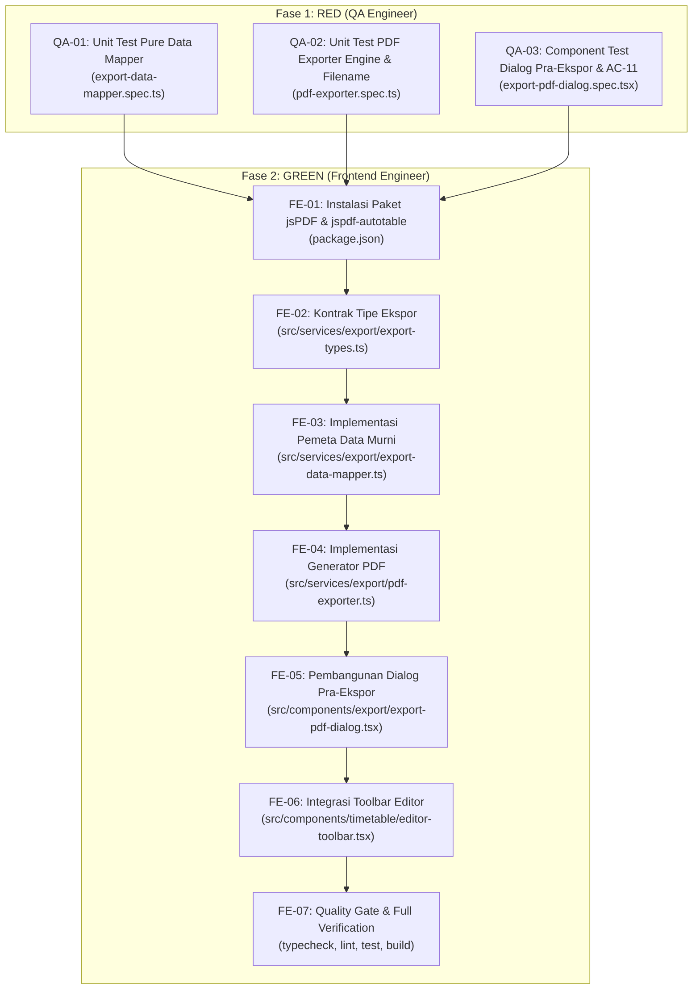

# Spesifikasi Task & Kontrak Teknis: FR-08 — Ekspor Jadwal ke PDF

**Kode Fitur:** `FR-08` (Didukung oleh `AC-09`, `AC-11`, `FR-05`, `FR-11`, `NFR-01`, `NFR-03`, `NFR-05`)  
**Status:** Siap Dieksekusi (Fase RED -> Fase GREEN)  
**Dokumen Referensi:**
- Product Requirements Document: [`docs/Schedovyn-PRD.md`](../Schedovyn-PRD.md) (Bagian 5, 7, 8, 9, 10, 12)
- Technical Design Document: [`docs/Schedovyn-TDD.md`](../Schedovyn-TDD.md) (Bagian 8.1, 8.2)
- Design System & UI Guidelines: [`DESIGN.md`](../../DESIGN.md) (Bagian 4, 5.2)
- Agent Guidelines: [`AGENTS.md`](../../AGENTS.md)
- Task Terkait:
  - [`docs/tasks/FR-01-workspace-and-schedule-config.md`](./FR-01-workspace-and-schedule-config.md)
  - [`docs/tasks/FR-02-master-data-management.md`](./FR-02-master-data-management.md)
  - [`docs/tasks/FR-03-active-class-selection.md`](./FR-03-active-class-selection.md)
  - [`docs/tasks/FR-04-timetable-drag-and-drop-editor.md`](./FR-04-timetable-drag-and-drop-editor.md)
  - [`docs/tasks/FR-05-smart-conflict-detection.md`](./FR-05-smart-conflict-detection.md)
  - [`docs/tasks/FR-06-unscheduled-sessions-management.md`](./FR-06-unscheduled-sessions-management.md)
  - [`docs/tasks/FR-07-undo-and-redo.md`](./FR-07-undo-and-redo.md)

---

## 1. Konteks & Tujuan Fitur

### 1.1 Hasil Telusur `graphify`
Berdasarkan penelusuran arsitektur dan keterhubungan modul:
- **Dokumen Cetak Sebagai Hasil Akhir Penyusunan Jadwal:**
  Tujuan akhir staf kurikulum menyusun jadwal di Schedovyn adalah membagikan jadwal pembelajaran resmi kepada guru, wali kelas, dan siswa dalam bentuk berkas cetak dokumen PDF yang rapi, terbaca jelas, dan siap dibagikan ([`docs/Schedovyn-PRD.md#L352-L382`](file:///home/ardi/projects/schedovyn/frontend/docs/Schedovyn-PRD.md#L352-L382)).
- **Fondasi yang Sudah Tersedia:**
  - Data ruang kerja, konfigurasi hari, mata pelajaran, guru, ruangan, kelas, dan sesi tersimpan di IndexedDB dan Zustand Store [`src/store/use-workspace-store.ts`](../../src/store/use-workspace-store.ts).
  - Laporan validasi bentrokan waktu dan status kelengkapan jadwal telah tersedia secara real-time via `validationReport` (`FR-05`).
  - Pemformatan waktu `TimeString` ("HH:mm") telah terstandarisasi di `src/domain/time/time-utils.ts`.
- **Kekosongan yang Perlu Diimplementasikan pada FR-08:**
  - Belum ada modul pemetaan data ekspor murni (`src/services/export/export-data-mapper.ts`) dan kontrak tipe ekspor (`src/services/export/export-types.ts`).
  - Belum ada generator PDF berbasis client-side (`src/services/export/pdf-exporter.ts`) menggunakan `jsPDF` dan `jspdf-autotable`.
  - Belum ada dialog pra-ekspor (`src/components/export/export-pdf-dialog.tsx`) yang menangani seleksi cakupan ekspor (Kelas Aktif vs Seluruh Kelas) dan peringatan jadwal yang masih berkonflik atau belum lengkap (**AC-11**).
  - Belum ada tombol pemicu ekspor PDF di bilah kontrol editor (`EditorToolbar`).

### 1.2 Referensi Persyaratan
- **FR-08 (Ekspor PDF — PRD Bagian 5):**
  - Pengguna dapat mengekspor jadwal ke PDF tanpa mengirim data ke server (100% *Client-Side* & *Zero-Backend*).
  - **Pilihan Cakupan Ekspor:**
    1. Jadwal kelas aktif (`ACTIVE_CLASS`).
    2. Jadwal seluruh kelas dalam ruang kerja (`ENTIRE_WORKSPACE`).
  - **Konten Minimal Ekspor per Kelas:**
    - Nama sekolah / ruang kerja (`workspace.name`).
    - Periode akademik / semester (`workspace.academicPeriod`).
    - Nama kelas & tingkat (`classGroup.name`, `classGroup.grade`).
    - Jadwal mingguan: Hari, Rentang Waktu (`startTime - endTime`), Mata Pelajaran, Guru, Ruangan.
    - Informasi konflik yang terkait, apabila terdapat konflik.
  - **Konten Ekspor Seluruh Kelas:**
    - Setiap kelas disajikan secara terpisah pada halaman tersendiri (*page-break* per kelas).
    - Halaman terakhir menyajikan **Ringkasan Validasi dan Konflik Seluruh Ruang Kerja**.
  - **Ketentuan Teknis:**
    - Orientasi **A4 Landscape** agar tabel mingguan tidak terpotong atau terlalu padat.
    - Isi dokumen tidak boleh terpotong sembarangan (*clean pagination*).
    - Layout ramah pencetakan (*print-friendly*).
    - PDF dibuat dan diunduh langsung melalui peramban (`doc.save(...)`).
    - **Ekspor dengan Konflik (FR-08.5 & AC-11):** Ekspor tetap dapat dilakukan meskipun masih ada konflik/peringatan, namun dokumen dan dialog pra-ekspor wajib menyertakan peringatan yang jelas.
- **AC-09 (Ekspor PDF — PRD Bagian 12):**
  - **Given** ruang kerja memiliki jadwal,
  - **When** pengguna memilih ekspor PDF,
  - **Then** browser menghasilkan berkas PDF berisi cakupan jadwal yang dipilih tanpa mengirim data jadwal ke server.
- **AC-11 (Ekspor dengan Konflik — PRD Bagian 12):**
  - **Given** jadwal masih mengandung konflik,
  - **When** pengguna memilih ekspor,
  - **Then** sistem memberikan peringatan sebelum atau saat proses ekspor dan menyertakan status konflik sesuai cakupan ekspor.
- **NFR-03 (Privasi):**
  - Ekspor PDF diproses secara lokal di browser; data jadwal tidak boleh diunggah ke pihak eksternal mana pun.

### 1.3 Masalah Pengguna & Batasan Ruang Lingkup
- **Masalah Pengguna:** Staf kurikulum perlu mencetak jadwal mingguan untuk ditempel di ruang guru atau dibagikan ke siswa. Jika jadwal dicetak melalui fitur "Print Web Page" bawaan browser, tampilannya berantakan, terpotong tombol-tombol antarmuka, dan tidak memuat keterangan sekolah secara formal. Selain itu, staf kurikulum sering tidak sadar mencetak jadwal yang ternyata masih memiliki bentrokan guru tanpa adanya peringatan resmi pada lembar cetak.
- **Cakupan Dalam Task Ini (In-Scope):**
  1. Kontrak tipe ekspor dokumen di `src/services/export/export-types.ts`.
  2. Implementasi pemeta data murni `src/services/export/export-data-mapper.ts` yang mengonversi entitas jadwal menjadi baris data tabel kronologis per kelas dengan penandaan konflik.
  3. Implementasi generator PDF client-side di `src/services/export/pdf-exporter.ts` menggunakan `jsPDF` (`landscape`, `a4`) dan `jspdf-autotable`.
  4. Komponen dialog pra-ekspor `src/components/export/export-pdf-dialog.tsx` dengan pilihan cakupan, opsi lampiran konflik, peringatan pra-ekspor (**AC-11**), dan tombol unduh jujur.
  5. Penambahan tombol pemicu ekspor PDF pada `EditorToolbar`.
  6. Pengujian automated test suite: unit test pemeta data, unit test generator PDF, dan component test dialog ekspor.
- **Di Luar Cakupan Task Ini (Out-of-Scope):**
  - Ekspor format spreadsheet Excel (`.xlsx`) (`FR-09`, akan dikerjakan pada task berikutnya).
  - Kustomisasi template desain logo grafis sekolah (dapat dipertimbangkan untuk pengembangan lanjutan).

---

## 2. Kontrak Data & Arsitektur Teknis

### 2.1 Kontrak Tipe Ekspor Dokumen (`src/services/export/export-types.ts`)

Mendefinisikan kontrak tipe data terpadu bebas dari `any`:

```typescript
import type {
  ClassGroup,
  DayOfWeek,
  DayScheduleConfig,
  Room,
  Subject,
  Teacher,
  TimeString,
  TimetableSession,
  Workspace,
} from "@/domain/types/entities"
import type {
  ScheduleConflict,
  ScopeValidationSummary,
} from "@/domain/types/validation"

export type ExportScope = "ACTIVE_CLASS" | "ENTIRE_WORKSPACE"

export interface ExportSessionRow {
  sessionId: string
  dayOfWeek: DayOfWeek
  dayLabel: string             // "Senin", "Selasa", dst.
  timeRange: string            // "07:30 - 08:15"
  startTime: TimeString
  endTime: TimeString
  durationMinutes: number
  subjectName: string
  teacherName: string          // Nama guru atau "-" jika kosong
  roomName: string             // Nama ruangan atau "-" jika kosong
  hasConflict: boolean         // True jika sesi ini terlibat bentrokan waktu
  conflictBadges: string[]     // Contoh: ["[BENTROKAN GURU]", "[LUAR JAM BELAJAR]"]
  conflictNotes: string        // Keterangan singkat bentrokan
}

export interface ExportConflictAppendixItem {
  conflictId: string
  title: string
  description: string
  dayLabel: string
  timeRange: string
  affectedClasses: string[]
}

export interface ExportClassPayload {
  classGroup: ClassGroup
  workspace: Workspace
  rows: ExportSessionRow[]
  conflictAppendix: ExportConflictAppendixItem[]
  hasConflicts: boolean
  totalSessions: number
  totalDurationMinutes: number
  validationSummary?: ScopeValidationSummary | null
}

export interface PdfExportOptions {
  scope: ExportScope
  includeConflictAppendix: boolean
  customNotes?: string
}

export interface PdfExportMetadata {
  workspaceName: string
  academicPeriod: string
  exportedAt: string           // Tanggal cetak terformat, misal: "22 Oktober 2026, 10:45"
  scope: ExportScope
}
```

---

### 2.2 Kontrak Pemeta Data Murni (`src/services/export/export-data-mapper.ts`)

Modul ini adalah *pure TypeScript function* (tanpa dependensi ke jsPDF atau DOM) yang mengubah entitas ruang kerja menjadi `ExportClassPayload`:

```typescript
export interface MapClassScheduleParams {
  classGroup: ClassGroup
  workspace: Workspace
  dayConfigs: readonly DayScheduleConfig[]
  sessions: readonly TimetableSession[]
  subjects: readonly Subject[]
  teachers: readonly Teacher[]
  rooms: readonly Room[]
  conflicts: readonly ScheduleConflict[]
  validationSummary?: ScopeValidationSummary | null
}

/**
 * Memetakan seluruh data sesi dan konflik kelas menjadi baris tabel kronologis
 * berurutan berdasarkan hari sekolah aktif dan waktu mulai menaik.
 */
export function mapClassScheduleForExport(
  params: MapClassScheduleParams
): ExportClassPayload

/**
 * Memetakan data seluruh kelas dalam ruang kerja menjadi daftar ExportClassPayload
 * berurutan berdasarkan nama kelas.
 */
export function mapWorkspaceScheduleForExport(params: {
  classes: readonly ClassGroup[]
  workspace: Workspace
  dayConfigs: readonly DayScheduleConfig[]
  sessions: readonly TimetableSession[]
  subjects: readonly Subject[]
  teachers: readonly Teacher[]
  rooms: readonly Room[]
  conflicts: readonly ScheduleConflict[]
  validationSummaryByClass?: Record<string, ScopeValidationSummary>
}): ExportClassPayload[]

/**
 * Menghasilkan nama berkas unduhan yang aman dari karakter ilegal sistem berkas.
 */
export function formatPdfDownloadFileName(
  scope: ExportScope,
  workspaceName: string,
  className?: string
): string
```

**Aturan Pengurutan & Penandaan:**
1. Sesi difilter khusus untuk `session.classId === classGroup.id`.
2. Pengurutan baris: urutan hari mengikuti `ORDERED_DAYS_OF_WEEK` (Senin s.d. Minggu), kemudian waktu mulai `toMinutes(session.startTime)` menaik.
3. Sesi yang tercatat di dalam `conflicts` (berdasarkan `conflict.affectedSessionIds.includes(session.id)`) diberi `hasConflict = true`, lencana `[KONFLIK]`, serta rangkuman keterangan penyebab bentrokan.
4. Sanitasi nama berkas: karakter spasi diubah menjadi garis bawah (`_`), karakter terlarang (`/`, `\`, `:`, `*`, `?`, `"`, `<`, `>`, `|`) dibersihkan.
   - Contoh satu kelas: `Jadwal_SMP_Negeri_1_Nusantara_Kelas_VII-A.pdf`
   - Contoh seluruh kelas: `Jadwal_SMP_Negeri_1_Nusantara_Semua_Kelas.pdf`

---

### 2.3 Kontrak Generator PDF Client-Side (`src/services/export/pdf-exporter.ts`)

Menggunakan pustaka **`jsPDF`** dan **`jspdf-autotable`**:

```typescript
export interface GeneratePdfParams {
  payloads: ExportClassPayload[]
  options: PdfExportOptions
  metadata: PdfExportMetadata
}

/**
 * Membangun dokumen PDF A4 Landscape di memori dan memicu unduhan di peramban.
 */
export async function generateTimetablePdf(
  params: GeneratePdfParams
): Promise<{ fileName: string; totalPages: number }>
```

**Tata Letak & Tipografi Dokumen PDF:**
1. **Format Halaman:** Orientasi `landscape`, ukuran `a4` (297 mm x 210 mm), margin `14 mm`.
2. **Kop & Header Dokumen (Tiap Kelas):**
   - Baris 1 (Bold, 16pt): Nama Sekolah / Ruang Kerja (`workspaceName`).
   - Baris 2 (Regular, 10pt): Periode Akademik (`academicPeriod`) dan Tanggal Unduh.
   - Baris 3 (Semibold, 13pt): `JADWAL PEMBELAJARAN KELAS: {classGroup.name} (Tingkat {classGroup.grade})`.
   - Garis pemisah horizontal tebal (`#1e293b`).
3. **Banner Peringatan Status Validasi (Jika Berkonflik / Belum Lengkap):**
   - Jika `hasConflicts === true`: Kotak peringatan latar belakang merah muda terang (`#fee2e2`), border merah (`#dc2626`), teks: `PERINGATAN: Jadwal kelas ini mengandung {N} bentrokan waktu aktif. Sesi yang bermasalah ditandai dengan tanda [KONFLIK].`
   - Jika `!hasConflicts` namun jadwal belum lengkap: Kotak peringatan kuning (`#fef3c7`), teks: `PERHATIAN: Jadwal kelas ini masih memiliki {N} sesi yang belum ditempatkan.`
4. **Tabel Jadwal Mingguan (`autoTable`):**
   - Kolom: `No`, `Hari`, `Waktu Mulai - Selesai`, `Durasi`, `Mata Pelajaran`, `Guru Pengampu`, `Ruangan`, `Catatan Status`.
   - Gaya Header: Warna latar gelap netral (`#0f172a`), teks putih (`#ffffff`), font tebal.
   - Gaya Baris Sesi Normal: Teks kontras tinggi, latar belakang selang-seling abu-abu terang (`#f8fafc`).
   - Gaya Baris Sesi Berkonflik: Latar belakang sel merah muda lembut (`#fef2f2`), teks status berwarna merah tebal dengan label `[KONFLIK]`.
5. **Lampiran Rincian Konflik (Di Bawah Tabel atau Halaman Berikutnya):**
   - Jika `options.includeConflictAppendix === true` dan terdapat konflik, cetak tabel lampiran rincian konflik: `Jenis Masalah`, `Hari & Waktu`, `Penyebab & Kelas Lain yang Terlibat`.
6. **Halaman Penutup untuk Mode Seluruh Ruang Kerja (`ENTIRE_WORKSPACE`):**
   - Setelah seluruh kelas dicetak, tambahkan halaman baru: **Ringkasan Validasi dan Rekapitulasi Seluruh Ruang Kerja** (Total Sesi Terjadwal, Total Kelas, Total Konflik Ruang Kerja).
7. **Nomor Halaman:** Pada sudut kanan bawah setiap lembar dicetak footer formal: `Halaman X dari Y — Dibuat secara otomatis dengan Schedovyn`.

---

### 2.4 Arsitektur Komponen Dialog Pra-Ekspor (`src/components/export/export-pdf-dialog.tsx`)

Komponen dialog pra-ekspor menggunakan shadcn/ui (`Dialog`, `DialogContent`, `Alert`, `RadioGroup`, `Checkbox`, `Button`):

**Struktur Interaksi Dialog:**
1. **Trigger:** Tombol pada `EditorToolbar`:
   - Label: `"Ekspor PDF"` dengan ikon `FileDownIcon`.
2. **Pilihan Cakupan:**
   - Radio button: **"Kelas Aktif Saat Ini ({activeClassName})"** (default).
   - Radio button: **"Seluruh Kelas dalam Ruang Kerja ({totalClasses} Kelas)"**.
3. **Peringatan Pra-Ekspor Real-Time (AC-11):**
   - Komponen membaca `validationReport` dari store untuk cakupan yang dipilih.
   - Jika terdapat bentrokan waktu: Tampilkan alert merah (`Alert` varian destructive) berisi:
     - Judul: `"Jadwal Mengandung Bentrokan Waktu"`.
     - Deskripsi: Menampilkan jumlah konflik dan daftar ringkas bentrokan guru/ruangan yang terlibat.
   - Jika tidak ada bentrokan waktu namun alokasi sesi belum lengkap: Tampilkan alert kuning berisi sisa sesi yang belum terjadwal.
4. **Opsi Tambahan:**
   - Checkbox: `"Sertakan lampiran rincian konflik pada dokumen"` (tercentang otomatis jika ada konflik).
5. **Tombol Aksi Unduh:**
   - Jika jadwal bebas konflik dan lengkap: Tombol primer bertuliskan **"Unduh Dokumen PDF"** (ikon unduh).
   - Jika jadwal masih berkonflik: Tombol berubah label secara transparan menjadi **"Tetap Ekspor PDF dengan Peringatan Konflik"** (varian outline / warning).
   - Selama proses pembuatan PDF berjalan: Tombol menampilkan state loading (*"Menyiapkan Dokumen PDF..."*).

---

## 3. Acceptance Criteria (Given-When-Then)

### AC-FR08-01: Ekspor PDF Jadwal Kelas Aktif Bebas Konflik (AC-09)
- **Given** pengguna berada di ruang kerja "SMP Negeri 1 Nusantara" pada kelas aktif "VII-A" yang telah terisi jadwal tanpa konflik,
- **When** pengguna membuka dialog ekspor PDF dan mengeklik "Unduh Dokumen PDF",
- **Then** browser membuat dan mengunduh berkas bernama `Jadwal_SMP_Negeri_1_Nusantara_Kelas_VII-A.pdf`,
- **And** dokumen berorientasi A4 Landscape memuat kop sekolah, identitas kelas VII-A, tabel jadwal mingguan kronologis, nama guru, dan ruangan,
- **And** tidak ada data jadwal yang dikirim ke server.

### AC-FR08-02: Peringatan Pra-Ekspor saat Jadwal Mengandung Konflik (AC-11)
- **Given** kelas aktif VII-A memiliki 1 bentrokan guru dengan kelas VIII-A pada hari Senin pukul 08:30–09:30,
- **When** pengguna membuka dialog ekspor PDF,
- **Then** dialog menampilkan kotak peringatan merah yang merinci bentrokan guru tersebut,
- **And** tombol unduh menampilkan teks `"Tetap Ekspor PDF dengan Peringatan Konflik"`.

### AC-FR08-03: Dokumen PDF Memuat Peringatan Konflik dan Penandaan Sesi (FR-08.5 & AC-11)
- **Given** jadwal kelas yang diekspor masih mengandung konflik,
- **When** dokumen PDF berhasil diunduh dan dibuka,
- **Then** bagian atas dokumen memuat banner peringatan merah mengenai adanya konflik waktu aktif,
- **And** baris sesi yang berkonflik pada tabel jadwal diberi latar belakang merah muda lembut dan lencana `[KONFLIK]`,
- **And** dokumen memuat tabel lampiran rincian konflik yang menjelaskan penyebab dan sesi kelas lain yang terlibat.

### AC-FR08-04: Ekspor PDF Seluruh Kelas dalam Ruang Kerja
- **Given** ruang kerja memiliki 4 kelas ("VII-A", "VII-B", "VIII-A", "VIII-B"),
- **When** pengguna memilih cakupan "Seluruh Kelas dalam Ruang Kerja" dan mengeklik unduh,
- **Then** berkas PDF bernama `Jadwal_SMP_Negeri_1_Nusantara_Semua_Kelas.pdf` terunduh,
- **And** setiap kelas dicetak pada halaman baru tanpa terpotong antar-halaman (*clean page-break*),
- **And** halaman terakhir memuat ringkasan validasi seluruh ruang kerja.

### AC-FR08-05: Penanganan Data Kosong pada Guru dan Ruangan
- **Given** sebuah sesi pembelajaran terjadwal belum memiliki guru atau ruangan yang ditentukan,
- **When** sesi tersebut dicetak ke dalam tabel jadwal PDF,
- **Then** kolom guru dan kolom ruangan menampilkan tanda strip `"-"` secara rapi tanpa mencetak nilai `null`, `undefined`, atau sel kosong yang janggal.

### AC-FR08-06: Sanitasi Karakter Ilegal pada Nama Berkas
- **Given** nama sekolah mengandung karakter terlarang (misal `"SMPN 1 / Rujukan: Unggulan *"`),
- **When** berkas PDF diunduh,
- **Then** sistem membersihkan karakter terlarang tersebut sehingga nama berkas dapat disimpan secara aman di semua sistem operasi peramban.

---

## 4. Breakdown Task Eksekusi (TDD Roadmap)



---

### 4.1 Task QA Engineer (Fase RED)

QA Engineer bertugas menulis seluruh skenario pengujian unit dan komponen di dalam folder pengujian hingga seluruh *assertion* siap dan berstatus **FAIL (RED)** sebelum kode produksi diimplementasikan:

#### Task QA-01: Unit Test Pure Data Mapper
- **File:** `src/__tests__/unit/export/export-data-mapper.spec.ts`
- **Cakupan Pengujian:**
  1. Pemetaan sesi kelas ke baris tabel kronologis berdasarkan urutan hari (`Senin` s.d. `Minggu`) dan waktu mulai.
  2. Format rentang waktu format 24 jam (`07:30 - 08:15`).
  3. Penanganan nilai kosong guru (`teacherId: null`) dan ruangan (`roomId: null`) menjadi tanda `"-"`.
  4. Penandaan `hasConflict = true`, lencana `[KONFLIK]`, dan catatan konflik pada sesi yang bermasalah.
  5. Penyusunan daftar lampiran konflik (`conflictAppendix`) yang memuat penyebab dan kelas yang terlibat.
  6. Pemetaan seluruh kelas ruang kerja (`mapWorkspaceScheduleForExport`): memastikan isolasi data tiap kelas dan urutan kelas alfabetis.
  7. Fungsi sanitasi nama berkas unduhan (`formatPdfDownloadFileName`): membersihkan spasi dan karakter ilegal (`/`, `\`, `:`, dll.).

#### Task QA-02: Unit Test Generator PDF (Mocked jsPDF)
- **File:** `src/__tests__/unit/export/pdf-exporter.spec.ts`
- **Cakupan Pengujian:**
  1. Memverifikasi inisialisasi `jsPDF` dengan orientasi `"landscape"`, satuan `"mm"`, dan format `"a4"`.
  2. Memverifikasi pemanggilan `autoTable` dengan header kolom yang sesuai persyaratan (Hari, Jam, Durasi, Mapel, Guru, Ruangan, Status).
  3. Memverifikasi pencetakan banner peringatan saat payload memiliki konflik (`hasConflicts === true`).
  4. Memverifikasi penambahan halaman baru (`doc.addPage`) per kelas pada mode ekspor seluruh ruang kerja.
  5. Memverifikasi pemanggilan `doc.save(fileName)` dengan nama berkas yang telah disanitasi.

#### Task QA-03: Component Test Dialog Pra-Ekspor & Peringatan Konflik (AC-11)
- **File:** `src/__tests__/components/export-pdf-dialog.spec.tsx`
- **Lingkungan:** Vitest + `@testing-library/react` + `@testing-library/user-event`
- **Cakupan Pengujian:**
  1. Dialog menampilkan pilihan cakupan: "Kelas Aktif" vs "Seluruh Kelas".
  2. Saat jadwal kelas aktif bebas konflik: dialog menampilkan status bersih dan tombol primer bertuliskan `"Unduh Dokumen PDF"`.
  3. Saat jadwal kelas aktif mengandung konflik (**AC-11**): dialog menampilkan kotak peringatan merah yang merinci bentrokan waktu, dan tombol berubah menjadi `"Tetap Ekspor PDF dengan Peringatan Konflik"`.
  4. Saat alokasi sesi belum lengkap: dialog menampilkan peringatan sesi yang belum terjadwal.
  5. Checkbox "Sertakan Lampiran Konflik" aktif secara default saat ada konflik.
  6. Mengeklik tombol unduh memicu pemanggilan generator PDF dengan opsi yang dipilih dan menampilkan indikator loading.

---

### 4.2 Task Frontend Engineer (Fase GREEN)

Frontend Engineer bertugas mengimplementasikan pustaka ekspor, modul pemetaan data, generator PDF, dan komponen dialog UI hingga seluruh test QA lulus (**GREEN**):

#### Task FE-01: Penambahan Dependensi Ekspor
- Tambahkan paket `jspdf` dan `jspdf-autotable` ke dalam `frontend/package.json`:
  ```bash
  bun add jspdf jspdf-autotable
  ```
- Pastikan deklarasi tipe TypeScript terintegrasi dengan baik.

#### Task FE-02: Kontrak Tipe Ekspor Dokumen
- Buat berkas `src/services/export/export-types.ts` sesuai kontrak Bagian 2.1.
- Pastikan seluruh interface bebas dari tipe `any`.

#### Task FE-03: Implementasi Pemeta Data Murni
- Buat berkas `src/services/export/export-data-mapper.ts` sesuai kontrak Bagian 2.2.
- Terapkan fungsi `mapClassScheduleForExport`, `mapWorkspaceScheduleForExport`, dan `formatPdfDownloadFileName`.
- Jalankan `bun test src/__tests__/unit/export/export-data-mapper.spec.ts` hingga lulus (**GREEN**).

#### Task FE-04: Implementasi Generator Dokumen PDF
- Buat berkas `src/services/export/pdf-exporter.ts` sesuai kontrak Bagian 2.3.
- Susun kop dokumen formal, banner peringatan konflik, tabel jadwal mingguan via `jspdf-autotable`, tabel lampiran konflik, dan pemisahan halaman rapi per kelas.
- Terapkan pewarnaan sel berkonflik (latar merah muda `#fef2f2` dan teks merah bold `[KONFLIK]`).
- Jalankan `bun test src/__tests__/unit/export/pdf-exporter.spec.ts` hingga lulus (**GREEN**).

#### Task FE-05: Pembangunan Komponen Dialog Pra-Ekspor
- Buat berkas `src/components/export/export-pdf-dialog.tsx` sesuai spesifikasi Bagian 2.4.
- Tampilkan opsi cakupan, kotak peringatan pra-ekspor (**AC-11**), dan tombol unduh transparan.
- Hubungkan pemanggilan `generateTimetablePdf` dengan penanganan loading state dan penutupan dialog setelah selesai.
- Jalankan `bun test src/__tests__/components/export-pdf-dialog.spec.tsx` hingga lulus (**GREEN**).

#### Task FE-06: Integrasi Toolbar Editor
- Perbarui `src/components/timetable/editor-toolbar.tsx`:
  - Tambahkan tombol `"Ekspor PDF"` dengan ikon `FileDownIcon`.
  - Pasang state pembuka `ExportPdfDialog`.

#### Task FE-07: Verifikasi Quality Gate
Jalankan verifikasi lengkap:
```bash
bun run typecheck
bun run lint
bun test
bun run build
```
Pastikan seluruh pemeriksaan menghasilkan **0 error**, tanpa kompromi tipe `any`, dan tata letak dokumen PDF rapi saat dicetak.

---

## 5. Ringkasan File Terdampak

| File Path | Tipe Perubahan | Penanggung Jawab |
|---|---|---|
| `package.json` | Modifikasi (Dependensi jspdf & autotable) | Frontend Engineer |
| `src/__tests__/unit/export/export-data-mapper.spec.ts` | Berkas Baru (Unit Test) | QA Engineer |
| `src/__tests__/unit/export/pdf-exporter.spec.ts` | Berkas Baru (Unit Test) | QA Engineer |
| `src/__tests__/components/export-pdf-dialog.spec.tsx` | Berkas Baru (Component Test) | QA Engineer |
| `src/services/export/export-types.ts` | Berkas Baru (Export Types) | Frontend Engineer |
| `src/services/export/export-data-mapper.ts` | Berkas Baru (Pure Mapping Logic) | Frontend Engineer |
| `src/services/export/pdf-exporter.ts` | Berkas Baru (PDF Generator Service) | Frontend Engineer |
| `src/components/export/export-pdf-dialog.tsx` | Berkas Baru (UI Dialog Pra-Ekspor) | Frontend Engineer |
| `src/components/timetable/editor-toolbar.tsx` | Modifikasi (Tombol Ekspor PDF) | Frontend Engineer |
| `docs/tasks/FR-08-pdf-export.md` | Berkas Baru (Spesifikasi Task) | Product Manager / Architect |
