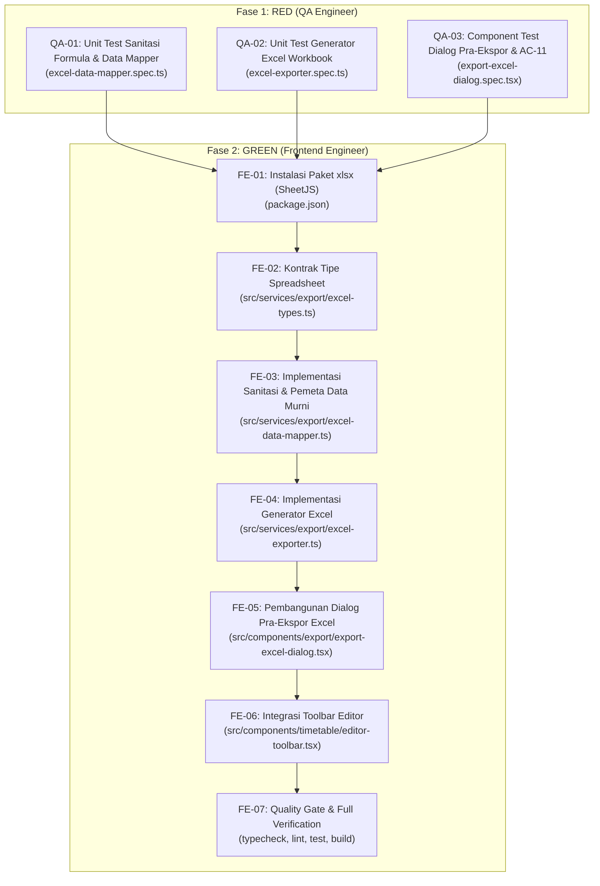

# Spesifikasi Task & Kontrak Teknis: FR-09 — Ekspor Jadwal ke Excel

**Kode Fitur:** `FR-09` (Didukung oleh `AC-10`, `AC-11`, `FR-05`, `FR-11`, `NFR-01`, `NFR-03`, `NFR-05`)  
**Status:** Siap Dieksekusi (Fase RED -> Fase GREEN)  
**Dokumen Referensi:**
- Product Requirements Document: [`docs/Schedovyn-PRD.md`](../Schedovyn-PRD.md) (Bagian 5, 7, 8, 9, 10, 12)
- Technical Design Document: [`docs/Schedovyn-TDD.md`](../Schedovyn-TDD.md) (Bagian 8.1, 8.3)
- Design System & UI Guidelines: [`DESIGN.md`](../../DESIGN.md) (Bagian 4, 5.2)
- Agent Guidelines: [`AGENTS.md`](../../AGENTS.md)
- Task Terkait:
  - [`docs/tasks/FR-01-workspace-and-schedule-config.md`](./FR-01-workspace-and-schedule-config.md)
  - [`docs/tasks/FR-02-master-data-management.md`](./FR-02-master-data-management.md)
  - [`docs/tasks/FR-03-active-class-selection.md`](./FR-03-active-class-selection.md)
  - [`docs/tasks/FR-04-timetable-drag-and-drop-editor.md`](./FR-04-timetable-drag-and-drop-editor.md)
  - [`docs/tasks/FR-05-smart-conflict-detection.md`](./FR-05-smart-conflict-detection.md)
  - [`docs/tasks/FR-06-unscheduled-sessions-management.md`](./FR-06-unscheduled-sessions-management.md)
  - [`docs/tasks/FR-07-undo-and-redo.md`](./FR-07-undo-and-redo.md)
  - [`docs/tasks/FR-08-pdf-export.md`](./FR-08-pdf-export.md)

---

## 1. Konteks & Tujuan Fitur

### 1.1 Hasil Telusur `graphify`
Berdasarkan penelusuran arsitektur dan keterhubungan modul:
- **Analisis Data Lanjutan Menggunakan Spreadsheet:**
  Selain dokumen cetak PDF (`FR-08`), pihak manajemen sekolah atau staf kurikulum sering kali memerlukan data jadwal mentah dalam format spreadsheet (`.xlsx`) agar dapat diolah lebih lanjut, dianalisis beban jam mengajarnya, atau diintegrasikan dengan aplikasi pelaporan sekolah lainnya ([`docs/Schedovyn-PRD.md#L383-L419`](file:///home/ardi/projects/schedovyn/frontend/docs/Schedovyn-PRD.md#L383-L419)).
- **Fondasi yang Sudah Tersedia:**
  - Seluruh data master (guru, ruangan, mapel, kelas) dan data sesi tersimpan di IndexedDB dan Zustand Store [`src/store/use-workspace-store.ts`](../../src/store/use-workspace-store.ts).
  - Laporan validasi bentrokan waktu dan status kelengkapan jadwal telah tersedia secara real-time via `validationReport` (`FR-05`).
  - Pemformatan waktu `TimeString` ("HH:mm") telah terstandarisasi di `src/domain/time/time-utils.ts`.
- **Kekosongan yang Perlu Diimplementasikan pada FR-09:**
  - Belum ada modul pemetaan data spreadsheet murni (`src/services/export/excel-data-mapper.ts`) dan kontrak tipe data spreadsheet (`src/services/export/excel-types.ts`).
  - Belum ada generator berkas `.xlsx` client-side (`src/services/export/excel-exporter.ts`) menggunakan pustaka `xlsx` (SheetJS).
  - Belum ada fungsi sanitasi formula spreadsheet (`sanitizeSpreadsheetText`) untuk mencegah celah *Formula Injection* / eksekusi formula tak disengaja.
  - Belum ada dialog pra-ekspor Excel (`src/components/export/export-excel-dialog.tsx`) yang menangani seleksi cakupan dan peringatan jadwal yang masih berkonflik atau belum lengkap (**AC-11**).
  - Belum ada tombol pemicu ekspor Excel di bilah kontrol editor (`EditorToolbar`).

### 1.2 Referensi Persyaratan
- **FR-09 (Ekspor Excel — PRD Bagian 5):**
  - Pengguna dapat mengekspor jadwal ke format `.xlsx` langsung melalui peramban (100% *Client-Side* & *Zero-Backend*).
  - **Pilihan Cakupan Ekspor:**
    1. Jadwal kelas aktif (`ACTIVE_CLASS`).
    2. Jadwal seluruh kelas dalam ruang kerja (`ENTIRE_WORKSPACE`).
  - **Struktur Multi-Worksheet:**
    - Ekspor satu kelas: minimal memiliki worksheet `Jadwal` dan worksheet `Konflik` (jika terdapat bentrokan/peringatan).
    - Ekspor seluruh ruang kerja: memiliki worksheet `Jadwal`, `Rekap Guru`, `Rekap Ruangan`, dan `Konflik`.
  - **Kolom Minimal pada Worksheet `Jadwal`:**
    - `Hari`
    - `Waktu Mulai` (format 24 jam `HH:mm`)
    - `Waktu Selesai` (format 24 jam `HH:mm`)
    - `Durasi (Menit)` (angka numerik murni)
    - `Kelas`
    - `Tingkat`
    - `Mata Pelajaran`
    - `Guru`
    - `Ruangan`
    - `Status Validasi`
  - **Ketentuan Teknis:**
    1. Data diekspor sebagai data spreadsheet bersih yang siap difilter dan diolah (dengan fitur *AutoFilter*).
    2. Format waktu konsisten menggunakan format 24 jam.
    3. Nilai teks tidak boleh berubah menjadi formula spreadsheet secara tidak sengaja (*Formula Injection Prevention*).
    4. Ekspor tidak membutuhkan endpoint backend.
    5. Sistem memberi peringatan jika jadwal yang diekspor masih mengandung konflik (**AC-11**).
- **AC-10 (Ekspor Excel — PRD Bagian 12):**
  - **Given** ruang kerja memiliki jadwal,
  - **When** pengguna memilih ekspor Excel,
  - **Then** browser menghasilkan berkas `.xlsx` dengan worksheet dan kolom yang ditentukan dalam persyaratan ekspor.
- **AC-11 (Ekspor dengan Konflik — PRD Bagian 12):**
  - **Given** jadwal masih mengandung konflik,
  - **When** pengguna memilih ekspor,
  - **Then** sistem memberikan peringatan sebelum atau saat proses ekspor dan menyertakan status konflik sesuai cakupan ekspor.
- **NFR-03 (Privasi):**
  - Ekspor Excel diproses secara lokal di browser; data jadwal tidak boleh dikirim ke server.

### 1.3 Masalah Pengguna & Batasan Ruang Lingkup
- **Masalah Pengguna:** Admin sekolah membutuhkan rekap beban mengajar guru per minggu dan utilisasi ruangan untuk keperluan administrasi dinas atau yayasan. Jika data jadwal harus disalin manual satu per satu ke Excel, proses tersebut memakan waktu berjam-jam dan rentan salah hitung durasi jam mengajar.
- **Cakupan Dalam Task Ini (In-Scope):**
  1. Kontrak tipe data spreadsheet di `src/services/export/excel-types.ts`.
  2. Implementasi fungsi sanitasi formula spreadsheet (`sanitizeSpreadsheetText`) di `src/services/export/excel-data-mapper.ts`.
  3. Pemetaan murni data jadwal flat table, rekap beban mengajar guru, rekap pemakaian ruangan, dan daftar konflik di `src/services/export/excel-data-mapper.ts`.
  4. Implementasi generator Excel client-side di `src/services/export/excel-exporter.ts` menggunakan pustaka `xlsx` (SheetJS) dengan penataan lebar kolom otomatis (*autofit*) dan *AutoFilter*.
  5. Komponen dialog pra-ekspor `src/components/export/export-excel-dialog.tsx` dengan pilihan cakupan, informasi worksheet yang akan dibuat, peringatan pra-ekspor (**AC-11**), dan tombol unduh jujur.
  6. Penambahan tombol pemicu ekspor Excel pada `EditorToolbar`.
  7. Pengujian automated test suite: unit test sanitasi formula & data mapper, unit test generator Excel, dan component test dialog ekspor.
- **Di Luar Cakupan Task Ini (Out-of-Scope):**
  - Pembuatan grafik visual / chart di dalam file Excel (diserahkan pada pengguna di aplikasi spreadsheet).
  - Impor data jadwal kembali dari Excel ke Schedovyn (fitur impor merupakan lingkup versi lanjutan).

---

## 2. Kontrak Data & Arsitektur Teknis

### 2.1 Kontrak Tipe Data Spreadsheet (`src/services/export/excel-types.ts`)

Mendefinisikan kontrak tipe data spreadsheet terpadu bebas dari `any`:

```typescript
import type { ExportScope } from "@/services/export/export-types"

export interface ExcelScheduleRow {
  hari: string
  waktuMulai: string           // "07:30"
  waktuSelesai: string         // "08:15"
  durasiMenit: number          // Angka numerik murni
  kelas: string
  tingkat: string
  mataPelajaran: string
  guru: string                 // Nama guru atau "Belum Ditentukan"
  ruangan: string              // Nama ruangan atau "-"
  statusValidasi: string       // "Valid" atau "Konflik: ..." / "Peringatan: ..."
}

export interface ExcelTeacherSummaryRow {
  namaGuru: string
  jumlahSesi: number
  totalMenitMingguan: number   // Angka numerik murni
  totalJamFormat: string       // Contoh: "12 jam 30 menit" atau "12.5 jam"
  daftarKelas: string          // Contoh: "VII-A, VII-B, VIII-A"
  jumlahKonflikTerkait: number // Angka numerik murni
}

export interface ExcelRoomSummaryRow {
  namaRuangan: string
  jenisRuangan: string         // Kelas, Lab, Lapangan, dll.
  jumlahSesiPenggunaan: number
  totalMenitPenggunaan: number // Angka numerik murni
  jumlahKonflikRuangan: number // Angka numerik murni
}

export interface ExcelConflictRow {
  kategori: string             // "Konflik Waktu" atau "Peringatan Kelengkapan"
  jenisMasalah: string         // Contoh: "Bentrokan Jadwal Guru", "Kebutuhan Sesi Belum Terpenuhi"
  hari: string
  rentangWaktu: string
  kelasTerlibat: string
  rincianPenyebab: string
}

export interface ExcelExportPayload {
  scheduleRows: ExcelScheduleRow[]
  teacherSummaryRows: ExcelTeacherSummaryRow[]
  roomSummaryRows: ExcelRoomSummaryRow[]
  conflictRows: ExcelConflictRow[]
  scope: ExportScope
  workspaceName: string
  className?: string
  hasConflicts: boolean
}

export interface ExcelExportOptions {
  scope: ExportScope
  includeSummaries?: boolean   // Default true pada mode seluruh ruang kerja
}
```

---

### 2.2 Kontrak Sanitasi Formula & Pemeta Data Murni (`src/services/export/excel-data-mapper.ts`)

Fungsi murni (*pure TypeScript*) terisolasi dari SheetJS untuk kemudahan pengujian otomatis:

```typescript
import type {
  ClassGroup,
  DayScheduleConfig,
  Room,
  Subject,
  Teacher,
  TimetableSession,
  Workspace,
} from "@/domain/types/entities"
import type {
  ScheduleConflict,
  ScopeValidationSummary,
} from "@/domain/types/validation"
import type {
  ExcelConflictRow,
  ExcelExportPayload,
  ExcelRoomSummaryRow,
  ExcelScheduleRow,
  ExcelTeacherSummaryRow,
} from "@/services/export/excel-types"
import type { ExportScope } from "@/services/export/export-types"

/**
 * Sanitasi nilai teks untuk mencegah Formula Injection (FR-09 Ketentuan Teknis 3).
 * Menambahkan awalan kutip tunggal (') jika string diawali karakter '=', '+', '-', '@', '\t', '\r'.
 */
export function sanitizeSpreadsheetText(raw: string | null | undefined): string

/**
 * Memetakan baris-baris sesi jadwal menjadi tabel flat siap filter.
 */
export function mapExcelScheduleRows(params: {
  sessions: readonly TimetableSession[]
  classes: readonly ClassGroup[]
  subjects: readonly Subject[]
  teachers: readonly Teacher[]
  rooms: readonly Room[]
  conflicts: readonly ScheduleConflict[]
  filterClassId?: string | null
}): ExcelScheduleRow[]

/**
 * Memetakan rekapitulasi beban mengajar per guru mingguan.
 */
export function mapExcelTeacherSummaryRows(params: {
  teachers: readonly Teacher[]
  sessions: readonly TimetableSession[]
  classes: readonly ClassGroup[]
  conflicts: readonly ScheduleConflict[]
}): ExcelTeacherSummaryRow[]

/**
 * Memetakan rekapitulasi penggunaan ruangan mingguan.
 */
export function mapExcelRoomSummaryRows(params: {
  rooms: readonly Room[]
  sessions: readonly TimetableSession[]
  conflicts: readonly ScheduleConflict[]
}): ExcelRoomSummaryRow[]

/**
 * Memetakan daftar konflik waktu dan peringatan kelengkapan menjadi baris tabel konflik.
 */
export function mapExcelConflictRows(params: {
  conflicts: readonly ScheduleConflict[]
  validationSummary?: ScopeValidationSummary | null
  classes: readonly ClassGroup[]
}): ExcelConflictRow[]

/**
 * Menyusun paket payload lengkap untuk pembuatan berkas Excel.
 */
export function buildExcelExportPayload(params: {
  scope: ExportScope
  workspace: Workspace
  activeClassId: string | null
  classes: readonly ClassGroup[]
  dayConfigs: readonly DayScheduleConfig[]
  sessions: readonly TimetableSession[]
  subjects: readonly Subject[]
  teachers: readonly Teacher[]
  rooms: readonly Room[]
  conflicts: readonly ScheduleConflict[]
  validationSummary?: ScopeValidationSummary | null
}): ExcelExportPayload

/**
 * Menghasilkan nama berkas unduhan spreadsheet yang aman dari karakter ilegal.
 */
export function formatExcelDownloadFileName(
  scope: ExportScope,
  workspaceName: string,
  className?: string
): string
```

**Aturan Sanitasi Formula (Formula Injection Prevention):**
```typescript
export function sanitizeSpreadsheetText(raw: string | null | undefined): string {
  if (!raw) return ""
  const trimmed = String(raw)
  if (/^[=+\-@\t\r]/.test(trimmed)) {
    return `'${trimmed}`
  }
  return trimmed
}
```

---

### 2.3 Kontrak Generator Excel Client-Side (`src/services/export/excel-exporter.ts`)

Menggunakan pustaka **`xlsx`** (SheetJS):

```typescript
export interface GenerateExcelResult {
  fileName: string
  sheetNames: string[]
  totalRows: number
}

/**
 * Membangun WorkBook multi-worksheet di memori peramban dan memicu unduhan berkas .xlsx.
 */
export async function generateTimetableExcel(
  payload: ExcelExportPayload,
  options: ExcelExportOptions
): Promise<GenerateExcelResult>
```

**Spesifikasi Penyusunan WorkBook:**
1. **Worksheet `Jadwal`:**
   - Dibuat menggunakan `XLSX.utils.json_to_sheet(payload.scheduleRows)`.
   - Mengaktifkan *AutoFilter* pada seluruh rentang data (`ws['!autofilter'] = { ref: ws['!ref'] }`).
   - Penataan lebar kolom otomatis (*column width autofit*) agar teks tidak terpotong.
   - Kolom `Durasi (Menit)` memiliki tipe numerik `t: "n"`.
2. **Worksheet `Rekap Guru` (Seluruh Ruang Kerja):**
   - Menampilkan daftar guru terurut nama, jam mengajar, dan daftar kelas yang diajar.
   - Mengaktifkan *AutoFilter*.
3. **Worksheet `Rekap Ruangan` (Seluruh Ruang Kerja):**
   - Menampilkan daftar ruangan, jenis fasilitas, dan total menit pemakaian.
   - Mengaktifkan *AutoFilter*.
4. **Worksheet `Konflik`:**
   - Dibuat jika terdapat konflik/peringatan atau pada mode seluruh ruang kerja.
   - Menampilkan kategori masalah, hari/jam, kelas yang terlibat, dan keterangan lengkap.
5. **Eksekusi Unduhan:**
   - Memanggil `XLSX.writeFile(wb, fileName, { bookType: "xlsx", type: "binary" })` langsung di peramban tanpa server.

---

### 2.4 Arsitektur Komponen Dialog Pra-Ekspor (`src/components/export/export-excel-dialog.tsx`)

Komponen dialog pra-ekspor menggunakan shadcn/ui (`Dialog`, `DialogContent`, `Alert`, `RadioGroup`, `Button`):

**Struktur Interaksi Dialog:**
1. **Trigger:** Tombol pada `EditorToolbar`:
   - Label: `"Ekspor Excel"` dengan ikon `FileSpreadsheetIcon`.
2. **Pilihan Cakupan:**
   - Radio button: **"Kelas Aktif Saat Ini ({activeClassName})"** (default).
   - Radio button: **"Seluruh Kelas dalam Ruang Kerja ({totalClasses} Kelas)"**.
3. **Ringkasan Worksheet yang Akan Dibuat:**
   - Mode Kelas Aktif: Menampilkan daftar lembar kerja yang akan dihasilkan: `Jadwal` dan `Konflik` (jika ada).
   - Mode Seluruh Kelas: Menampilkan daftar lembar kerja: `Jadwal`, `Rekap Guru`, `Rekap Ruangan`, dan `Konflik`.
4. **Peringatan Pra-Ekspor Real-Time (AC-11):**
   - Membaca `validationReport` dari store untuk cakupan yang dipilih.
   - Jika terdapat bentrokan waktu: Tampilkan alert merah (`Alert` varian destructive) berisi jumlah konflik dan rincian ringkas.
   - Jika jadwal belum lengkap: Tampilkan alert kuning berisi jumlah sesi yang belum terjadwal.
5. **Tombol Aksi Unduh:**
   - Jika jadwal bebas konflik dan lengkap: Tombol primer bertuliskan **"Unduh Berkas Excel (.xlsx)"** (ikon spreadsheet).
   - Jika jadwal masih berkonflik: Tombol berubah label secara transparan menjadi **"Tetap Ekspor Excel dengan Peringatan Konflik"** (varian outline / warning).
   - Selama proses pembuatan berkas berjalan: Tombol menampilkan state loading (*"Menyiapkan Berkas Excel..."*).

---

## 3. Acceptance Criteria (Given-When-Then)

### AC-FR09-01: Ekspor Excel Jadwal Kelas Aktif Bebas Konflik (AC-10)
- **Given** kelas aktif VII-A memiliki jadwal pembelajaran yang telah lengkap terisi dan bebas dari bentrokan waktu,
- **When** pengguna membuka dialog ekspor Excel dan mengeklik "Unduh Berkas Excel (.xlsx)",
- **Then** peramban membuat dan mengunduh berkas spreadsheet bernama `Jadwal_SMP_Negeri_1_Nusantara_Kelas_VII-A.xlsx`,
- **And** berkas workbook memuat worksheet `Jadwal` dengan kolom: Hari, Waktu Mulai, Waktu Selesai, Durasi (Menit), Kelas, Tingkat, Mata Pelajaran, Guru, Ruangan, dan Status Validasi,
- **And** fitur AutoFilter aktif pada baris header worksheet `Jadwal`,
- **And** tidak ada data yang dikirim ke server.

### AC-FR09-02: Ekspor Excel Seluruh Kelas dengan Multi-Worksheet Rekapitulasi
- **Given** ruang kerja memiliki beberapa kelas, guru, dan ruangan,
- **When** pengguna memilih cakupan "Seluruh Kelas dalam Ruang Kerja" dan mengeklik unduh,
- **Then** berkas spreadsheet bernama `Jadwal_SMP_Negeri_1_Nusantara_Semua_Kelas.xlsx` terunduh,
- **And** berkas memuat minimal 3 worksheet: `Jadwal` (seluruh sesi seluruh kelas), `Rekap Guru` (beban jam mengajar), dan `Rekap Ruangan` (jam penggunaan fasilitas).

### AC-FR09-03: Peringatan Pra-Ekspor dan Worksheet Konflik (AC-11 & FR-09.5)
- **Given** jadwal kelas VII-A memiliki bentrokan guru dengan kelas VIII-A pada hari Senin pukul 08:30–09:30,
- **When** pengguna membuka dialog ekspor Excel,
- **Then** dialog menampilkan kotak peringatan merah yang merinci bentrokan guru tersebut,
- **And** tombol unduh menampilkan teks `"Tetap Ekspor Excel dengan Peringatan Konflik"`,
- **When** berkas diunduh dan dibuka,
- **Then** workbook menyertakan worksheet `Konflik` yang merinci bentrokan guru tersebut,
- **And** kolom `Status Validasi` pada baris sesi terkait di worksheet `Jadwal` memuat keterangan bentrokan secara eksplisit.

### AC-FR09-04: Pencegahan Formula Injection (FR-09 Ketentuan Teknis 3)
- **Given** terdapat nama guru atau mata pelajaran yang diawali karakter formula, misalnya `"=SUM(1,2)"`, `"+Bonus"`, atau `"- Pengajar Tamu"`,
- **When** berkas Excel diekspor dan dibuka di Microsoft Excel atau LibreOffice Calc,
- **Then** nilai teks tersebut diawali dengan tanda kutip tunggal (`'`) dan bertipe sel string (`t: "s"`),
- **And** teks tersebut tidak dieksekusi sebagai formula spreadsheet aktif.

### AC-FR09-05: Kolom Durasi Bertipe Numerik Murni (FR-09 Ketentuan Teknis 1)
- **Given** berkas Excel berhasil diekspor,
- **When** pengguna memeriksa kolom `Durasi (Menit)` pada worksheet `Jadwal` atau `Rekap Guru`,
- **Then** nilai kolom berupa angka murni (misalnya `45` atau `90`),
- **And** pengguna dapat langsung menerapkan formula matematika spreadsheet (seperti `=SUM(...)`) pada kolom tersebut tanpa error `#VALUE!`.

### AC-FR09-06: Sanitasi Karakter Ilegal pada Nama Berkas Unduhan
- **Given** nama sekolah atau ruang kerja mengandung karakter terlarang sistem berkas (misal `"SMPN 1 / Unggulan: 2026*"`),
- **When** berkas Excel diunduh,
- **Then** karakter terlarang dibersihkan secara otomatis sehingga berkas dapat tersimpan dengan aman di semua sistem operasi.

---

## 4. Breakdown Task Eksekusi (TDD Roadmap)



---

### 4.1 Task QA Engineer (Fase RED)

QA Engineer bertugas menulis seluruh skenario pengujian unit dan komponen di dalam folder pengujian hingga seluruh *assertion* siap dan berstatus **FAIL (RED)** sebelum kode produksi diimplementasikan:

#### Task QA-01: Unit Test Sanitasi Formula & Excel Data Mapper
- **File:** `src/__tests__/unit/export/excel-data-mapper.spec.ts`
- **Cakupan Pengujian:**
  1. `sanitizeSpreadsheetText`:
     - Teks diawali `=`, `+`, `-`, `@`, `\t`, `\r` otomatis diberi awalan `'`.
     - Teks normal (tanpa karakter formula) tidak diubah.
     - Nilai `null`, `undefined`, atau string kosong menghasilkan `""`.
  2. `mapExcelScheduleRows`:
     - Kolom `durasiMenit` bertipe data `number` murni (`typeof row.durasiMenit === "number"`).
     - Format jam format 24 jam (`07:30`, `08:15`).
     - Sesi berkonflik menghasilkan `statusValidasi` yang merinci jenis bentrokan.
     - Penanganan guru kosong (`"Belum Ditentukan"`) dan ruangan kosong (`"-"`).
  3. `mapExcelTeacherSummaryRows`:
     - Menghitung total menit mengajar dan jumlah sesi dengan tepat per guru.
     - Menggabungkan daftar kelas yang diajar guru secara unik (koma terpisah).
     - Menghitung jumlah konflik yang melibatkan guru tersebut.
  4. `mapExcelRoomSummaryRows`:
     - Menghitung total penggunaan fasilitas per ruangan.
  5. `mapExcelConflictRows`:
     - Memetakan bentrokan waktu dan peringatan kelengkapan.
  6. `formatExcelDownloadFileName`:
     - Sanitasi spasi dan karakter ilegal (`/`, `\`, `:`, `*`, `?`, `"`, `<`, `>`, `|`).

#### Task QA-02: Unit Test Generator Excel (Mocked SheetJS)
- **File:** `src/__tests__/unit/export/excel-exporter.spec.ts`
- **Cakupan Pengujian:**
  1. Memverifikasi inisialisasi workbook `XLSX.utils.book_new()`.
  2. Memverifikasi pembuatan sheet `Jadwal` dengan AutoFilter aktif.
  3. Memverifikasi pembuatan sheet `Rekap Guru` dan `Rekap Ruangan` pada mode seluruh ruang kerja.
  4. Memverifikasi pembuatan sheet `Konflik` saat ada bentrokan waktu.
  5. Memverifikasi pemanggilan `XLSX.writeFile` dengan nama berkas `.xlsx` yang telah disanitasi.

#### Task QA-03: Component Test Dialog Pra-Ekspor Excel & AC-11
- **File:** `src/__tests__/components/export-excel-dialog.spec.tsx`
- **Lingkungan:** Vitest + `@testing-library/react` + `@testing-library/user-event`
- **Cakupan Pengujian:**
  1. Dialog menampilkan pilihan cakupan: "Kelas Aktif" vs "Seluruh Kelas".
  2. Menampilkan daftar ringkas worksheet yang akan dibuat sesuai cakupan yang dipilih.
  3. Saat jadwal kelas aktif bebas konflik: dialog menampilkan status bersih dan tombol primer bertuliskan `"Unduh Berkas Excel (.xlsx)"`.
  4. Saat jadwal kelas aktif mengandung konflik (**AC-11**): dialog menampilkan kotak peringatan merah yang merinci bentrokan waktu, dan tombol berubah menjadi `"Tetap Ekspor Excel dengan Peringatan Konflik"`.
  5. Saat alokasi sesi belum lengkap: dialog menampilkan peringatan sesi yang belum terjadwal.
  6. Mengeklik tombol unduh memicu pemanggilan generator Excel dengan opsi yang dipilih dan menampilkan indikator loading.

---

### 4.2 Task Frontend Engineer (Fase GREEN)

Frontend Engineer bertugas mengimplementasikan pustaka ekspor, modul pemetaan data, generator Excel, dan komponen dialog UI hingga seluruh test QA lulus (**GREEN**):

#### Task FE-01: Penambahan Dependensi Ekspor Excel
- Tambahkan paket `xlsx` (SheetJS) ke dalam `frontend/package.json`:
  ```bash
  bun add xlsx
  ```
- Pastikan modul dapat diimpor dengan baik di lingkungan TypeScript Vite.

#### Task FE-02: Kontrak Tipe Data Spreadsheet
- Buat berkas `src/services/export/excel-types.ts` sesuai kontrak Bagian 2.1.
- Pastikan seluruh interface bebas dari tipe `any`.

#### Task FE-03: Implementasi Sanitasi & Pemeta Data Murni
- Buat berkas `src/services/export/excel-data-mapper.ts` sesuai kontrak Bagian 2.2.
- Terapkan fungsi `sanitizeSpreadsheetText`, `mapExcelScheduleRows`, `mapExcelTeacherSummaryRows`, `mapExcelRoomSummaryRows`, `mapExcelConflictRows`, `buildExcelExportPayload`, dan `formatExcelDownloadFileName`.
- Jalankan `bun test src/__tests__/unit/export/excel-data-mapper.spec.ts` hingga lulus (**GREEN**).

#### Task FE-04: Implementasi Generator Berkas Excel
- Buat berkas `src/services/export/excel-exporter.ts` sesuai kontrak Bagian 2.3.
- Susun WorkBook multi-worksheet (`Jadwal`, `Rekap Guru`, `Rekap Ruangan`, `Konflik`), aktifkan AutoFilter, hitung lebar kolom otomatis (*col widths*), dan pemicu unduhan via `XLSX.writeFile`.
- Jalankan `bun test src/__tests__/unit/export/excel-exporter.spec.ts` hingga lulus (**GREEN**).

#### Task FE-05: Pembangunan Komponen Dialog Pra-Ekspor Excel
- Buat berkas `src/components/export/export-excel-dialog.tsx` sesuai spesifikasi Bagian 2.4.
- Tampilkan opsi cakupan, ringkasan worksheet, kotak peringatan pra-ekspor (**AC-11**), dan tombol unduh transparan.
- Hubungkan pemanggilan `generateTimetableExcel` dengan penanganan loading state dan penutupan dialog setelah selesai.
- Jalankan `bun test src/__tests__/components/export-excel-dialog.spec.tsx` hingga lulus (**GREEN**).

#### Task FE-06: Integrasi Toolbar Editor
- Perbarui `src/components/timetable/editor-toolbar.tsx`:
  - Tambahkan tombol `"Ekspor Excel"` dengan ikon `FileSpreadsheetIcon`.
  - Pasang state pembuka `ExportExcelDialog`.

#### Task FE-07: Verifikasi Quality Gate
Jalankan verifikasi lengkap:
```bash
bun run typecheck
bun run lint
bun test
bun run build
```
Pastikan seluruh pemeriksaan menghasilkan **0 error**, tanpa kompromi tipe `any`, dan berkas `.xlsx` dapat dibuka bersih di Microsoft Excel / LibreOffice Calc.

---

## 5. Ringkasan File Terdampak

| File Path | Tipe Perubahan | Penanggung Jawab |
|---|---|---|
| `package.json` | Modifikasi (Dependensi xlsx) | Frontend Engineer |
| `src/__tests__/unit/export/excel-data-mapper.spec.ts` | Berkas Baru (Unit Test) | QA Engineer |
| `src/__tests__/unit/export/excel-exporter.spec.ts` | Berkas Baru (Unit Test) | QA Engineer |
| `src/__tests__/components/export-excel-dialog.spec.tsx` | Berkas Baru (Component Test) | QA Engineer |
| `src/services/export/excel-types.ts` | Berkas Baru (Excel Types) | Frontend Engineer |
| `src/services/export/excel-data-mapper.ts` | Berkas Baru (Pure Mapping Logic & Sanitasi) | Frontend Engineer |
| `src/services/export/excel-exporter.ts` | Berkas Baru (Excel Generator Service) | Frontend Engineer |
| `src/components/export/export-excel-dialog.tsx` | Berkas Baru (UI Dialog Pra-Ekspor Excel) | Frontend Engineer |
| `src/components/timetable/editor-toolbar.tsx` | Modifikasi (Tombol Ekspor Excel) | Frontend Engineer |
| `docs/tasks/FR-09-excel-export.md` | Berkas Baru (Spesifikasi Task) | Product Manager / Architect |
