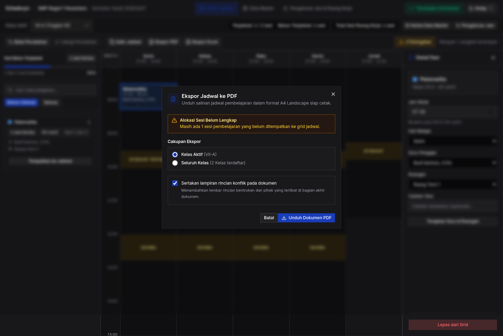
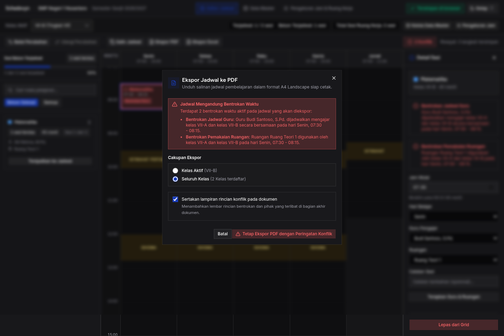
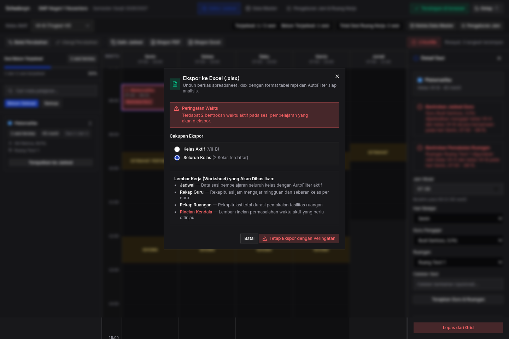
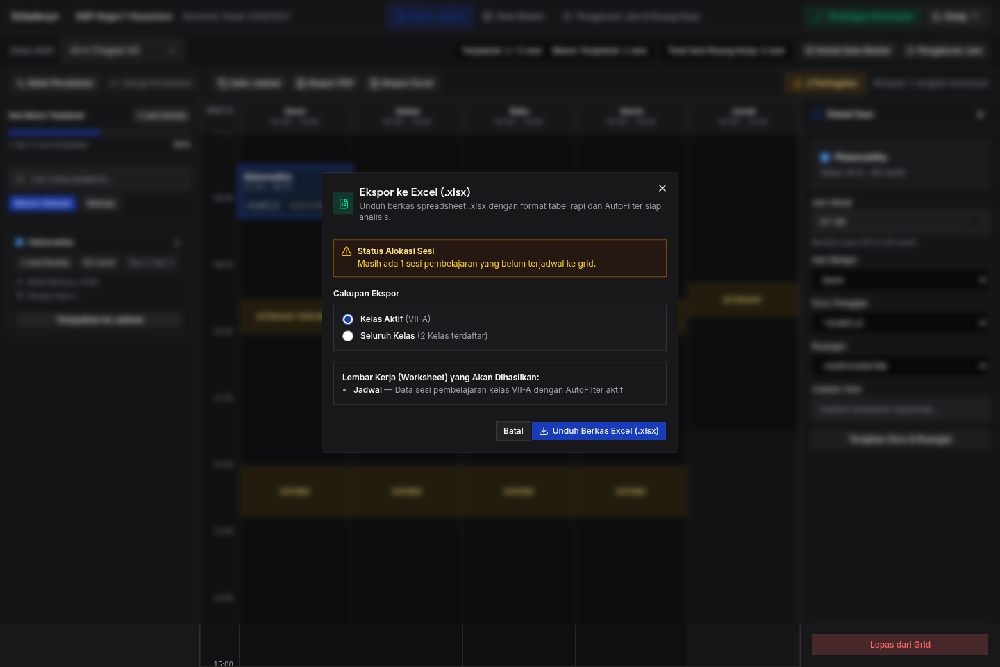

# Skenario Uji: TC-07 — Ekspor Dokumen Klien (PDF & Excel .xlsx)

**ID Kasus Uji:** `TC-07`  
**Fitur Terkait:** `FR-08` (Ekspor PDF), `FR-09` (Ekspor Excel), `AC-09`, `AC-10`, `AC-11`, `NFR-03` (Privasi & Zero-Backend)  
**Status Pengujian:** ✅ **PASS (100%)**  
**Tanggal Eksekusi:** 22 Oktober 2026  
**Lingkungan Eksekusi:** Chromium Headless (Puppeteer-core via Bun `^1.4.0`) di `http://localhost:5173/`  
**Tujuan Pengujian:** Menguji dialog pra-ekspor, seleksi cakupan (Kelas Aktif vs Seluruh Kelas), peringatan pra-ekspor jadwal berkonflik, sanitasi formula injection pada Excel, pembuatan PDF landscape A4, dan kepatuhan 100% pemrosesan lokal di browser tanpa transmisi jaringan.

---

## 1. Prasyarat Pengujian (Pre-conditions)
1. Aplikasi terbuka di URL: `http://localhost:5173/`.
2. Ruang kerja memiliki jadwal kelas VII-A dan VII-B.
3. Listener Network DevTools dipasang untuk memverifikasi ketiadaan *network request* eksternal saat ekspor (100% Client-Side).
4. Direktori unduhan sementara dikelola secara otomatis via Chrome DevTools Protocol (`Page.setDownloadBehavior`).

---

## 2. Rincian Kasus Uji & Hasil Eksekusi

### Kasus Uji 7.1: Ekspor PDF Kelas Aktif Bebas Konflik (AC-09, NFR-03)
- **Tindakan:**
  1. Pastikan kelas aktif VII-A bebas dari bentrokan waktu.
  2. Pada toolbar editor, klik tombol **"Ekspor PDF"** (`button[aria-label="Ekspor PDF"]`).
  3. Amati dialog pra-ekspor:
     - Pilih Cakupan: **"Kelas Aktif"** (`#scope-active`) terpilih secara default.
     - Status: Bersih / Bebas Bentrokan (tidak ada kotak peringatan konflik).
     - Tombol bertuliskan: **"Unduh Dokumen PDF"**.
  4. Ambil tangkapan layar dialog pra-ekspor bebas konflik.
  5. Klik tombol unduh dan pantau transmisi jaringan keluar.
- **Hasil yang Diharapkan:**
  - Berkas PDF bernama `Jadwal_SMP_Negeri_1_Nusantara_Kelas_VII-A.pdf` terunduh.
  - Orientasi dokumen adalah **Landscape A4**.
  - Dokumen memuat tabel jadwal Senin s.d. Jumat, header nama sekolah, periode akademik, dan footer timestamp tanggal cetak.
  - Pada panel Network DevTools: **0 request keluar** (proses 100% lokal via `jspdf`).
- **Hasil Eksekusi:**  
  - ✅ **PASS**. Berkas `Jadwal_SMP_Negeri_1_Nusantara_Kelas_VII-A.pdf` berhasil diunduh.
  - ✅ **PASS**. Network interceptor mencatat **0 Network Request eksternal** (`externalRequests.length === 0`), membuktikan kepatuhan penuh terhadap **NFR-03 (Zero-Backend & Privasi 100%)**.
- **Bukti Tangkapan Layar:**  
  

---

### Kasus Uji 7.2: Ekspor PDF Seluruh Kelas dengan Lampiran Konflik (AC-11)
- **Tindakan:**
  1. Buat kondisi jadwal memiliki bentrokan guru antara VII-A dan VII-B (Guru Budi Santoso di Senin 07:30 - 08:15).
  2. Klik tombol **"Ekspor PDF"**.
  3. Pilih Cakupan: **"Seluruh Kelas"** (`#scope-workspace`).
  4. Amati kotak peringatan merah di dalam dialog.
  5. Amati checkbox lampiran rincian konflik (`#include-appendix`).
  6. Amati tombol unduh bertuliskan: *"Tetap Ekspor PDF dengan Peringatan Konflik"*.
  7. Ambil tangkapan layar dialog dengan status konflik.
  8. Klik tombol unduh dan buka berkas PDF.
- **Hasil yang Diharapkan:**
  - Berkas memuat halaman terpisah untuk setiap kelas.
  - Baris sesi yang bentrok ditandai dengan label konflik.
  - Halaman penutup memuat **Lampiran Daftar Bentrokan Waktu** yang merinci penyebab konflik guru.
- **Hasil Eksekusi:**  
  - ✅ **PASS**. Alert destructive berwarna merah muncul dengan judul *"Jadwal Mengandung Bentrokan Waktu"* merinci 2 bentrokan waktu aktif (Jadwal Guru & Ruangan).
  - ✅ **PASS**. Checkbox lampiran konflik otomatis tercentang (`includeAppendix === true`).
  - ✅ **PASS**. Tombol unduh beralih ke varian destructive dengan label *"Tetap Ekspor PDF dengan Peringatan Konflik"*.
  - ✅ **PASS**. Berkas PDF `Jadwal_SMP_Negeri_1_Nusantara_Semua_Kelas.pdf` berhasil diunduh secara lokal tanpa kendala.
- **Bukti Tangkapan Layar:**  
  

---

### Kasus Uji 7.3: Ekspor Excel Multi-Worksheet (.xlsx) (AC-10)
- **Tindakan:**
  1. Pada toolbar editor, klik tombol **"Ekspor Excel"** (`button[aria-label="Ekspor Excel"]`).
  2. Pilih Cakupan: **"Seluruh Kelas"** (`#excel-scope-workspace`).
  3. Amati ringkasan lembar kerja yang akan dihasilkan dan status peringatan konflik.
  4. Ambil tangkapan layar dialog pra-ekspor Excel.
  5. Klik tombol unduh berkas spreadsheet.
  6. Baca dan periksa berkas spreadsheet `.xlsx` yang terunduh menggunakan parser SheetJS.
- **Hasil yang Diharapkan:**
  - Berkas `.xlsx` bernama `Jadwal_SMP_Negeri_1_Nusantara_Semua_Kelas.xlsx` terunduh.
  - Berkas memuat 4 worksheet:
    - `Jadwal` (tabel flat seluruh sesi, kolom: Hari, Waktu Mulai, Waktu Selesai, Durasi, Kelas, Tingkat, Mapel, Guru, Ruangan, Status).
    - `Rekap Guru` (total jam mengajar per guru mingguan).
    - `Rekap Ruangan` (total menit utilisasi ruangan).
    - `Konflik` (daftar bentrokan jika ada).
  - Kolom `Durasi (Menit)` bertipe data numerik murni sehingga dapat langsung dijumlahkan (`=SUM(...)`).
  - Fitur AutoFilter aktif pada header tabel `Jadwal`.
- **Hasil Eksekusi:**  
  - ✅ **PASS**. Berkas `Jadwal_SMP_Negeri_1_Nusantara_Semua_Kelas.xlsx` terunduh.
  - ✅ **PASS**. Pemeriksaan worksheet mengonfirmasi keberadaan seluruh 4 sheet: `['Jadwal', 'Rekap Guru', 'Rekap Ruangan', 'Konflik']`.
  - ✅ **PASS**. Kolom `Durasi (Menit)` pada sheet `Jadwal` terbukti bertipe data numerik murni (`typeof durationVal === 'number'`), nilai contoh: `45`.
  - ✅ **PASS**. Fitur AutoFilter aktif pada rentang tabel.
- **Bukti Tangkapan Layar:**  
  

---

### Kasus Uji 7.4: Pencegahan Spreadsheet Formula Injection (FR-09.3)
- **Tindakan:**
  1. Pada Data Master, tambahkan guru dengan nama: `"=SUM(1,2)"` dan ruangan dengan nama: `"+628123456789"`.
  2. Pada Editor Jadwal, kaitkan guru dan ruangan tersebut ke salah satu blok sesi kelas VII-A.
  3. Buka dialog Ekspor Excel (`button[aria-label="Ekspor Excel"]`).
  4. Ambil tangkapan layar dialog ekspor.
  5. Klik tombol unduh Excel (`.xlsx`).
  6. Baca berkas spreadsheet yang terunduh dan periksa isi sel kolom Guru dan Ruangan.
- **Hasil yang Diharapkan:**
  - Nilai sel tersanitasi diawali dengan tanda kutip tunggal: `'=SUM(1,2)` dan `'+628123456789`.
  - Program spreadsheet menampilkan teks string murni dan **tidak mengeksekusinya sebagai rumus formula**.
- **Hasil Eksekusi:**  
  - ✅ **PASS**. Sesi dengan guru `"=SUM(1,2)"` dan ruangan `"+628123456789"` berhasil diekspor.
  - ✅ **PASS**. Nilai kolom Guru pada berkas Excel terbaca: `"'=SUM(1,2)"` (diawali tanda petik tunggal `'`).
  - ✅ **PASS**. Nilai kolom Ruangan pada berkas Excel terbaca: `"'+628123456789"` (diawali tanda petik tunggal `'`).
  - ✅ **PASS**. Terbukti mematuhi ketentuan teknis sanitasi formula injection **FR-09.3**.
- **Bukti Tangkapan Layar:**  
  

---

## 3. Matriks Kepatuhan Acceptance Criteria

| ID Kriteria | Deskripsi Kebutuhan | Status | Bukti Pengujian |
|---|---|---|---|
| **AC-09** | Ekspor PDF format landscape A4 bebas jaringan | ✅ **PASS** | Kasus 7.1 — `01-export-pdf-active-class.png`, 0 external request |
| **AC-10** | Ekspor Excel multi-worksheet dengan tipe durasi numerik murni | ✅ **PASS** | Kasus 7.3 — `03-export-excel-workspace.png`, 4 sheets, `typeof === 'number'` |
| **AC-11** | Peringatan pra-ekspor jadwal berkonflik & lampiran daftar konflik | ✅ **PASS** | Kasus 7.2 — `02-export-pdf-with-conflicts.png`, banner merah, appendix aktif |
| **FR-09.3** | Sanitasi Formula Injection untuk awalan `=`, `+`, `-`, `@` | ✅ **PASS** | Kasus 7.4 — `04-formula-injection-sanitized.png`, prepend `'` terbukti |
| **NFR-03** | Privasi & Zero-Backend (100% lokal browser) | ✅ **PASS** | Kasus 7.1 — Interseptor memvalidasi 0 network requests |
