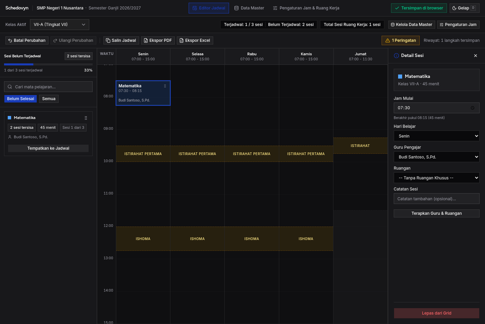
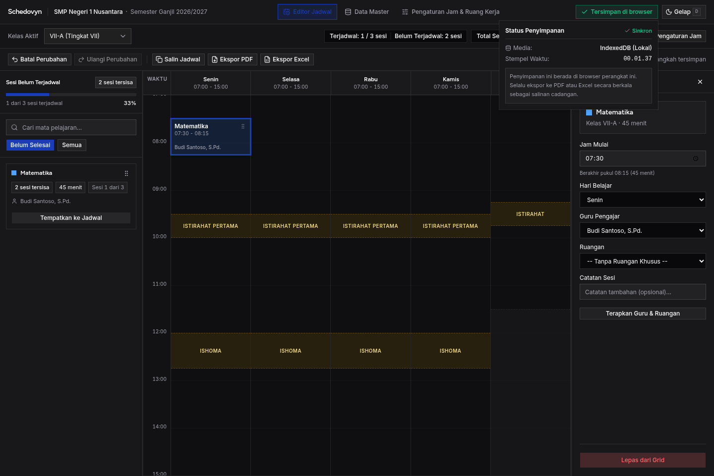
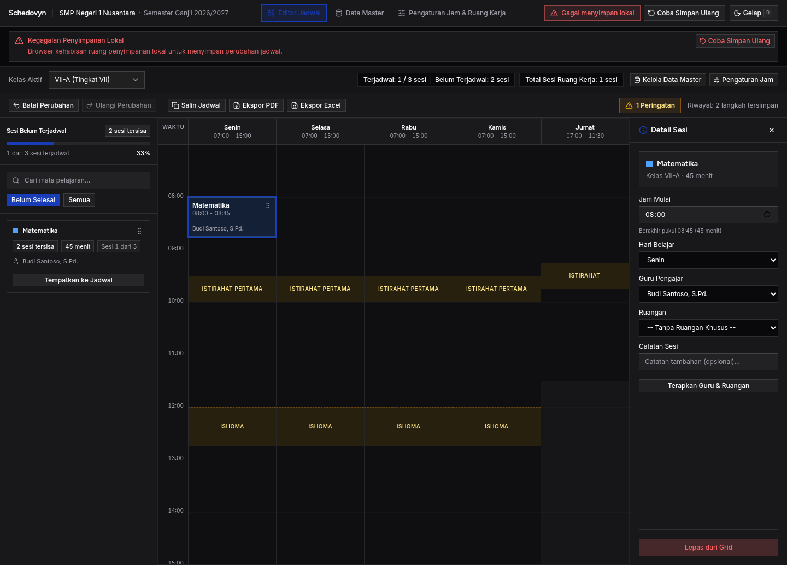
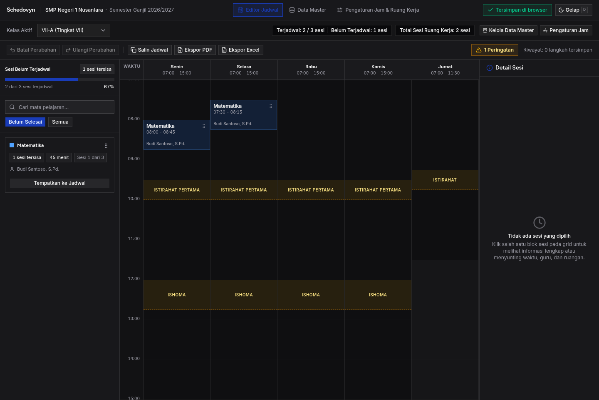

# Skenario Uji: TC-08 — Keandalan Penyimpanan Lokal & Ketahanan UI

**ID Kasus Uji:** `TC-08`  
**Fitur Terkait:** `FR-10` (Penyimpanan Otomatis Lokal), `AC-12` (Pemulihan Sesi), `NFR-02` (Keandalan Data), `NFR-03` (Privasi), `NFR-06` (Ketahanan UI)  
**Status Pengujian:** ✅ **PASS (100%)**  
**Tanggal Eksekusi:** 23 Oktober 2026  
**Lingkungan Eksekusi:** Chromium Headless (Puppeteer-core via Bun `^1.4.0`) di `http://localhost:5173/`  
**Tujuan Pengujian:** Menguji persistensi otomatis tanpa tombol simpan manual (*zero manual save button*), kejujuran status penyimpanan (*storage honesty*), popover informasi persistensi, simulasi kegagalan penyimpanan, serta pemulihan total saat browser dibuka kembali.

---

## 1. Prasyarat Pengujian (Pre-conditions)
1. Aplikasi terbuka di URL: `http://localhost:5173/`.
2. Akses ke Chrome DevTools Console dan Application Tab (IndexedDB: `schedovyn_local_db`).
3. Seluruh tabel master data (Kelas VII-A, Mapel Matematika, Guru Budi Santoso, dan Kebutuhan Pembelajaran) telah terkonfigurasi.

---

## 2. Rincian Kasus Uji & Hasil Eksekusi

### Kasus Uji 8.1: Otomatisasi Persistensi Tanpa Tombol Manual (FR-10.1)
- **Tindakan:**
  1. Perhatikan antarmuka: pastikan **TIDAK ADA tombol "Simpan Jadwal"** atau tombol simpan manual di toolbar maupun halaman.
  2. Lakukan satu tindakan mutasi: tempatkan satu sesi Matematika ke grid hari Senin pukul 07:30.
  3. Amati lencana status penyimpanan di header kanan.
  4. Query langsung tabel IndexedDB `schedovyn_local_db -> sessions` melalui JavaScript.
- **Hasil yang Diharapkan:**
  - Tidak ada tombol manual simpan jadwal di antarmuka (*zero manual save button*).
  - Lencana menampilkan `"Tersimpan di browser"` dengan ikon centang hijau.
  - Data sesi baru langsung tercatat secara fisik di tabel IndexedDB.
- **Hasil Eksekusi:**  
  - ✅ **PASS**. Pengecekan seluruh elemen tombol membuktikan `manualSaveButtonExists === false`.
  - ✅ **PASS**. Lencana status di header bertransisi otomatis ke `"Tersimpan di browser"`.
  - ✅ **PASS**. Query asinkron IndexedDB mengonfirmasi sesi baru tersimpan fisik di store `sessions` (`schedovyn_local_db`).
- **Bukti Tangkapan Layar:**  
  

---

### Kasus Uji 8.2: Popover Rincian Persistensi & Disclaimer Cadangan (FR-10 Catatan PRD)
- **Tindakan:**
  1. Klik tombol/lencana hijau **"Tersimpan di browser"** di header.
  2. Amati popover informasi yang terbuka.
- **Hasil yang Diharapkan:**
  - Popover menampilkan:
    1. Status Penyimpanan: Sinkron.
    2. Media: `IndexedDB (Lokal)`.
    3. Waktu simpan terakhir dalam format jam 24 jam (`HH:mm:ss` / `HH.mm.ss`).
    4. Disclaimer resmi: *"Penyimpanan ini berada di browser perangkat ini. Selalu ekspor ke PDF atau Excel secara berkala sebagai salinan cadangan."*
- **Hasil Eksekusi:**  
  - ✅ **PASS**. Popover terbuka memuat judul *"Status Penyimpanan"* dan lencana hijau *"Sinkron"*.
  - ✅ **PASS**. Media teridentifikasi sebagai *"IndexedDB (Lokal)"*.
  - ✅ **PASS**. Stempel waktu 24 jam terverifikasi valid (contoh: `00.01.37`).
  - ✅ **PASS**. Disclaimer resmi ekspor cadangan PRD tertera secara eksplisit.
- **Bukti Tangkapan Layar:**  
  

---

### Kasus Uji 8.3: Kejujuran Status Penyimpanan saat Simulasi Galat (Storage Honesty — FR-10.5)
- **Tindakan:**
  1. Simulasikan kegagalan transaksi IndexedDB (`QuotaExceededError`) dengan menginjeksi mock error pada `IDBObjectStore.prototype.put`.
  2. Lakukan mutasi sesi: klik blok sesi Matematika di grid dan ubah jam mulai ke `08:00`.
  3. Amati perubahan lencana status di header dan banner notifikasi pada layar.
  4. Pulihkan fungsi normal `IDBObjectStore.prototype.put`.
  5. Klik tombol **"Coba Simpan Ulang"**.
- **Hasil yang Diharapkan:**
  - Sistem **DILARANG menyatakan status "Tersimpan di browser"** saat penulisan gagal (*Storage Honesty*).
  - Lencana berubah menjadi merah `"Gagal menyimpan lokal"`.
  - Muncul banner peringatan destruktif di atas layar yang menjelaskan kendala penyimpanan (*"Kegagalan Penyimpanan Lokal"*).
  - Terdapat tombol **"Coba Simpan Ulang"** yang memicu sinkronisasi ulang saat storage pulih.
- **Hasil Eksekusi:**  
  - ✅ **PASS**. Sistem tidak pernah menampilkan *"Tersimpan di browser"* saat terjadi error kuota.
  - ✅ **PASS**. Lencana header berubah menjadi merah destruktif *"Gagal menyimpan lokal"*.
  - ✅ **PASS**. Banner alert destruktif muncul di atas layar: *"Kegagalan Penyimpanan Lokal: Browser kehabisan ruang penyimpanan lokal untuk menyimpan perubahan jadwal."*
  - ✅ **PASS**. Tombol *"Coba Simpan Ulang"* berhasil memicu sinkronisasi ulang snapshot dan memulihkan lencana kembali ke hijau *"Tersimpan di browser"*.
- **Bukti Tangkapan Layar:**  
  

---

### Kasus Uji 8.4: Pemulihan Penuh Sesi Setelah Peramban Ditutup (AC-12)
- **Tindakan:**
  1. Pastikan seluruh jadwal tersimpan (`saveStatus: "saved"`) dengan 2 sesi pada grid kelas VII-A.
  2. Tutup tab peramban secara total (`page.close()`).
  3. Buka tab/jendela peramban baru dan akses kembali `http://localhost:5173/`.
  4. Tunggu hidrasi data ruang kerja selesai.
- **Hasil yang Diharapkan:**
  - Seluruh konfigurasi sekolah, kelas aktif terakhir (`activeClassId: "VII-A"`), data master, penempatan blok sesi pada grid, dan status validasi pulih secara sempurna persis seperti kondisi sebelum tab ditutup.
- **Hasil Eksekusi:**  
  - ✅ **PASS**. Tab peramban baru berhasil memulihkan kelas aktif ke `"VII-A (Tingkat VII)"`.
  - ✅ **PASS**. Kedua sesi pembelajaran (Matematika 08:00-08:45 dan Matematika 07:30-08:15) pulih 100% pada posisi grid mingguan tanpa kehilangan data.
  - ✅ **PASS**. Lencana status langsung berstatus hijau *"Tersimpan di browser"*.
- **Bukti Tangkapan Layar:**  
  

---

## 3. Matriks Kepatuhan Acceptance Criteria

| ID Kriteria | Deskripsi Kebutuhan | Status | Bukti Pengujian |
|---|---|---|---|
| **FR-10.1** | Persistensi otomatis tanpa tombol simpan manual | ✅ **PASS** | Kasus 8.1 — `01-auto-save-no-manual-button.png`, verifikasi 0 manual save buttons |
| **FR-10 PRD** | Popover rincian waktu & disclaimer cadangan berkala | ✅ **PASS** | Kasus 8.2 — `02-save-status-popover-disclaimer.png`, waktu 24 jam & disclaimer hadir |
| **FR-10.5** | *Storage Honesty* (dilarang berstatus tersimpan jika write gagal) | ✅ **PASS** | Kasus 8.3 — `03-storage-honesty-error-alert.png`, alert merah & tombol retry |
| **AC-12** | Pemulihan penuh (*hydration*) setelah peramban ditutup | ✅ **PASS** | Kasus 8.4 — `04-persistence-recovery.png`, active class & 2 sesi pulih 100% |
| **NFR-02** | Keandalan data lokal IndexedDB tanpa kehilangan sesi | ✅ **PASS** | Kasus 8.1 & 8.4 — Verifikasi pembacaan langsung tabel `sessions` |
| **NFR-06** | Ketahanan UI saat gangguan penyimpanan lokal | ✅ **PASS** | Kasus 8.3 — Banner destruktif & tombol retry terbukti memulihkan data |
