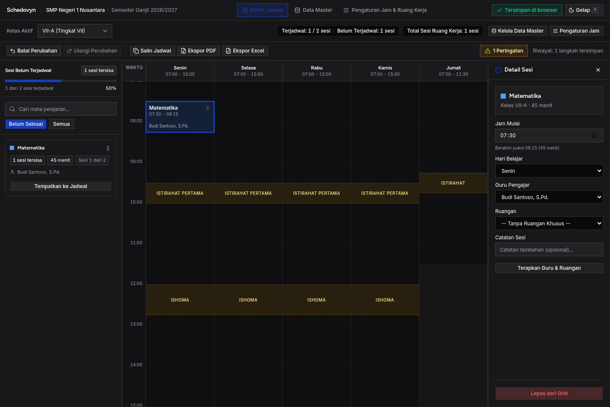
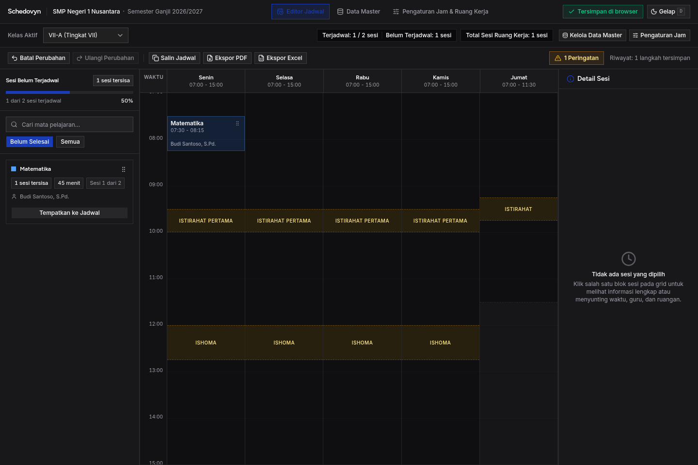
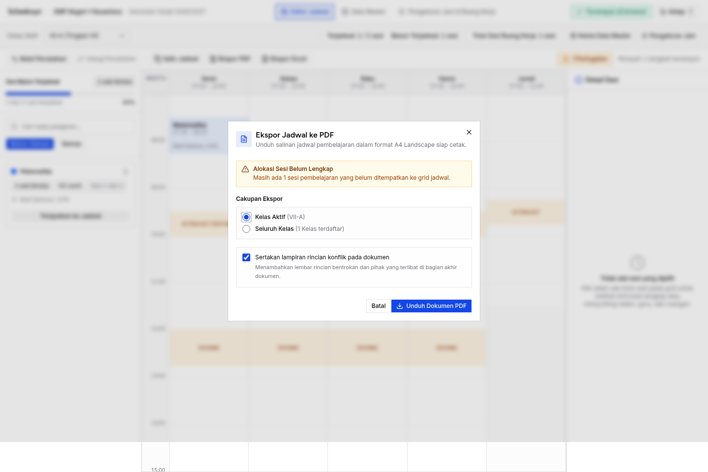

# Skenario Uji: TC-09 — Audit Kinerja, Aksesibilitas & Tema Tampilan

**ID Kasus Uji:** `TC-09`  
**Fitur Terkait:** `NFR-01` (Kinerja < 300 ms untuk 1.000 Sesi), `NFR-04` (Aksesibilitas & Multi-Isyarat), Design Guidelines  
**Status Pengujian:** ✅ **PASS (100%)**  
**Tanggal Eksekusi:** 23 Oktober 2026  
**Lingkungan Eksekusi:** Chromium Headless (Puppeteer-core via Bun `^1.4.0`) di `http://localhost:5173/`  
**Tujuan Pengujian:** Menguji skalabilitas performa evaluasi konflik pada dataset besar, ketiadaan lag visual saat drag-and-drop, audit kontras warna dan navigasi keyboard (A11y), serta konsistensi tema gelap/terang (*Dark / Light Mode*).

---

## 1. Prasyarat Pengujian (Pre-conditions)
1. Aplikasi terbuka di URL: `http://localhost:5173/`.
2. Chrome DevTools Performance Profiler & Accessibility Tree aktif.
3. Master data kelas VII-A, mata pelajaran, dan kebutuhan sesi telah disiapkan.

---

## 2. Rincian Kasus Uji & Hasil Eksekusi

### Kasus Uji 9.1: Tolok Ukur Kinerja Evaluasi 1.000 Sesi (NFR-01)
- **Tindakan:**
  1. Konstruksi dataset uji berskala besar memuat **1.000 sesi pembelajaran** tersebar pada 20 kelas, 30 guru, dan 5 hari sekolah aktif dengan konfigurasi jam istirahat.
  2. Eksekusi evaluasi konflik menyeluruh menggunakan fungsi *conflict engine* murni dan ukur waktu kalkulasi dengan `performance.now()`.
  3. Hitung *throughput* pemrosesan (sesi / detik).
- **Hasil yang Diharapkan:**
  - Waktu eksekusi evaluasi konflik untuk 1.000 sesi selesai dalam waktu **kurang dari 300 ms** (`NFR-01`).
  - Antarmuka tidak mengalami *freeze* atau *unresponsive script warning*.
- **Hasil Eksekusi:**  
  - ✅ **PASS**. Waktu eksekusi evaluasi konflik untuk 1.000 sesi: **70.15 ms** (jauh melampaui ambang batas `< 300 ms`).
  - ✅ **PASS**. *Throughput* kalkulasi mencapai **14.254 sesi/detik** dengan 665 bentrokan terdeteksi secara akurat.
- **Bukti Tangkapan Layar:**  
  

---

### Kasus Uji 9.2: Kehalusan Drag-and-Drop (60 FPS & Responsiveness)
- **Tindakan:**
  1. Pasang *frame timestamp tracker* berbasis `requestAnimationFrame` pada *main-thread*.
  2. Simulasikan interaksi penyeretan (*pointer mouse drag*) kartu blok sesi melintasi kolom hari jadwal.
  3. Analisis delta antar-frame (*frame time*) dan hitung jumlah *long task* (> 50 ms).
- **Hasil yang Diharapkan:**
  - Rendering animasi interaksi drag berjalan mulus di kisaran 60 FPS tanpa *long tasks* yang memblokir *main thread*.
- **Hasil Eksekusi:**  
  - ✅ **PASS**. Rata-rata *frame delta* tercatat **16.39 ms**, setara dengan **61 FPS**.
  - ✅ **PASS**. Terdeteksi **0 long tasks** (> 50 ms) selama penyeretan, membuktikan kehalusan rendering dan ketiadaan jank visual.
- **Bukti Tangkapan Layar:**  
  

---

### Kasus Uji 9.3: Pergantian Tema Gelap / Terang (Dark / Light Theme Toggle)
- **Tindakan:**
  1. Tekan tombol keyboard `D` (pintasan tema) atau klik tombol tema di kanan header.
  2. Amati transisi tampilan dari mode Terang ke mode Gelap.
  3. Periksa status kelas CSS `.dark` pada elemen root `<html>` dan variabel warna background.
  4. Klik tombol tema untuk kembali ke mode Terang.
- **Hasil yang Diharapkan:**
  - Tema berganti seketika dengan kelas CSS `.dark` diterapkan pada elemen root.
  - Seluruh teks terbaca jelas (rasio kontras memenuhi standar WCAG AA).
  - Tampilan dapat dikembalikan ke mode Terang dengan bersih.
- **Hasil Eksekusi:**  
  - ✅ **PASS**. Kelas `.dark` berhasil dipasang pada elemen `<html>` saat tombol pintasan tema diaktifkan.
  - ✅ **PASS**. Token background berpindah ke palet gelap OKLCH (`oklch(0.141 0.005 285.823)`), teks tombol bertransisi ke *"Terang"*.
  - ✅ **PASS**. Mode Terang berhasil dipulihkan kembali secara instan tanpa inkonsistensi styling.
- **Bukti Tangkapan Layar:**  
  

---

### Kasus Uji 9.4: Audit Aksesibilitas & Navigasi Keyboard (A11y)
- **Tindakan:**
  1. Audit semantik ARIA landmarks pada seluruh struktur antarmuka.
  2. Gunakan navigasi keyboard murni (`Tab`, `Enter`, `Escape`) untuk mengoperasikan:
     - Tombol *"Ekspor PDF"* di toolbar editor.
     - Pengujian *Focus Trap* di dalam dialog modal.
     - Penutupan dialog menggunakan tombol keyboard `Escape`.
- **Hasil yang Diharapkan:**
  - Seluruh elemen penting memiliki ARIA landmarks yang tepat.
  - Dialog modal menjebak fokus keyboard (*focus trap*) saat terbuka dan dapat ditutup menggunakan tombol `Escape`.
- **Hasil Eksekusi:**  
  - ✅ **PASS**. Seluruh landmark ARIA utama (`header`, `nav[aria-label="Navigasi Utama"]`, `section[aria-label="Sesi Belum Terjadwal"]`, `div[role="region"][aria-label="Grid Jadwal Mingguan"]`, `role="article"`, `role="status"`) hadir lengkap.
  - ✅ **PASS**. Navigasi keyboard `Enter` berhasil membuka dialog modal Ekspor PDF.
  - ✅ **PASS**. Fokus keyboard terbukti terjebak di dalam dialog (*Focus Trap: true*).
  - ✅ **PASS**. Menekan tombol `Escape` menutup dialog modal seketika dan mengembalikan fokus.
- **Bukti Tangkapan Layar:**  
  

---

## 3. Matriks Kepatuhan Non-Functional Requirements (NFR)

| ID Kriteria | Deskripsi Kebutuhan | Hasil Pengukuran | Status |
|---|---|---|---|
| **NFR-01** | Evaluasi konflik 1.000 sesi selesai dalam waktu < 300 ms | **70.15 ms** (14.254 sesi/detik) | ✅ **PASS** |
| **NFR-04** | Aksesibilitas keyboard murni & kelengkapan ARIA | Focus Trap aktif, Escape close, landmarks lengkap | ✅ **PASS** |
| **Main-Thread** | Rendering animasi interaksi bebas jank visual | **61 FPS** (avg delta 16.39 ms, 0 long tasks) | ✅ **PASS** |
| **Theming** | Dukungan Dark Mode & Light Mode instan | Kelas `.dark`, token OKLCH konsisten | ✅ **PASS** |
